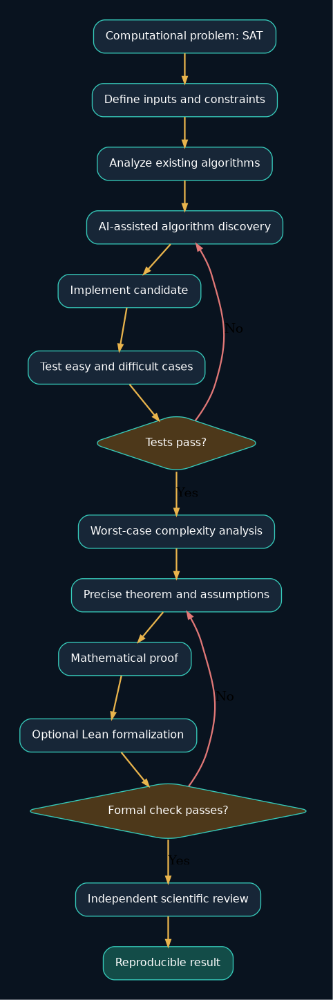
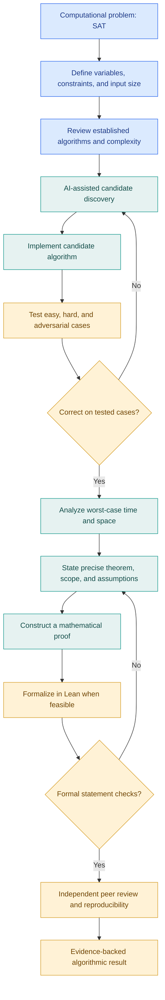
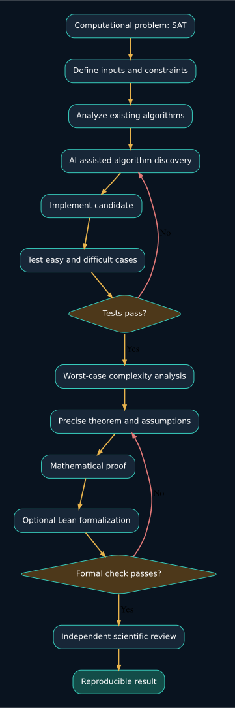
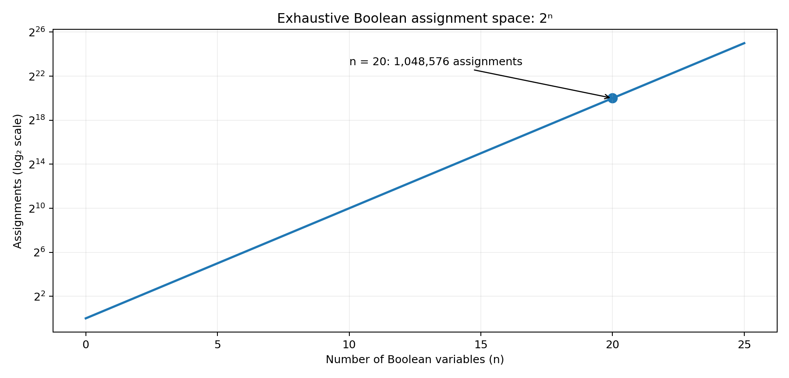
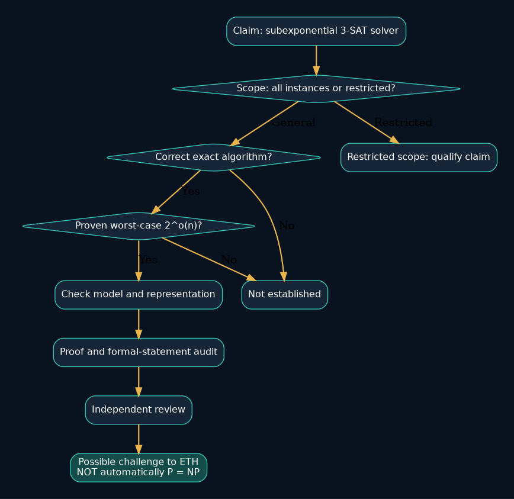

<div align="center">
  

# Research Problem 01 — Mathematical Discovery and Computational Complexity

**PROMPT & PULSE AI · RESEARCH TO REALITY · OPENAI RESEARCH DIRECTION**

*Can AI discover a fundamentally better algorithm—and how would we know it is correct?*

[Educational overview](#1-problem-statement) · [Live Mermaid diagram](#4-end-to-end-mermaid-diagram) · [Architecture](#research-system-architecture) · [Hands-on SAT demo](#hands-on-cpu-only-example) · [Claim audit](#research-claim-audit)
</div>



> **Scope and evidence:** This is an educational *research problem*, not a claim that OpenAI (or any organization) has proved a faster general 3-SAT algorithm or refuted ETH. The heading identifies an AI research direction, not a verified institutional project announcement. Visuals, demos, and additional architecture material below are newly created learning aids. The original uploaded explanation is retained verbatim in [`docs/original_uploaded_explanation.md`](docs/original_uploaded_explanation.md), including its non-reusable exported diagram CSS.

## 1. Problem statement

Can artificial intelligence discover better algorithms for computational problems that appear to require exponentially growing amounts of computation, and can those discoveries be mathematically verified?

Some problems are easy to verify once a solution is given, but extremely difficult to solve as the number of possible combinations grows.

For example, imagine a scheduling system trying to find a valid assignment for hundreds of interconnected tasks. As the number of constraints increases, exploring every possible combination may become computationally infeasible.

The central research challenge is whether AI can discover mathematical structures or algorithms that reduce the computational work required.

## 2. Concepts behind the problem

| Concept                  | Explanation                                                                                                    |
| ------------------------ | -------------------------------------------------------------------------------------------------------------- |
| Computational complexity | Studies how computation time and memory requirements grow with input size.                                     |
| P versus NP              | Asks whether every problem whose proposed solution can be efficiently verified can also be efficiently solved. |
| SAT / 3-SAT              | Asks whether Boolean variables can be assigned values that satisfy logical constraints.                        |
| Exponential complexity   | Running time that grows rapidly, such as \\(O(2^n)\\).                                                         |
| ETH                      | Hypothesizes that 3-SAT cannot be solved in subexponential time in the number of variables.                    |
| Algorithm discovery      | Searching for new computational methods that solve problems more efficiently.                                  |
| Formal verification      | Using proof assistants, such as Lean, to check mathematical proofs of precisely stated claims.                 |

## 3. Research goal

Develop AI-assisted methods that can propose new algorithms, investigate their complexity, and help produce rigorous mathematical evidence supporting their correctness and performance claims.

The goal is not merely to generate code that runs faster on a few examples. It is to determine whether a method provides a genuine, generalizable algorithmic improvement under clearly defined assumptions.

## 4. End-to-end Mermaid diagram

This GitHub-renderable, **editable Mermaid source** reconstructs the workflow described in the original uploaded diagram, which was exported as CSS and concatenated labels rather than actual Mermaid source. You can also edit [`diagrams/discovery-workflow.mmd`](diagrams/discovery-workflow.mmd).



**Image preview** (renders even in Markdown viewers without Mermaid support):



## 5. A simple example: SAT

Consider:

$$ (x_1\lor x_2)\land(\neg x_1\lor x_3) $$

The question is: Can we assign true or false values to the variables so that the entire expression is true?

For example, choosing $x_1=\text{True}$, $x_2=\text{False}$, and $x_3=\text{True}$ satisfies the formula.

A straightforward exhaustive approach tries all $2^n$ combinations for $n$ Boolean variables.

How quickly does exhaustive search grow?

| Number of variables | Possible assignments |
|---:|---:|
| **20** | **1,048,576** |

This represents exhaustive enumeration, not the running time of every SAT solver. Modern solvers exploit structure and pruning.

The important research question is whether a proposed method can achieve better asymptotic performance for the general problem, not just for selected examples.

## 6. What is still difficult?

An AI-generated algorithm might appear promising, but researchers must establish that it is correct, clarify its worst-case time complexity, and determine whether any assumptions restrict its applicability.

A Lean-checked proof provides confidence about a formal theorem, but independent reviewers must still check whether that theorem expresses the intended mathematical claim.

Also, refuting ETH would not automatically prove P = NP. ETH concerns a more specific exponential-time hypothesis, whereas P versus NP asks about polynomial-time solvability.

## 7. Interview perspective

Question: Suppose an AI research agent claims to have discovered a subexponential algorithm for 3-SAT. How would you evaluate that claim?

A strong answer would examine the exact algorithm, correctness proof, worst-case complexity, assumptions, input representation, and independent reproducibility. It would also distinguish empirical benchmarks from theoretical complexity guarantees.

Subscriber challenge: Explain why testing a proposed algorithm on one million SAT instances cannot, by itself, establish its worst-case complexity for all possible inputs.

Core takeaway: The breakthrough is not simply getting AI to propose a faster algorithm. It is discovering an improvement that can withstand rigorous mathematical analysis, formal checking where applicable, and independent scientific review.



## Research system architecture

The following is a **proposed research workflow**, not an existing, deployed OpenAI architecture. The agent proposes candidate algorithms; a deterministic tester and formal reasoning process judge what evidence has actually been established.

```mermaid
flowchart LR
    subgraph Inputs[Specification and baseline]
       P[Problem and size parameter] --> C[Constraints and representations]
       C --> BASE[Reference solver and benchmark corpus]
    end
    subgraph Discovery[Candidate search]
       AGENT[AI research agent] --> PROPOSE[Candidate algorithm and pseudocode]
       PROPOSE --> CODE[Sandboxed implementation]
       CODE --> TEST[Correctness and differential tests]
       TEST -->|Counterexample| AGENT
    end
    subgraph Assurance[Mathematical assurance]
       TEST -->|Passes tests| ANALYSIS[Asymptotic worst-case analysis]
       ANALYSIS --> THEOREM[Precise theorem and assumptions]
       THEOREM --> PROOF[Proof or proof obligation]
       PROOF --> LEAN[Optional Lean formal check]
       LEAN --> AUDIT[Independent reviewers]
    end
    BASE --> AGENT
    BASE --> TEST
    AUDIT --> RESULT[Reproducible research artifact]
```




[Edit this architecture diagram](diagrams/research-architecture.mmd) · [SVG image](assets/research-architecture.svg)

## Research claim audit

A faster experimental runtime is different from a proven improvement in worst-case asymptotic complexity. For a proposed **general 3-SAT** algorithm, one must first clarify whether the result covers all inputs, whether it is exact, and whether the time bound is truly subexponential in the stated variable count.



```mermaid
flowchart TD
    CLAIM[Claim: subexponential algorithm for general 3-SAT] --> SCOPE{All 3-SAT inputs?}
    SCOPE -- No --> LIMITED[Restricted-family result: state the restriction]
    SCOPE -- Yes --> EXACT{Exact and correct?}
    EXACT -- No --> REJECT[Not a general exact SAT result]
    EXACT -- Yes --> TIME{Proven worst-case 2^o(n)?}
    TIME -- No --> EMP[Benchmarks are insufficient]
    TIME -- Yes --> MODEL[Check input encoding and computational model]
    MODEL --> PROOF[Verify proof and formal theorem alignment]
    PROOF --> REVIEW[Independent replication and scrutiny]
    REVIEW --> ETH[Potential implication for ETH, not automatically P = NP]
```

An algorithm with a proven running time of $2^{o(n)}$ for **general 3-SAT**, under the standard interpretation of the ETH hypothesis, would contradict ETH. It would **not** by itself establish a polynomial-time algorithm or prove $P=NP$. A fast solver for a restricted SAT family may be valuable without contradicting ETH at all. A verified Lean proof checks a formally stated theorem; reviewers still need to evaluate its relation to the intended claim.

## Hands-on CPU-only example

The self-contained Python implementation below enumerates all assignments for a tiny Boolean formula and reports a satisfying witness. It is deliberately a teaching baseline, not a competitive SAT solver and not evidence for a complexity breakthrough.

```bash
python examples/sat_baseline.py
python examples/sat_baseline.py --variables 20 --count-only
python -m unittest discover -s examples -p 'test_*.py'
```

The example formula is $(x_1 \lor x_2) \land (\neg x_1 \lor x_3)$. One satisfying assignment is $x_1=\mathrm{True}, x_2=\mathrm{False}, x_3=\mathrm{True}$. In the `--count-only` mode, $2^{20}=1,048,576$ is computed without constructing all assignments.

## Evaluation and reproducibility checklist

- [ ] Specify the exact problem, instance encoding, size parameter, and claim scope.
- [ ] Establish a trusted reference solver and independently check all candidate outputs.
- [ ] Include satisfiable, unsatisfiable, adversarial, and out-of-distribution cases.
- [ ] Separate experimental runtimes from proven worst-case asymptotic bounds.
- [ ] State all mathematical assumptions and the computational model.
- [ ] Provide a fully inspectable algorithm and proof, with checkable formalization when feasible.
- [ ] Review formal-statement alignment and independently reproduce results.
- [ ] Publish failure cases and constraints rather than just successful benchmarks.

## Project files

```text
Research_Problem_01_GitHub_Ready/
├── README.md                         # GitHub-ready educational explanation
├── assets/                           # Real PNG/SVG files (no external hotlinks)
│   ├── prompt-pulse-logo.png
│   ├── discovery-workflow.png / .svg
│   ├── research-architecture.png / .svg
│   ├── claim-audit.png / .svg
│   └── sat-search-space.png
├── diagrams/                         # Editable Mermaid files and Graphviz sources
│   ├── discovery-workflow.mmd / .dot
│   ├── research-architecture.mmd / .dot
│   └── claim-audit.mmd / .dot
├── examples/
│   ├── sat_baseline.py
│   └── test_sat_baseline.py
└── docs/
    └── original_uploaded_explanation.md
```

### Edit and publish

Upload **the entire folder** to a GitHub repository with `README.md` at the repository root. Relative asset paths will display automatically. Edit the `mermaid` fenced blocks directly on GitHub, or copy the `.mmd` files into [Mermaid Live Editor](https://mermaid.live/). The pre-rendered PNG/SVG images are committed separately so they remain viewable even where Mermaid rendering is not available. The `.dot` files are editable Graphviz equivalents used to generate the image assets; they are not exact Mermaid engine exports.

**Attribution:** Prompt & Pulse AI — Research to Reality. Educational content adapted from the supplied Research Problem 01 draft. New diagrams and Python examples are included to make it reusable as a GitHub learning repository.
