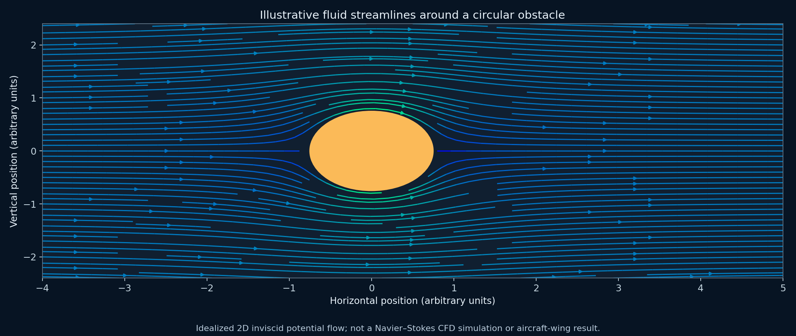
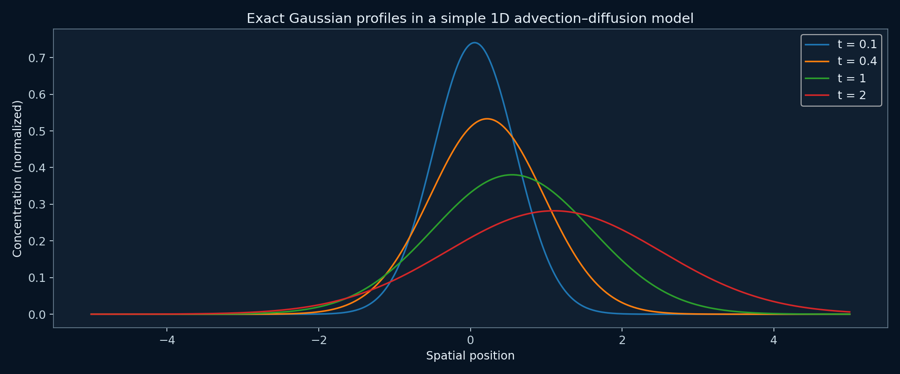
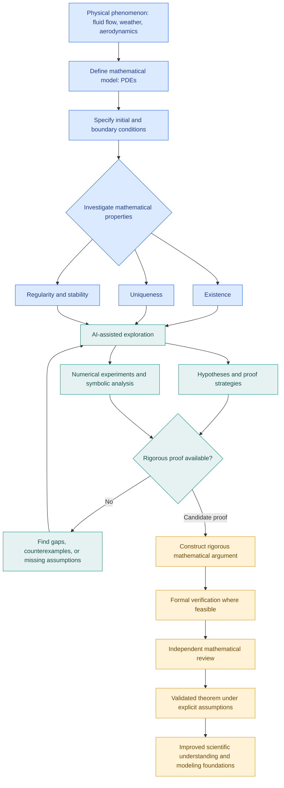
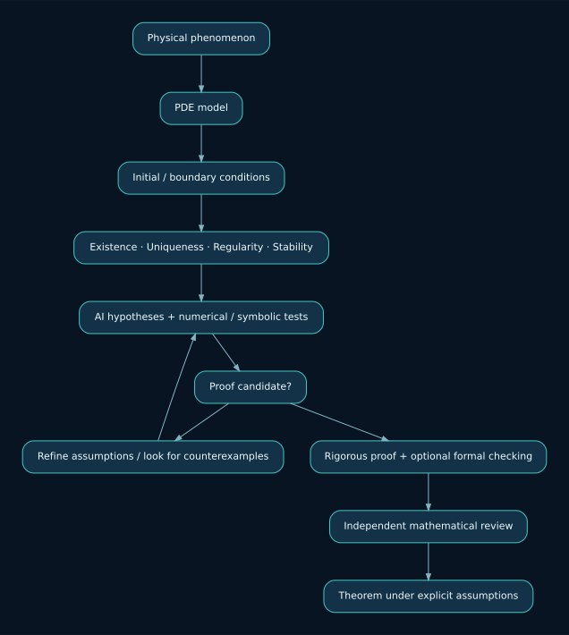
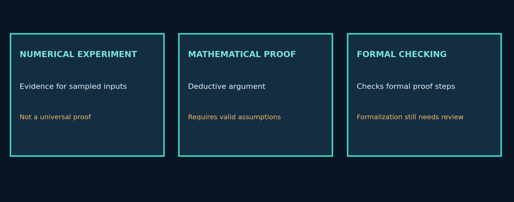
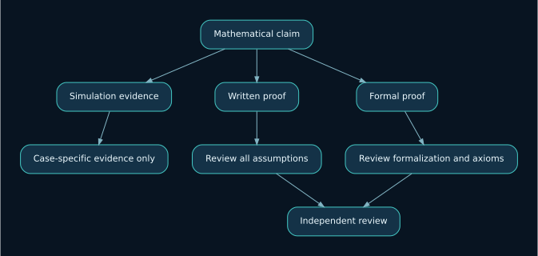

# Research Problem 02: Mathematical Foundations of Physics

**PROMPT & PULSE AI | RESEARCH TO REALITY | OPENAI RESEARCH DIRECTION**

> **Research direction, not an announcement of a solved theorem.** This page explains a proposed direction for AI-assisted mathematical research; it does not establish that OpenAI has proved the Navier–Stokes conjecture.

*Original educational visualization: idealized potential flow around a cylinder; not a CFD solution for an aircraft.*

## 1. Problem statement

Can artificial intelligence help mathematicians prove whether the equations used to describe physical phenomena have solutions that exist, remain mathematically well-defined, and behave predictably under specified conditions?

We use mathematical equations to simulate weather, fluid movement, aircraft aerodynamics, ocean currents, and many other physical phenomena.

But there is a fundamental difference between a computer generating a simulation and mathematicians proving that the underlying equations possess well-defined solutions.

For example, a weather simulation may produce predictions for the next seven days. That does not prove that the mathematical equations used by the simulation always have smooth, unique solutions for every permitted initial condition.

This is the fundamental problem researchers want to understand.

## 2. A real-world example

Imagine engineers designing an aircraft.

They use computational fluid dynamics (CFD) software to simulate airflow over the wings.

The simulation predicts pressure, velocity, and turbulence.

But several important questions arise:

- Does a mathematical solution exist for the chosen conditions?
- Is the solution unique?
- Can the solution develop mathematical singularities?
- Will small changes in initial conditions produce large differences in behavior?
- How accurately does the numerical simulation approximate the underlying equations?

These questions connect engineering simulations to mathematical physics.

*Educational example: a simple one-dimensional advection–diffusion model. It is not a numerical solution of the 3D Navier–Stokes problem.*

## 3. Technical concepts behind the problem

| Concept                               | What students should understand                                                         |
| ------------------------------------- | --------------------------------------------------------------------------------------- |
| Partial differential equations (PDEs) | Equations describing how physical quantities change across space and time.              |
| Navier–Stokes equations               | Equations describing the motion of fluids such as air and water.                        |
| Existence                             | Whether a solution to the mathematical equations exists.                                |
| Uniqueness                            | Whether specified conditions determine only one solution.                               |
| Regularity                            | Whether a solution remains sufficiently smooth instead of developing singularities.     |
| Stability                             | How solutions respond to perturbations in initial conditions or inputs.                 |
| Boundary conditions                   | Constraints specifying how a system behaves at its physical or mathematical boundaries. |
| Numerical methods                     | Computational techniques for approximating mathematical solutions.                      |
| Formal verification                   | Machine-assisted checking of precisely stated mathematical claims.                      |

### A closer look at Navier–Stokes

One form of the incompressible Navier–Stokes momentum equation is:

$$ \rho\left(\frac{\partial \mathbf{u}}{\partial t}+ (\mathbf{u}\cdot\nabla)\mathbf{u}\right) =-\nabla p+\mu\nabla^2\mathbf{u}+\mathbf{f} $$

Where:

- $\mathbf{u}$ represents fluid velocity.
- $p$ represents pressure.
- $\rho$ represents fluid density.
- $\mu$ represents dynamic viscosity.
- $\mathbf{f}$ represents external force per unit volume.

The equation describes how fluid motion evolves under pressure, viscosity, and external forces.

The famous Navier–Stokes existence and smoothness problem concerns whether smooth solutions of the three-dimensional incompressible equations remain smooth for all time under the specified mathematical conditions.

## 4. End-to-end Mermaid diagram

The diagram shows how AI-assisted mathematical discovery could connect physical modeling, numerical exploration, rigorous proof, and independent verification.

**Editable Mermaid source:** [`diagrams/workflow.mmd`](diagrams/workflow.mmd).

Important: Numerical experiments can support or challenge a conjecture, but they do not establish a general mathematical proof. Even formally checked statements require careful validation of the modeled assumptions.

### AI-assisted research architecture (illustrative design)

[Edit the architecture diagram (`.mmd`)](diagrams/architecture.mmd)

### Why three kinds of evidence are not interchangeable

[Edit the evidence diagram (`.mmd`)](diagrams/evidence.mmd)

## 5. Research goal

The goal is to develop AI-assisted mathematical methods that help researchers:

1. Discover useful mathematical structures in complex physical equations.
2. Generate hypotheses about existence, uniqueness, regularity, and stability.
3. Explore proof strategies and identify counterexamples.
4. Formulate rigorous mathematical arguments.
5. Validate precisely specified results through independent review and formal tools where feasible.

The broader ambition is to strengthen the mathematical foundations of scientific computing—not simply to generate more convincing simulations.

## 6. What remains unsolved?

A central difficulty is that physical equations can exhibit complicated nonlinear behavior.

In three-dimensional fluid dynamics, researchers cannot simply assume that every smooth initial state will produce a globally smooth solution for all future time.

AI may help discover new arguments or useful mathematical structures. However, producing convincing calculations, numerical results, or incomplete proofs would not resolve the open mathematical problem.

Another important distinction is between mathematical well-posedness and real-world predictive accuracy. Even when a mathematical model is well-posed, it may omit important physical effects or contain uncertain inputs.

## 7. Interview perspective

Interview question: What is the difference between numerical simulation, mathematical proof, and formal verification when studying physical systems?

Strong answer direction:

Numerical simulation approximates the behavior of a mathematical model for particular inputs and computational conditions.

A mathematical proof establishes a precisely stated property for all cases covered by its assumptions.

Formal verification can use machine-checkable representations to validate the logical correctness of formalized proof steps.

These approaches complement one another, but they provide different kinds of evidence.

## 8. Subscriber learning challenge

Imagine an AI system produces one million successful simulations of fluid flow without encountering a singularity.

Can we conclude that the Navier–Stokes equations always produce smooth solutions?

No.

Those simulations provide computational evidence for the cases examined, but they do not prove a universal mathematical statement.

To establish such a claim, researchers would need a rigorous argument covering the entire class of conditions specified in the theorem.

### Key takeaway

AI can help researchers explore mathematical problems, but discovering a pattern is different from proving that the pattern must always hold.

That distinction is fundamental to mathematical discovery, scientific computing, formal verification, and trustworthy AI-assisted research.

Prompt & Pulse AI — Learn AI. Build AI. Stay Ahead.

---

## Repository files and usage

| File or directory | Purpose |
|---|---|
| `README.md` | Complete educational explanation and embedded visualizations |
| `assets/` | Locally stored logo, illustrated plots, and rendered SVG diagrams |
| `diagrams/*.mmd` | Editable Mermaid sources for all three flowcharts |
| `source/original-educational-text.md` | Exact original upload retained, including exported diagram CSS/text artifact |

**To publish:** upload the entire extracted folder to a GitHub repository. The relative image paths are repository-local, so the illustrations display directly in the README. GitHub also renders the embedded `mermaid` code fence. Edit diagrams in [`Mermaid Live Editor`](https://mermaid.live/) or a Markdown editor with Mermaid support.

### Additional learning references (not claims of new discoveries)

- [Clay Mathematics Institute — Navier–Stokes Equation](https://www.claymath.org/millennium-problems/navier-stokes-equation/)
- [Lean theorem prover](https://lean-lang.org/)
- [Mermaid diagram documentation](https://mermaid.js.org/)

**Scientific scope:** Existence, uniqueness, regularity and stability depend on the precise PDE, dimension, domain, initial/boundary conditions and solution concept. Successful computations do not constitute a universal proof.
