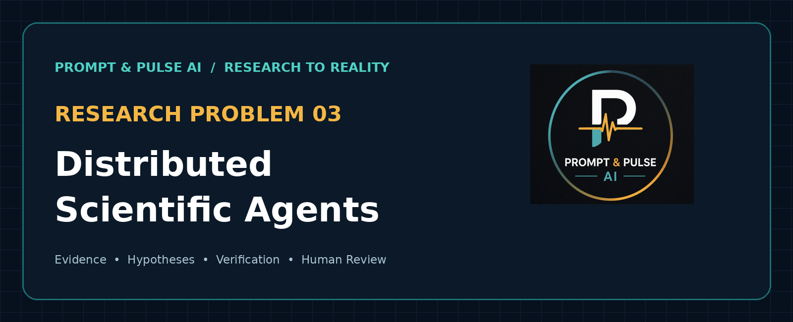
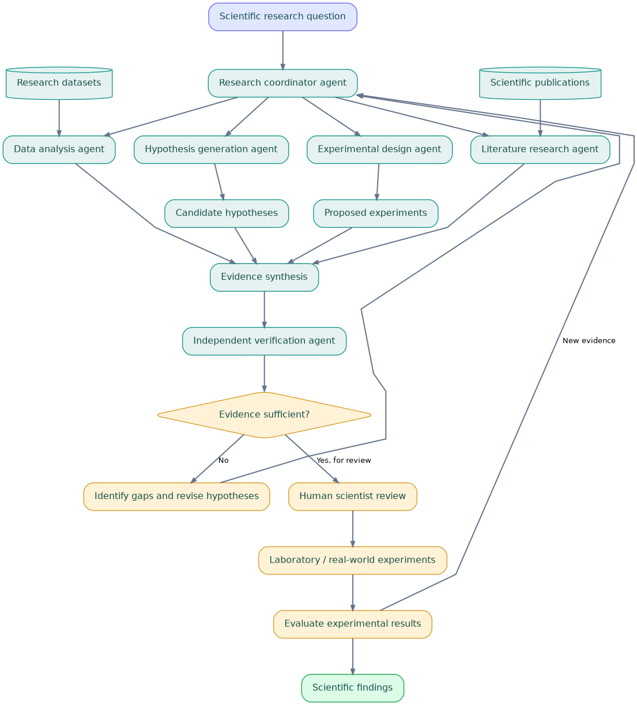
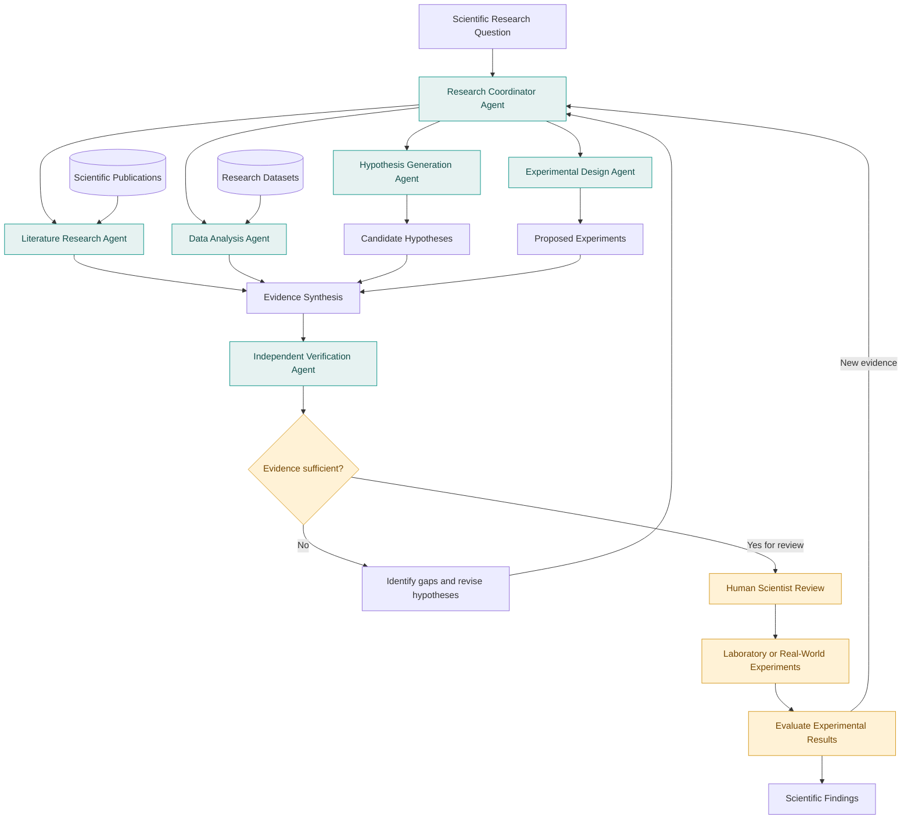
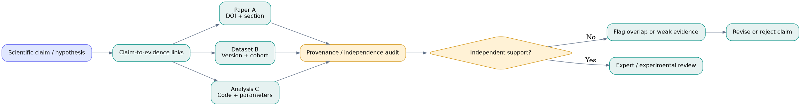
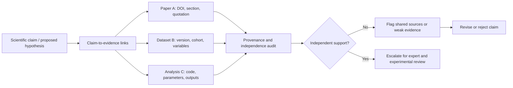
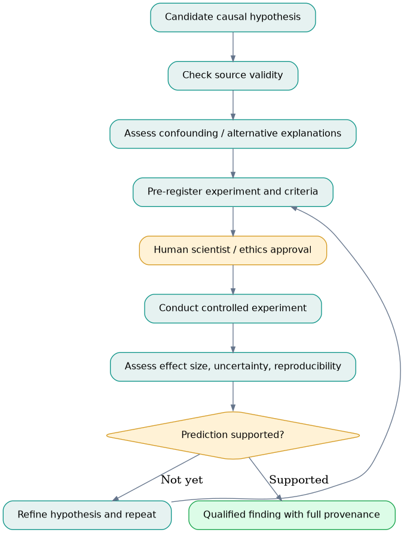
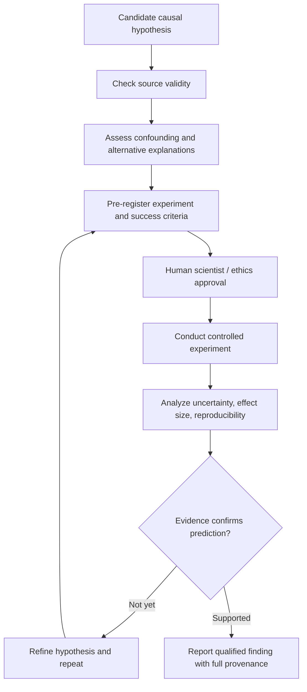

<div align="center">



# Research Problem 03: Distributed Scientific Agents

**PROMPT & PULSE AI | RESEARCH TO REALITY | OPENAI RESEARCH DIRECTION**

[Concept](#1-problem-statement) · [Architecture](#4-end-to-end-mermaid-diagram) · [Practical example](#5-practical-example) · [Risks](#6-research-challenges) · [Hands-on lab](#9-hands-on-design-exercise)

</div>

> **Scope note:** This is an educational research direction and proposed reference architecture, **not** a verified description of a specific deployed OpenAI system or a claim that AI-generated hypotheses are validated discoveries.

## Research Problem 03: Distributed Scientific Agents

PROMPT & PULSE AI | RESEARCH TO REALITY | OPENAI RESEARCH DIRECTION

### 1. Problem statement

Can multiple AI agents collaborate as scientific researchers to analyze large amounts of information, discover hidden patterns, generate new hypotheses, and help scientists investigate complex problems?

Imagine researchers trying to discover why a particular medical treatment works for some patients but not others.

Relevant information may be spread across thousands of research papers, biological datasets, clinical observations, and experimental reports.

A single researcher—or a single AI agent—may struggle to investigate all these sources thoroughly.

Distributed scientific agents explore a different approach: divide a scientific investigation among specialized AI agents that work together.

### 2. Technical concepts

| Concept                         | What it means                                                           |
| ------------------------------- | ----------------------------------------------------------------------- |
| Multi-agent systems             | Multiple AI agents collaborate on a shared objective.                   |
| Task decomposition              | Breaking a large research problem into smaller investigations.          |
| Scientific literature retrieval | Finding relevant published research and supporting evidence.            |
| Evidence synthesis              | Combining findings from different sources into a coherent explanation.  |
| Hypothesis generation           | Proposing explanations that can be tested scientifically.               |
| Causal inference                | Investigating whether one factor actually causes another.               |
| Provenance                      | Tracking where a finding originated and which evidence supports it.     |
| Agent coordination              | Managing communication, dependencies, and disagreements between agents. |

### 3. Research goal

Develop AI systems that can accelerate scientific investigations by coordinating literature reviews, data analysis, hypothesis generation, and evidence verification.

The goal is to help scientists identify promising discoveries while maintaining scientific rigor and reproducibility.

### 4. End-to-end Mermaid diagram

The following is the editable, GitHub-native replacement for the unrenderable ChatGPT-exported diagram stylesheet in the original source. The same architecture is also provided as a locally bundled image.



[Full-size SVG](assets/images/end_to_end.svg) · [Editable Mermaid source](diagrams/end_to_end.mmd) · [Editable Graphviz source](diagrams/end_to_end.dot)



### 5. Practical exampleSuppose a scientific team wants to investigate why a disease progresses faster in certain patients.

The literature agent gathers published findings. The data agent searches for statistical relationships. The hypothesis agent suggests possible biological explanations. The experiment-design agent proposes ways to test them.

A verification agent checks whether the hypotheses are actually supported by the available evidence.

Human scientists then decide which experiments to perform.

The key distinction: AI agents can help discover and prioritize hypotheses, but a plausible explanation is not automatically a scientifically established fact.

### 6. Research challenges

The main difficulties include conflicting evidence, hallucinated citations, correlated agent errors, incorrect causal assumptions, and inefficient collaboration.

For example, three agents agreeing that a particular gene causes a disease does not establish causation if all three relied on the same flawed study.

Independent evidence and experimental validation remain essential.

### 7. Interview perspective

Question: How would you design a multi-agent scientific research platform that generates trustworthy, evidence-backed hypotheses?

A strong answer should explain task decomposition, agent specialization, document retrieval, citation provenance, shared state, independent verification, uncertainty handling, and human experimental approval.

### Subscriber challenge

Suppose five scientific agents independently conclude that a particular biological factor causes a disease.

Is agreement among five agents sufficient to establish a scientific discovery?

No. Their conclusions may share the same data, assumptions, or methodological errors. The hypothesis still requires appropriate causal evidence and experimental testing.

Core takeaway: Distributed scientific agents aim to accelerate the process of scientific discovery, not replace scientific evidence or human validation.

Prompt & Pulse AI — Learn AI. Build AI. Stay Ahead.

---

## 8. How the architecture works (additional educational explanation)

**1. Define the research question.** The scientist specifies the population, outcome, constraints, and the difference between exploratory analysis and a causal claim. A clearly scoped question prevents agents from optimizing incompatible goals.

**2. Coordinate independent work.** The coordinator assigns literature review, dataset exploration, hypothesis generation, and experimental design to specialists. An agent is a role with access to bounded tools—not necessarily a separately trained model.

**3. Collect and structure evidence.** The literature agent records paper identifiers, quoted passages, publication dates, methodologies, and limitations. The data agent records dataset versions, cohort selection, preprocessing, and analysis scripts. Both maintain links from every substantive claim to its supporting source.

**4. Generate testable hypotheses.** A hypothesis should be a falsifiable prediction, for example: “Among patients with comparable baseline risk, marker X predicts a different response to treatment Y.” Predictive association alone does **not** demonstrate a causal mechanism.

**5. Independently verify.** The verifier checks cited passages, alternative explanations, dependence between supposedly independent sources, possible confounding, data leakage, and reproducibility. Agreement among agents is weak evidence when they share the same sources or model failure modes.

**6. Obtain human approval and test.** Scientific experts decide whether experiments are feasible, ethical, and well-controlled; institutional review and relevant governance may be required. Experimental observations can support, narrow, or refute a hypothesis, and must feed back into the investigation.

### Evidence and provenance architecture



[SVG](assets/images/provenance.svg) · [Mermaid](diagrams/provenance.mmd)



### Causal-validation and experimental feedback loop



[SVG](assets/images/validation.svg) · [Mermaid](diagrams/validation.mmd)



## 9. Hands-on design exercise

**Scenario:** A research team asks whether biomarker X explains why some patients respond differently to a treatment. Use publicly licensed, suitably de-identified data and literature. Do not treat this teaching exercise as medical advice or clinical evidence.

1. Write a precise research question and define what would count as disconfirming evidence.
2. Create four work queues: literature, data analysis, candidate hypotheses, and experiment proposals.
3. For each claim, store `claim_id`, `source_id`, exact evidence span, dataset version (if applicable), analysis code reference, confidence rationale, and unresolved objections.
4. Give the verification agent **independent retrieval** rather than only the generator's summary.
5. Run an adversarial test: feed two agents a duplicated flawed source and check whether the verifier detects the shared evidence.
6. Produce a scientist-review packet that separates *observed associations*, *hypotheses*, *uncertainties*, and *approved next experiments*.

**Success criteria:** no fabricated references in an audited test set; every critical claim has retrievable provenance; duplicated source dependence is flagged; causal wording is withheld without appropriate evidence; human sign-off is recorded before any experiment.

### Example research record (illustrative, not clinical findings)

```json
{
  "hypothesis_id": "H-001",
  "status": "proposed_unverified",
  "question": "Does biomarker X modify response to treatment Y?",
  "evidence": [
    {"source_id": "PAPER-001", "locator": "section or figure", "verified": false},
    {"source_id": "DATASET-001", "version": "v1", "verified": false}
  ],
  "possible_confounders": ["baseline severity", "age", "selection bias"],
  "independent_replication": "not_established",
  "human_review": "pending",
  "next_action": "design and seek approval for a suitable study"
}
```

## 10. Evaluation and failure analysis

| Dimension | Question to test | Suggested evidence |
| --- | --- | --- |
| Citation validity | Does each citation resolve to text supporting that claim? | Human-audited claim/source pairs |
| Evidence independence | Are agents reusing the same underlying study or dataset? | Source-lineage overlap audit |
| Reproducibility | Can another researcher reproduce the analysis? | Versioned data and executable scripts |
| Causal discipline | Are confounding and alternatives acknowledged? | Reviewer rubric and negative controls |
| Hypothesis quality | Is the hypothesis specific, falsifiable, and informative? | Expert scoring with blinded review |
| Coordination efficiency | Do extra agents improve findings enough to justify cost? | Single-agent baseline vs multi-agent benchmark |
| Human governance | Are sensitive experiments gated by approval? | Approval records and audit trail |

**Important distinction:** a consensus vote among five agents is *not* five independent scientific replications. If all five rely on one flawed paper, the effective evidence base may still be just that one study.

## 11. Example implementation blueprint (proposed, not implemented here)

| Layer | Possible technology | Responsibilities |
| --- | --- | --- |
| Research workflow | LangGraph or a task queue | State, retries, bounded fan-out, human checkpoints |
| Source ingestion | PubMed / Crossref metadata, licensed datasets | Retrieve documents and record provenance |
| Search | PostgreSQL + pgvector / hybrid search | Source-scoped, auditable retrieval |
| Specialized agents | LLMs with structured-output contracts | Literature, data, hypothesis, experiments, verification |
| Evidence store | Relational records + object storage | Immutable source IDs and analysis artifacts |
| Evaluation | pytest, evaluation datasets, expert review | Citation checks, robustness, regression testing |
| Observability | OpenTelemetry | Traces, latency, cost, errors, audit events |

Suggested workflow: ingest → register sources → parallelize bounded research tasks → evidence synthesis → independent source audit → confidence and causal checks → human decision → external experiment → update the evidence record.

## 12. Further learning (background references)

These are general references relevant to the concepts; they do not establish that the proposed architecture is an official OpenAI research project.

- [PubMed](https://pubmed.ncbi.nlm.nih.gov/) — biomedical literature search.
- [Crossref](https://www.crossref.org/) — research identifiers and metadata.
- [The Turing Way](https://the-turing-way.netlify.app/) — reproducible, collaborative research practices.
- [Causal Inference: The Mixtape](https://mixtape.scunning.com/) — introduction to causal identification and pitfalls.
- [Mermaid documentation](https://mermaid.js.org/intro/) — edit and preview the architecture diagrams.
- [GitHub Mermaid support](https://github.blog/2022-02-14-include-diagrams-markdown-files-mermaid/) — render Mermaid directly in Markdown.

## 13. Repository contents and publishing

```text
Research_Problem_03_Distributed_Scientific_Agents/
├── README.md                         # full educational explanation + embedded Mermaid
├── assets/images/
│   ├── research-problem-03-cover.png # actual cover artwork
│   ├── prompt-pulse-logo.png         # original bundled branding image
│   ├── end_to_end.png / .svg         # rendered architecture
│   ├── provenance.png / .svg         # rendered provenance diagram
│   └── validation.png / .svg         # rendered experimental workflow
├── diagrams/
│   ├── end_to_end.mmd / .dot         # editable diagram sources
│   ├── provenance.mmd / .dot
│   └── validation.mmd / .dot
└── source/
    └── original_uploaded_content.md # unmodified original Markdown export
```

**To publish:** unzip the download; put all the files in the root of a GitHub repository (do not upload only `README.md`). GitHub will display the packaged PNG/SVG images from the relative paths above, and it will render the embedded Mermaid blocks. Edit the `.mmd` files or the Mermaid code in `README.md` to update diagrams; regenerate PNG/SVG assets after changes.

---

**Prompt & Pulse AI — Learn AI. Build AI. Stay Ahead.**
