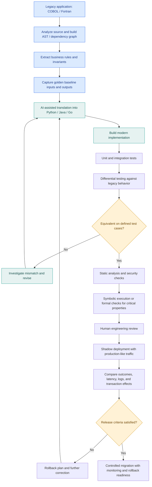
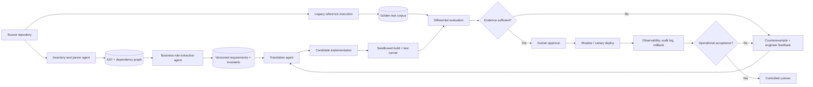
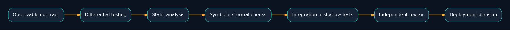
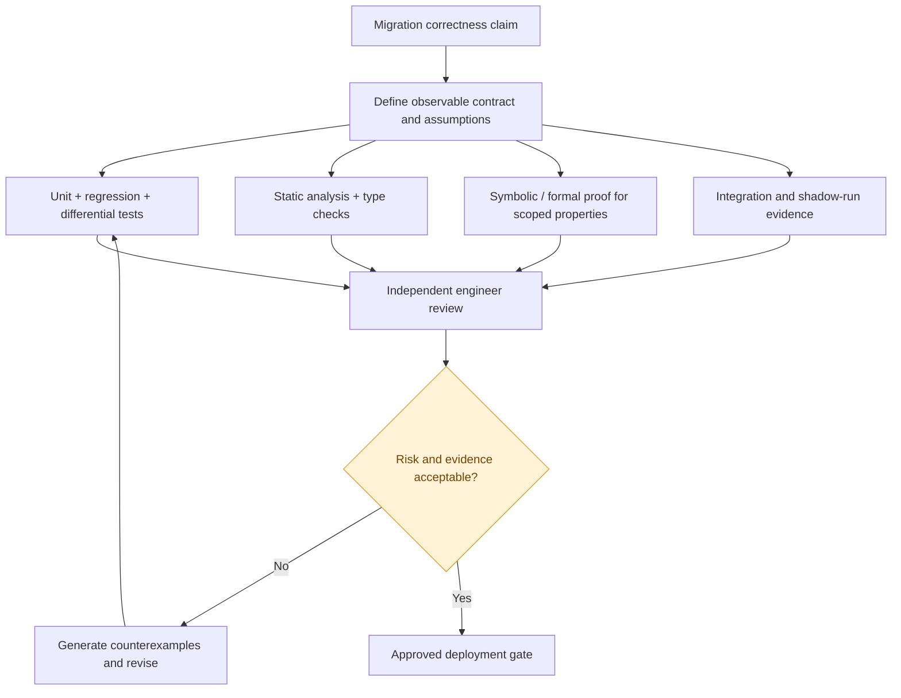

<p align="center"></p>

# Research Problem 04 — Software Engineering Across Programming Languages

**Prompt & Pulse AI · Research to Reality · Research direction: AI-assisted software modernization**

> **Central question:** Can AI modernize code across languages while preserving observable business behavior and correctness?


**In this repository:** the full educational narrative of Research Problem 04, a restored editable end-to-end Mermaid diagram, two additional architecture views, PNG/SVG image assets, and a runnable Python differential-testing demonstration. The diagrams are *illustrative designs*, not an official OpenAI architecture. This is a study of a research direction; it does not assert a particular announced OpenAI result.

**Navigation:** [Problem](#1-problem-statement) · [Concepts](#3-technical-concepts-behind-the-problem) · [Workflow](#4-end-to-end-mermaid-diagram) · [Example](#5-practical-example-migrating-a-financial-application) · [Agent architecture](#10-agentic-modernization-reference-architecture) · [Hands-on lab](#12-hands-on-differential-testing-lab) · [Interview](#8-interview-perspective)

---

## 1. Problem statement

Can artificial intelligence understand, translate, modernize, and verify software written in different programming languages while preserving its original functionality, business logic, and correctness?

Imagine a bank that has been operating for 40 years.

Its core banking applications were developed using COBOL, and they process millions of financial transactions.

Now the bank wants to modernize its systems using Python, Java, or Go.

But there is a serious challenge.

What happens if the new application looks correct, passes several tests, but calculates interest differently from the original system?

Even a small difference in financial calculations could affect thousands of customers.

The research problem is not simply translating one programming language into another.

It is understanding what the original program does and ensuring the modernized implementation preserves the required behavior.

## 2. Why is this problem difficult?

Consider two programs implementing the same business requirement:

Calculate interest, apply the correct rounding rules, and update a customer's account balance.

The original COBOL application may use fixed-point decimal arithmetic, whereas a translated Python implementation may accidentally use binary floating-point arithmetic.

Both programs might compile and run successfully.

But they could produce different results for certain values.

This introduces a fundamental concept:

Syntactic equivalence is not the same as semantic equivalence.

Syntax describes how a program is written. Semantics describes what the program actually does.

## 3. Technical concepts behind the problem

| Concept                    | Explanation                                                                           |
| -------------------------- | ------------------------------------------------------------------------------------- |
| Program semantics          | The meaning and behavior of a program.                                                |
| Abstract syntax tree (AST) | A structured representation of source code.                                           |
| Compiler passes            | Transformations applied to a program during compilation.                              |
| Behavioral equivalence     | Whether two programs exhibit equivalent observable behavior under defined conditions. |
| Differential testing       | Running the same inputs through two implementations and comparing outputs.            |
| Symbolic execution         | Analyzing program paths using symbolic inputs rather than only concrete values.       |
| Regression testing         | Verifying that changes do not break previously working behavior.                      |
| Formal verification        | Mathematically verifying specified properties under explicit assumptions.             |
| Program synthesis          | Automatically generating programs that satisfy a specification or examples.           |

## 4. End-to-end Mermaid diagram

AI-assisted legacy software modernization with correctness checks and controlled deployment. The Mermaid source is editable in [`diagrams/modernization-workflow.mmd`](diagrams/modernization-workflow.mmd). The uploaded Markdown contained a flattened CSS/render dump instead of executable Mermaid; the flow below reconstructs the step labels and decision branches into functional editable source.


<details><summary>Editable Mermaid source — full modernization workflow</summary>


</details>

## 5. Practical example: Migrating a financial application

Suppose a COBOL application calculates compound interest.

The underlying formula is:

\[ A=P\left(1+\frac{r}{n}\right)^{nt} \]

Where:

- \(P\) is the principal amount.
- \(r\) is the annual interest rate.
- \(n\) is the compounding frequency per year.
- \(t\) is the number of years.
- \(A\) is the final balance.

An AI agent translates the implementation into Python.

However, the correct business result depends on more than the formula.

It also depends on decimal precision, when rounding occurs, how dates are counted, and which conventions the original application uses.

A successful migration must validate these behaviors rather than merely reproduce the mathematical expression.

## 6. Research goal

Develop AI-assisted software engineering techniques that can modernize legacy systems while preserving specified behavior and reducing migration risk.

Potential capabilities include identifying business rules, translating code, generating regression tests, detecting behavioral differences, and assisting with formal verification.

The ultimate goal is trustworthy software modernization, not just faster code generation.

## 7. What remains difficult?

One major challenge is incomplete documentation.

Legacy applications often contain decades of business rules that are not written anywhere except in the source code.

Another challenge is test coverage.

Even if two implementations pass 10,000 identical test cases, this does not prove they behave identically for every possible input.

Other challenges include concurrency behavior, external dependencies, security assumptions, performance requirements, and transaction consistency.

For critical systems, AI-generated migrations therefore require independent testing and carefully controlled deployment.

## 8. Interview perspective

Interview question: How would you migrate a mission-critical COBOL banking application to a modern programming language using AI while ensuring correctness?

A strong answer should cover source-code analysis, business-rule extraction, baseline datasets, differential testing, critical invariants, formal methods where appropriate, shadow execution, observability, and rollback.

A particularly strong candidate would also explain the difference between matching outputs on test cases and proving general behavioral equivalence.

## 9. Subscriber learning challenge

Imagine an AI agent successfully translates 100,000 lines of COBOL into Python.

All unit tests pass.

Can the bank immediately replace the original application?

Not necessarily.

The engineering team must establish whether the test suite covers relevant financial rules, edge cases, integration behavior, security requirements, and operational conditions.

A successful compilation and passing tests are valuable evidence, but they are not a complete correctness guarantee.

### Key takeaway

The challenge of AI-assisted software modernization is not whether AI can write code in another language. It is whether the new code faithfully preserves the behavior that matters.

This problem connects compiler design, program synthesis, formal verification, software testing, AI agents, and enterprise system reliability.

Prompt & Pulse AI — Learn AI. Build AI. Stay Ahead.

Next in the series: Research Problem 05 — Reward Hacking and AI Alignment: What happens when an AI agent maximizes its score but fails to achieve the real objective?

---

## 10. Agentic modernization reference architecture

This **proposed architecture** separates agents that interpret source code, extract business requirements, generate a candidate, and test it from independent gates that decide whether the generated implementation is safe to accept. The legacy application is treated as a behavioral oracle only where its current behavior is authoritative; undocumented bugs must be triaged against the intended business contract rather than reproduced blindly.




## 11. What counts as correctness evidence?

Passing a finite test suite supports a bounded claim; it is **not** a proof of full semantic equivalence. A formal proof applies only to the specified property, model, and assumptions. Operational acceptance additionally depends on security, external integrations, transaction boundaries, and rollback.





### Suggested acceptance evidence

| Evidence | What it establishes | What it does **not** establish |
|---|---|---|
| Golden test corpus | Output compatibility on recorded cases | Behavior on all unseen inputs |
| Differential / property-based tests | Finds mismatches over sampled and generated cases | An unconditional mathematical proof |
| Static security analysis | Flags known issue classes in inspected code | Freedom from all vulnerabilities |
| Scoped formal verification | Proves a specified property under stated assumptions | Complete correctness of the broader system |
| Shadow deployment | Reveals divergences under realistic integration loads | Guaranteed safety for full traffic |
| Human signoff and rollback | Accountable risk acceptance and recovery plan | Zero migration risk |

## 12. Hands-on differential-testing lab

The included standard-library-only Python demo contrasts **binary floating-point rounding** with **decimal rounding**. It intentionally uses a simplified two-step interest example; it is *not* a COBOL interpreter or a claim about all COBOL programs. Real migration must first recover source-system precision, rounding, day-count, and transaction conventions.

Run from the repository root:

```bash
python -m unittest discover -s tests -v
python examples/interest_migration.py
```

Inspect the code in [`examples/interest_migration.py`](examples/interest_migration.py) and change the rounding policy. Record where candidate and reference behavior differ, then decide whether the target must replicate the old behavior or implement a separately approved corrected specification.

## 13. Reuse diagrams and images on GitHub

| Asset | GitHub-rendered preview | Editable source |
|---|---|---|
| End-to-end modernization | [`PNG`](assets/modernization-workflow.png) / [`SVG`](assets/modernization-workflow.svg) | [`Mermaid`](diagrams/modernization-workflow.mmd) / [`Graphviz`](diagrams/modernization-workflow.dot) |
| Agent reference architecture | [`PNG`](assets/agent-architecture.png) / [`SVG`](assets/agent-architecture.svg) | [`Mermaid`](diagrams/agent-architecture.mmd) / [`Graphviz`](diagrams/agent-architecture.dot) |
| Correctness evidence | [`PNG`](assets/correctness-evidence.png) / [`SVG`](assets/correctness-evidence.svg) | [`Mermaid`](diagrams/correctness-evidence.mmd) / [`Graphviz`](diagrams/correctness-evidence.dot) |

GitHub automatically renders Mermaid fenced code blocks in README files. To modify a diagram, edit its `.mmd` file or the Mermaid block above. The bundled PNG/SVG previews were generated from editable Graphviz `.dot` sources and may be regenerated using `dot -Tpng file.dot -o file.png` or `dot -Tsvg file.dot -o file.svg`. The Mermaid and Graphviz files are parallel authored representations and are not automatically synchronized.

## 14. Publication context and scope

This README preserves the original Research Problem 04 learning sections 1–9, the key takeaway, series transition, and technical definitions. Supplementary sections 10–14 and rendered diagrams were added to make the repository educational and reusable. The original flattened diagram export was replaced with readable, editable Mermaid without reproducing its nonfunctional styling payload. The unrelated follow-up conversation describing counts of the wider 20-problem series is not part of the educational README.

**Prompt & Pulse AI — Learn AI. Build AI. Stay Ahead.**
