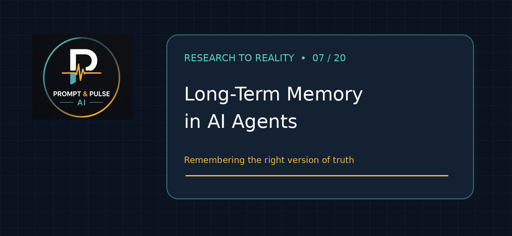
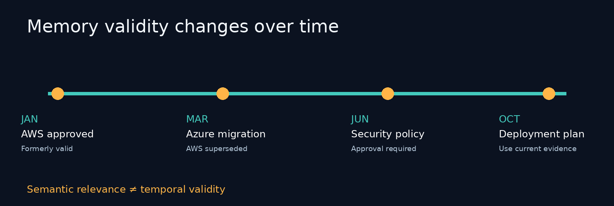
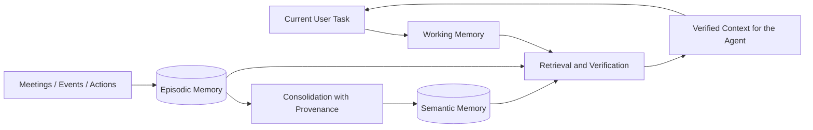
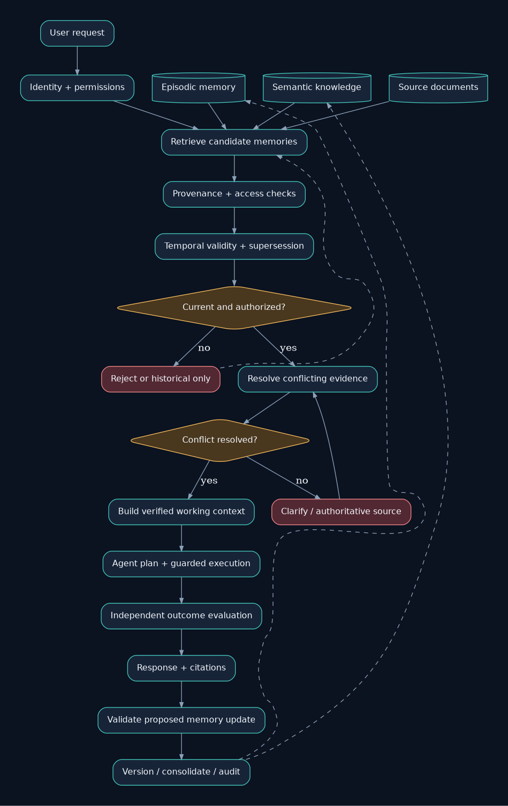
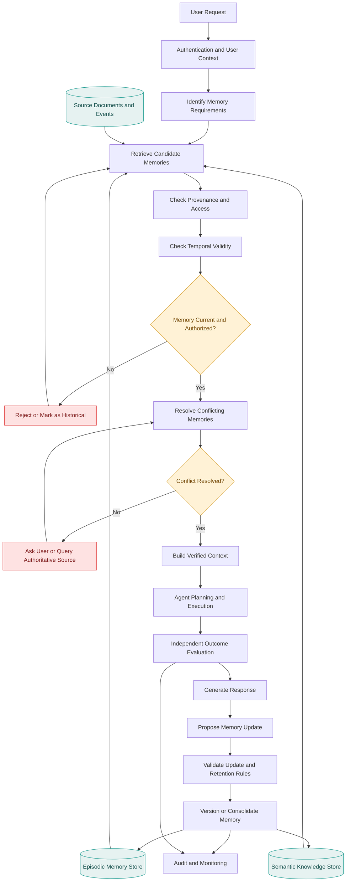
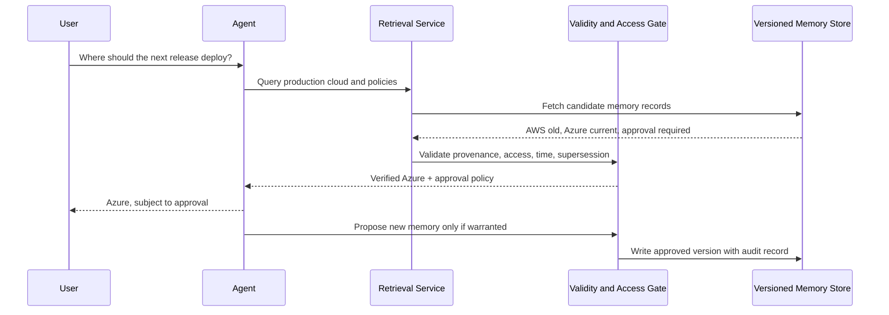

# Research Problem 07: Long-Term Memory in AI Agents



[](diagrams/) [](#research-problem-07-long-term-memory-in-ai-agents)

**In this repository:** [Problem](#1-problem-statement) · [Core concepts](#3-technical-concepts-behind-the-problem) · [Architecture](#4-end-to-end-mermaid-architecture-diagram) · [Research](#5-practical-example-chatgpts-evolving-memory-architecture) · [Interview](#8-interview-perspective) · [Student lab](#9-subscriber-learning-challenge) · [References](#10-research-references)

**Visual files:** [`assets/`](assets/) (local PNG and SVG previews) | **Editable diagrams:** [`diagrams/`](diagrams/) (`.mmd` sources).

PROMPT & PULSE AI | RESEARCH TO REALITY | OPENAI RESEARCH DIRECTION | SERIES 07/20

## 1. Problem statement

How can AI assistants remember, retrieve, and update useful information across conversations and tasks without relying on outdated facts, incorrect assumptions, irrelevant context, or information they should no longer use?

Imagine an AI engineering assistant supporting a company for an entire year.

In January, the team decides to deploy its application on AWS.

In March, the organization changes its architecture to Azure.

In June, the security team introduces a new policy requiring approval before production deployments.

In October, an engineer asks the assistant:

"Prepare the deployment plan using our current infrastructure and security requirements."

The AI remembers the January AWS decision and generates a technically convincing deployment plan.

But the company now uses Azure, and the plan ignores the June approval requirement.

The assistant remembered information.

The problem is that it remembered the wrong version of the truth.

This introduces one of the most important research challenges in persistent AI systems:

How do we make AI memory useful without allowing outdated or unreliable information to control future decisions?

## 2. Why is this problem difficult?

Most language models operate on information supplied within their current context.

When a conversation ends, the model itself does not automatically acquire a reliable, permanent record of every relevant fact. Applications can provide continuity using external memory stores, summaries, retrieval mechanisms, and other memory-management systems.

But storing information is only the beginning.

Consider the following sequence:




[Edit this timeline](diagrams/decision-timeline.mmd).

| Date    | Information                            | Validity                                    |
| ------- | -------------------------------------- | ------------------------------------------- |
| January | Deploy on AWS                          | Previously valid                            |
| March   | Migrate production deployment to Azure | Supersedes January                          |
| June    | Require production approval            | Additional current constraint               |
| October | Generate deployment plan               | Must use the applicable current information |

A simple vector database might retrieve the January document because it closely matches the words deployment architecture.

The retrieval may be semantically relevant yet temporally incorrect.

This illustrates a deeper distinction:

Relevance is not the same as validity.

A reliable memory system must consider what was said, when it applied, where it originated, whether it has been superseded, and whether the current user and workflow are authorized to access it.

## 3. Technical concepts behind the problem

| Concept                 | Explanation                                                                          |
| ----------------------- | ------------------------------------------------------------------------------------ |
| Long-term memory        | Information retained across separate interactions or tasks.                          |
| Working memory          | Information actively maintained for the current task.                                |
| Episodic memory         | Records of specific interactions, events, and actions.                               |
| Semantic memory         | Consolidated knowledge or facts derived from observations.                           |
| Memory consolidation    | Combining related information into a more useful, compact representation.            |
| Memory retrieval        | Selecting previously stored information relevant to the current request.             |
| Temporal validity       | Whether information remains applicable at the time it is used.                       |
| Provenance              | The origin and evidence supporting a stored fact.                                    |
| Memory versioning       | Tracking changes, updates, and superseded records.                                   |
| Conflict resolution     | Handling contradictory information from different sources.                           |
| Forgetting and deletion | Excluding or removing information according to retention policies and user controls. |
| Access control          | Restricting which memories are available to particular users or agents.              |

### Understanding different types of memory

### A conceptual AI memory architecture



[Edit this diagram](diagrams/memory-types.mmd).

Illustrative architecture. Working, episodic, and semantic memory are useful conceptual categories; implementations can organize memory differently.

Working memory contains the information needed during the current task, such as the user's request and intermediate results.

Episodic memory records events, such as an architectural decision made during a team meeting.

Semantic memory captures consolidated knowledge, such as which cloud platform the application currently uses.

The difficult part is maintaining consistency between them.

## 4. End-to-end Mermaid architecture diagram

This diagram shows how an AI assistant can retrieve relevant historical information, validate it, and use it to respond or act.



> **Editable source:** [`diagrams/memory-architecture.mmd`](diagrams/memory-architecture.mmd). GitHub also renders the Mermaid diagram below natively. The included PNG/SVG are locally packaged visual previews; their layout is independently produced from the same conceptual design.



### How the diagram works

The following sequence diagram provides a second, editable view of retrieval, verification, and guarded memory updates.



[Edit the sequence diagram](diagrams/memory-update-sequence.mmd).

The user submits a request, and the application determines whether historical context is needed.

The retrieval system searches relevant memories and source records.

Before including the retrieved information in the agent's context, the system checks access permissions, provenance, and temporal validity.

If the system retrieves contradictory records, it uses an authoritative source or requests clarification rather than silently treating both records as current.

The agent then completes the task using the validated context.

New information may be proposed for storage, but it must pass validation and retention checks before being consolidated into longer-term memory.

Key architectural principle: Memory should be treated as evidence that requires interpretation, not as an automatically authoritative instruction.

## 5. Practical example: ChatGPT's evolving memory architecture

In June 2026, OpenAI published research and product information about a memory architecture called Dreaming, designed to improve long-term continuity, freshness, and relevance.

Rather than simply storing isolated statements, this approach synthesizes useful information across interactions and updates memory as circumstances change.


Consider an illustrative example:

January: "I'm planning a trip to Singapore in July."

July: "I'm currently visiting Singapore."

August: "I've returned home."

A naive memory system might continue behaving as though the user is currently in Singapore.

A temporally aware system should distinguish between a planned trip, an ongoing trip, and a completed trip.

The research goal is not to remember every sentence forever.

It is to maintain a useful and appropriately updated understanding of context.

### What makes this a serious research challenge?

A 2026 paper, From Recall to Forgetting: Benchmarking Long-Term Memory for Personalized Agents, introduced the Memora benchmark and a metric called Forgetting-Aware Memory Accuracy (FAMA).

The study found that tested memory systems frequently reused information that had become invalid, showing that retrieving old facts correctly is not enough for dependable long-term memory.


That leads to an important distinction:

| Traditional memory question                  | More advanced memory question                                           |
| -------------------------------------------- | ----------------------------------------------------------------------- |
| Can the agent remember an earlier statement? | Can it determine whether the earlier statement still applies?           |
| Can it retrieve the right document?          | Can it identify whether that document has been superseded?              |
| Can it personalize a response?               | Can it avoid relying on inappropriate or obsolete personal information? |
| Can it store more information?               | Can it retain only useful, valid, authorized information?               |

## 6. Research goal

The goal is to develop AI memory systems that maintain useful continuity while reducing errors caused by outdated, contradictory, irrelevant, or inappropriate information.

An effective memory system should remember relevant context, update facts when circumstances change, preserve source provenance, support privacy and deletion controls, and use information only when it is appropriate for the current task.

There is an important distinction between improving factual memory retrieval and improving decision-making.

An agent might correctly retrieve the latest deployment policy yet fail to apply it when planning a deployment.

Therefore, researchers must evaluate not only what the agent remembers, but how the retrieved information influences its actions.

## 7. What remains difficult?

Temporal inconsistency: Old and new information can coexist, making it difficult to determine which record applies.

Implicit conflicts: A later event may invalidate an earlier fact without explicitly stating that the old fact is wrong.

Memory hallucination: An AI system may incorrectly summarize an interaction or infer a fact that was never established.

Privacy and authorization: Remembered information must not become accessible to unauthorized users or workflows.

Over-consolidation: Summarization can remove important exceptions, qualifications, and source details.

Memory scalability: Maintaining useful memory across many years introduces retrieval, storage, cost, and latency trade-offs.

Forgetting: Systems need ways to stop using information that has expired, been superseded, or should no longer be retained.

An important lesson is that increasing memory capacity does not automatically improve memory reliability.

## 8. Interview perspective

Interview question:

How would you design a long-term memory system for an enterprise AI assistant that operates across multiple projects, users, and changing business requirements?

### Strong answer direction

Begin by distinguishing working memory, episodic memory, and semantic memory.

Then design a memory service with source provenance, timestamps, authorization boundaries, versioned facts, and retrieval mechanisms.

Explain why semantic similarity alone cannot determine whether information is current.

Add conflict detection, temporal filtering, authoritative-source resolution, and memory-update workflows.

Include user-controlled correction and deletion processes, while considering how relevant backups, caches, and downstream memory stores are handled.

Finally, evaluate the system on multi-session tasks involving changing requirements, conflicting information, and expired facts.

What the interviewer is testing: Context engineering, retrieval systems, database design, temporal reasoning, privacy, distributed state management, and AI reliability.

## 9. Subscriber learning challenge

An AI assistant stored the following information:

January: "Our production infrastructure runs on AWS."

March: "We completed migration of production infrastructure to Azure."

October: The user asks, "Where should we deploy the next production release?"

What should the assistant do?

Recommend AWS because it is the oldest stored architectural decision.

Recommend Azure based on the newer record, while checking applicable current policies and permissions.

Recommend whichever cloud platform appears most frequently in memory.

Ignore all historical context and choose a random cloud platform.

**Challenge answer (for instructors):** The second option: Azure is the newer production decision; verify that it remains authoritative and that applicable security policies and permissions allow the release.

### A practical experiment for students

Build a small memory system that stores architectural decisions with these fields:

```json
{
  "subject": "production_cloud",
  "value": "Azure",
  "valid_from": "2026-03-01",
  "source": "approved_architecture_decision",
  "supersedes": "aws_decision_2026_01",
  "status": "current"
}
```

Then create a retrieval query asking which cloud provider is currently approved.

Compare two approaches:

A simple semantic-search system that retrieves the most similar document, and a memory system that also considers validity dates, supersession, provenance, and authorization.

Evaluate whether the second system reduces stale-information errors.

## 10. Research references

- [OpenAI — Dreaming: Better Memory for a More Helpful ChatGPT (June 2026)](https://openai.com/index/chatgpt-memory-dreaming/?utm_source=chatgpt.com)
- [ACL 2026 — From Recall to Forgetting: Benchmarking Long-Term Memory for Personalized Agents](https://aclanthology.org/2026.findings-acl.1337/?utm_source=chatgpt.com)
- [STALE — Can LLM Agents Know When Their Memories Are No Longer Valid?](https://arxiv.org/abs/2605.06527?utm_source=chatgpt.com)
- [Hindsight — Structured Agent Memory That Retains, Recalls, and Reflects](https://aclanthology.org/2026.acl-demo.27/?utm_source=chatgpt.com)

## Key takeaway

The goal of long-term AI memory is not to remember everything. It is to remember the right information, recognize when circumstances change, and use past knowledge appropriately in present decisions.

A system that remembers an outdated fact confidently may be less useful than one that recognizes uncertainty and checks the current source of truth.

This makes memory management a core part of agent reliability, not simply a convenience feature.

Prompt & Pulse AI — Learn AI. Build AI. Stay Ahead.

Next in the series: Research Problem 08 — Mechanistic Interpretability: Can we understand what happens inside a neural network and identify the internal computations responsible for its behavior?

---

## Repository guide

| Asset | Format | Purpose |
|---|---|---|
| `README.md` | Markdown | Complete educational article |
| `assets/research-07-cover.png` | PNG | Branded cover image |
| `assets/memory-architecture.png` | PNG | Architecture illustration |
| `assets/memory-architecture.svg` | SVG | Scalable illustration |
| `assets/decision-timeline.png` | PNG | Architecture-decision example |
| `assets/prompt-pulse-logo.png` | PNG | Supplied publication branding |
| `diagrams/*.mmd` | Mermaid | Editable diagram sources |
| `diagrams/architecture-preview.dot` | DOT | Editable source for the image previews |

**How to edit:** Modify the fenced `mermaid` blocks in the README or the corresponding `.mmd` file. GitHub renders fenced Mermaid natively. The packaged PNG and SVG files are static image assets and will not automatically regenerate after `.mmd` edits. To regenerate the DOT-based preview, run `dot -Tpng diagrams/architecture-preview.dot -o assets/memory-architecture.png` and `dot -Tsvg diagrams/architecture-preview.dot -o assets/memory-architecture.svg`.

**Editorial note:** The architecture is an educational reference design, not a claim about the exact internal implementation of ChatGPT or any named product. The external research references are retained from the supplied article; publication-specific claims should be rechecked against those primary sources before public reuse.
