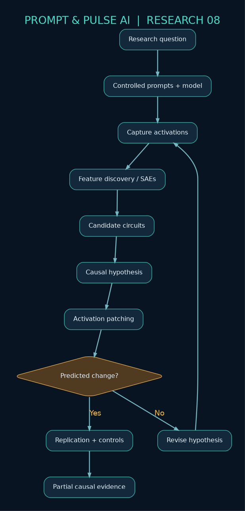
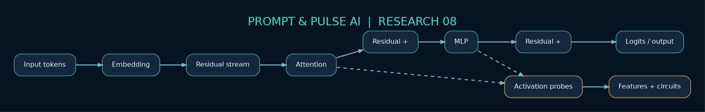
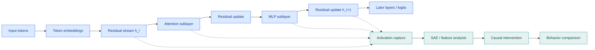
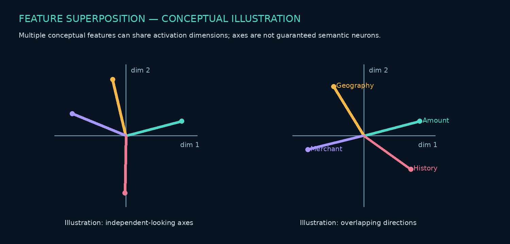
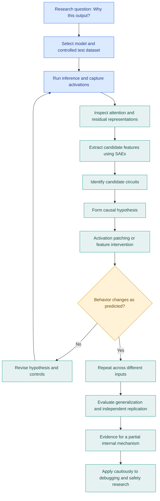
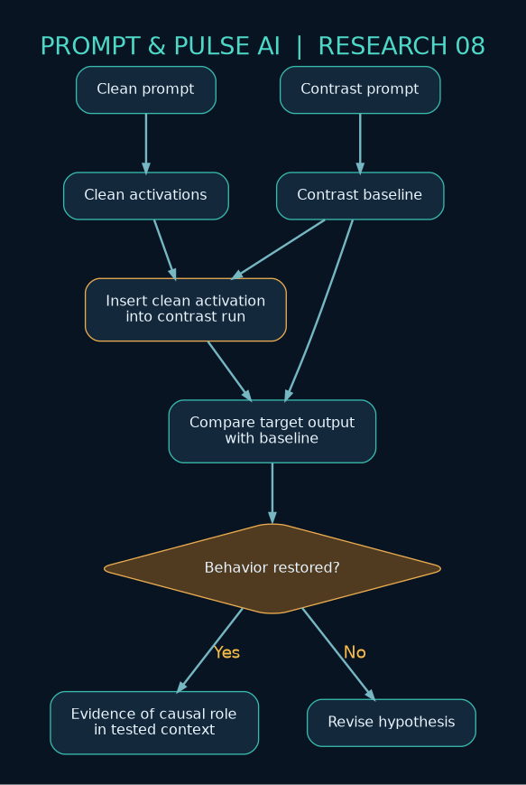
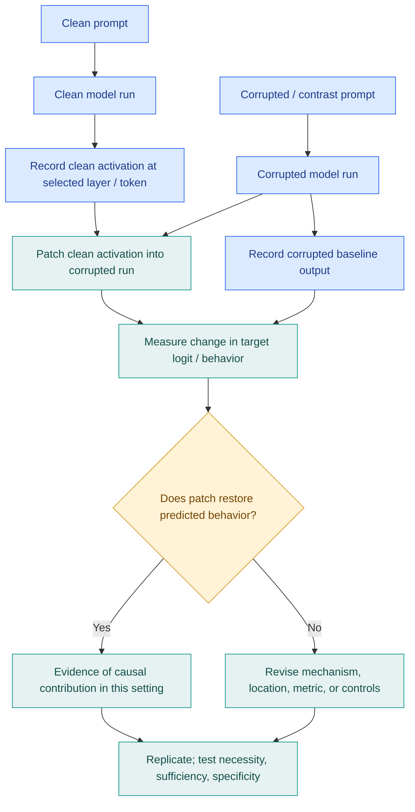

<div align="center">


# Research Problem 08: Mechanistic Interpretability
### Understanding How AI Thinks Internally

**PROMPT & PULSE AI | RESEARCH TO REALITY | ANTHROPIC RESEARCH DIRECTION | SERIES 08/20**

**Learn AI. Build AI. Stay Ahead.**

[Research](#5-practical-example-can-a-models-explanation-differ-from-its-actual-computation) · [Architecture](#4-end-to-end-mermaid-architecture-diagram) · [Hands-on lab](#9-subscriber-learning-challenge) · [References](#10-primary-research-references)

</div>

> **Research framing:** Mechanistic interpretability studies the computations of neural networks; it does not establish that LLMs “think” in a human sense. The bank scenario and student activities below are educational illustrations, not a validated financial decision system. Diagrams are conceptual, not recovered circuits from Claude.



## 1. Problem statement

**Can we identify and understand the internal computations inside large language models that cause them to produce particular answers, make decisions, or exhibit unexpected behaviors?**

Imagine a bank using an AI agent to review suspicious financial transactions.

The AI evaluates a transaction and recommends:

> “This transaction appears fraudulent. Block it.”

The bank wants to understand **why** the system reached that conclusion.

Was it influenced by an unusual transaction amount? A suspicious location? A historical fraud pattern? Or irrelevant information in the input?

The model can generate a convincing explanation, but that explanation may not faithfully describe the internal computations that actually influenced its prediction.

This creates a fundamental research challenge:

**How can we investigate what happens inside a neural network rather than relying only on what the model says about its decisions?**

This is the central problem of mechanistic interpretability.

## 2. Why is this problem difficult?

Traditional software is often organized around explicit instructions and logical conditions.

For example:

```python
if transaction_amount > threshold:
    flag_for_review = True
```

An engineer can inspect this rule and understand exactly why it was triggered.

A large neural network behaves differently.

Its knowledge and computations are distributed across many learned parameters and intermediate representations.

A model might contain billions of parameters, arranged into interconnected layers that transform numerical representations of input information.

It does not necessarily have a single identifiable neuron representing a complete concept such as fraud, honesty, or mathematical reasoning.

Instead, information can be represented through combinations of neural activations.

This leads to three important questions:

1. **Representation:** Where and how is information encoded inside the model?
2. **Computation:** How do internal components transform that information?
3. **Causality:** Which internal mechanisms actually contribute to a particular output?

Mechanistic interpretability attempts to answer these questions through experiments on model internals.

## 3. Technical concepts behind the problem

| Concept | Explanation |
|---|---|
| Transformer architecture | A neural-network architecture using attention and other components to process representations. |
| Neural activations | Numerical values produced by neurons or intermediate model components. |
| Residual stream | A representation pathway through which transformer blocks communicate information across layers. |
| Attention mechanism | A mechanism that allows token representations to incorporate information from other positions. |
| MLP layers | Feed-forward neural components that transform representations within transformer blocks. |
| Superposition | A phenomenon where multiple features are represented using overlapping dimensions. |
| Sparse autoencoders (SAEs) | Models used to identify more interpretable features from neural activations. |
| Feature attribution | Methods for estimating which inputs or internal features contribute to behavior. |
| Activation patching | Replacing selected activations to test their causal influence on model outputs. |
| Circuit tracing | Investigating groups of interacting features or components that implement recognizable computations. |
| Causal intervention | Manipulating a suspected internal mechanism to test whether behavior changes. |

### Understanding the transformer connection

A simplified residual update can be expressed as:

$$
h_{l+1}=h_l+F_l(h_l)
$$

Where:

- $h_l$ is the representation entering a sublayer.
- $F_l$ is a transformation, such as attention or an MLP operation.
- $h_{l+1}$ is the resulting representation.

In an actual transformer, multiple attention heads and feed-forward components contribute to the model's computations. A full block typically involves multiple updates, normalization, and architecture-specific choices, so this equation is an intentionally simplified abstraction.

Mechanistic interpretability investigates which patterns within these representations are associated with particular behaviors and whether those relationships are causal.



<details>
<summary><strong>Editable Mermaid: Transformer components and interpretability probes</strong></summary>



[Standalone editable source](diagrams/02-transformer-internals.mmd)

</details>

### What is superposition?

Imagine a model representing information about banking transactions.

A hypothetical model may encode features related to transaction amount, geography, merchant type, account history, and suspicious behavior.

These features need not occupy separate neurons.

Multiple features may share the same underlying neural dimensions.

This makes individual neuron inspection insufficient for understanding the entire computation.

Sparse autoencoders attempt to recover more interpretable features from these overlapping representations, although the resulting features are not always clean or complete.



*The illustration uses invented feature directions to explain superposition. It is not a measurement from a trained model.*

## 4. End-to-end Mermaid architecture diagram

This diagram demonstrates a conceptual workflow for investigating internal model behavior. It reconstructs the supplied flow as **working Mermaid source**, rather than the non-portable CSS / flattened diagram text in the original paste.



[Edit the Mermaid workflow source](diagrams/01-research-workflow.mmd) · [Open its SVG version](assets/workflow.svg)

### How the diagram works

A researcher begins with a specific behavioral question.

The model is run on controlled examples while its internal activations are recorded.

Researchers then identify candidate features and circuits associated with the behavior.

Next, they perform interventions, such as replacing activations from one input with activations from another.

If the model's behavior changes in the predicted way, that provides evidence of a causal relationship.

However, one successful intervention is not sufficient to establish a general mechanism.

Researchers must repeat experiments, test different inputs, and assess whether the proposed explanation generalizes.

**The key principle: Observing a neural feature is not the same as proving that it causes a particular behavior.**

### Activation patching: a more detailed causal architecture





[Edit this diagram](diagrams/03-activation-patching.mmd). Patching gives evidence about a component's causal contribution under the chosen inputs and intervention; it does not by itself prove a complete, unique circuit.

## 5. Practical example: Can a model's explanation differ from its actual computation?

Anthropic's March 2025 research, [*Tracing the Thoughts of a Large Language Model*](https://www.anthropic.com/research/tracing-thoughts-language-model), investigated internal circuits associated with several interesting behaviors, including mathematical reasoning, planning, multilingual representations, and hallucinations.

### Example A: Mental arithmetic

Suppose a model is asked:

> What is 36 + 59?

The correct answer is **95**.

When asked how it calculated the answer, the model might describe the familiar school method of adding digits and carrying.

However, Anthropic's researchers found evidence that, in some tested cases, Claude used multiple internal computational pathways, including approximate magnitude computation and determining the final digit.

That creates a fascinating distinction:

**The model's verbal explanation of its reasoning may differ from the computations observed inside the network.**

*Scope note: 36 + 59 is a teaching example. It should not be confused with a claim that Anthropic reported this exact prompt.*

### Example B: Planning ahead

In another experiment, researchers investigated how Claude generated rhyming poetry.

They identified evidence that the model represented candidate ending words before producing the entire line.

By intervening on the relevant internal representations, researchers could influence the final generated words.

This suggests that next-token generation can involve internal planning extending beyond the next token.

### Example C: Investigating hallucinations

Researchers also studied mechanisms associated with declining to answer questions about unfamiliar entities.

They identified interactions between representations associated with known information and refusal behavior. Manipulating certain activations could increase incorrect confident responses.

This illustrates why studying internal mechanisms may offer insights that inspecting final answers alone cannot provide.

**Research evidence:** [Anthropic, March 27, 2025](https://www.anthropic.com/research/tracing-thoughts-language-model).

## 6. Research goal

Mechanistic interpretability aims to make neural-network computations more understandable and causally testable.

Researchers want to identify meaningful internal features, discover how those features interact, and determine whether manipulating them changes model behavior in predictable ways.

Longer-term applications could include improving model debugging, investigating hallucinations, detecting some unwanted behaviors, and developing stronger model-level auditing methods.

The ambition is significant: **to move from observing what AI does toward understanding some of the mechanisms that make it do those things.**

## 7. What remains difficult?

- **Partial visibility:** Current techniques capture only portions of a model's internal computation.
- **Feature ambiguity:** A discovered feature may represent several overlapping concepts rather than one clean, human-readable meaning.
- **Causal uncertainty:** Correlated activations do not automatically establish causal importance.
- **Scalability:** Investigating a short response is substantially easier than tracing a long, complex reasoning process.
- **Methodological artifacts:** Interpretability tools may introduce approximations that do not faithfully represent all computations in the underlying model.
- **Model differences:** Findings from one model or task may not generalize to other architectures and behaviors.

Anthropic explicitly acknowledges that its circuit-tracing methods reveal only a fraction of the relevant computation and require further methodological improvements. See its [open-source tools discussion](https://www.anthropic.com/research/open-source-circuit-tracing).

## 8. Interview perspective

**Interview question:**

> How would you investigate why a large language model produces a particular response using mechanistic interpretability, and how is this different from analyzing attention weights or application traces?

### Strong answer direction

Begin by identifying the behavior you want to investigate.

Construct controlled examples that isolate the suspected mechanism.

Record internal activations and investigate candidate representations using tools such as sparse autoencoders or circuit-tracing methods.

Next, perform causal interventions, such as activation patching, to determine whether manipulating the suspected representation changes the output.

Repeat the experiments across diverse inputs and compare against control conditions.

Finally, distinguish three separate sources of evidence:

| Method | What it helps investigate |
|---|---|
| Application tracing | Which external tools and operations the agent performed. |
| Attention analysis | How attention mechanisms distribute information across positions; weights alone do not establish a complete causal explanation. |
| Mechanistic interpretability | Which internal representations and computations contribute causally to behavior, subject to intervention and measurement limits. |

**What the interviewer is testing:** Transformer fundamentals, neural representations, causal inference, experimental methodology, interpretability limitations, and model evaluation.

## 9. Subscriber learning challenge

A researcher identifies a neural feature that becomes strongly activated whenever an LLM generates an incorrect answer.

**Can the researcher conclude that this feature causes hallucinations?**

A. Yes. Correlation proves the feature causes hallucinations.

B. No. Controlled interventions and additional tests are required to investigate causality.

C. Yes, provided the feature activates in more than 100 examples.

D. No, because internal neural activations cannot be studied experimentally.

<details>
<summary><strong>Reveal answer and explanation</strong></summary>

**Answer: B.** A correlation could reflect an upstream cause, a downstream consequence, or a confounding feature. Controlled patching/ablation, appropriate baselines and replication help test a causal claim. Even an intervention showing an effect does not prove a unique or universally general mechanism.

</details>

### A practical experiment for students

Try investigating model behavior using an open-weight transformer and available interpretability tools.

One possible exercise is to compare internal representations for pairs of prompts that differ in a controlled way—for example, asking for a factual answer with and without a misleading hint.

Examine whether changes in activations correlate with changes in responses. If your tooling supports activation patching, test a specific causal hypothesis.

Keep the experiment small and document its limitations. A useful result may simply show that a proposed explanation does not hold across the tested examples.

#### Reproducible experiment checklist

1. **Specify hypothesis and output metric:** e.g., correct-answer logit difference or probability, not only free-form explanation quality.
2. **Choose matched clean and contrast prompts:** control tokenization, position, length and unrelated content where feasible.
3. **Fix reproducibility details:** model and tokenizer revision, hardware, random seed, decoding and software versions.
4. **Save baseline activations:** target exact layer, token position and activation type.
5. **Perform the intervention:** patch, ablate, or scale the suspected component; include sham and unrelated-location controls.
6. **Measure effects and replicate:** compare clean, corrupted, and patched outcomes across a held-out set; report failures.
7. **Write a bounded conclusion:** distinguish correlation, intervention effects, and a general mechanism; do not infer real-world creditworthiness or fraud causality from a toy model.

See [`examples/experiment-template.md`](examples/experiment-template.md) for a fill-in research log. For real model tooling, consult the upstream [Circuit Tracer](https://github.com/safety-research/circuit-tracer) project and its documented example notebooks; this repository is an **educational content package**, not a claim that those experiments have been executed here.

## 10. Primary research references

1. [Anthropic — Tracing the Thoughts of a Large Language Model (March 27, 2025)](https://www.anthropic.com/research/tracing-thoughts-language-model)
2. [Anthropic — Open-Sourcing Circuit-Tracing Tools (May 29, 2025)](https://www.anthropic.com/research/open-source-circuit-tracing)
3. [Transformer Circuits — Mechanistic Interpretability Research](https://transformer-circuits.pub/)
4. [Circuit Tracer — Open-Source Research Tools](https://github.com/safety-research/circuit-tracer)

### Additional reading / reproducibility

- [Anthropic — Towards Monosemanticity (2023)](https://transformer-circuits.pub/2023/monosemantic-features/index.html)
- [Anthropic — Scaling and Evaluating Sparse Autoencoders (2024)](https://transformer-circuits.pub/2024/scaling-monosemanticity/index.html)
- [GitHub documentation — Creating diagrams with Mermaid](https://docs.github.com/en/get-started/writing-on-github/working-with-advanced-formatting/creating-diagrams)

## Key takeaway

**Knowing what an AI model says is different from understanding why it says it.**

Mechanistic interpretability investigates the internal computations that contribute to model behavior. It combines neural-network analysis with controlled causal experiments to move beyond surface-level explanations.

As AI becomes more autonomous, this research could help engineers understand and diagnose certain failures that are difficult to detect from model outputs alone.

---

**Prompt & Pulse AI — Learn AI. Build AI. Stay Ahead.**

**Next in the series (as supplied):** *Understanding Human Preferences: Can an AI agent accurately represent what a person values before making decisions, recommendations, or negotiating on their behalf?*

> **Editorial numbering note:** The supplied text labels this article "Research Problem 08" and also labels the next installment "Research Problem 08." The next installment title is preserved here without assigning a conflicting series number.

## How to use and customize this GitHub package

All images in this repository are stored locally under `assets/`; no external image host is required for GitHub rendering. The diagram source files under `diagrams/` can be edited in any text editor, [Mermaid Live Editor](https://mermaid.live/), or Graphviz-compatible renderer. README Mermaid blocks render natively on GitHub. The corresponding `.dot` files generate the included **SVG and PNG** reference renders (these are purpose-built conceptual diagrams, not direct Mermaid exports).

```bash
# Optional: regenerate standalone diagram illustrations if Graphviz is installed
for name in workflow transformer patching; do
  dot -Tsvg "diagrams/${name}.dot" -o "assets/${name}.svg"
  dot -Tpng "diagrams/${name}.dot" -o "assets/${name}.png"
done
```

*All custom illustrations and diagrams are explanatory originals. Product-specific research findings are attributed to the linked sources. Repo assets include Prompt & Pulse AI branding supplied for this project.*
