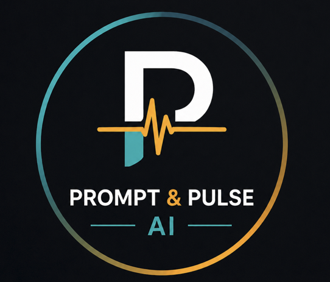
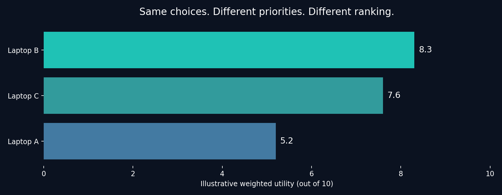
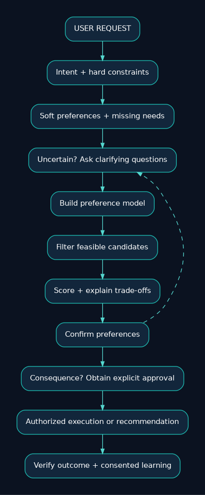
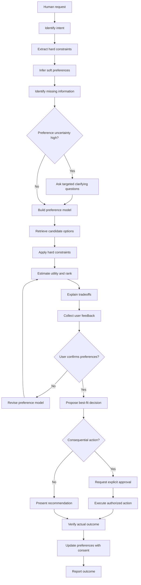
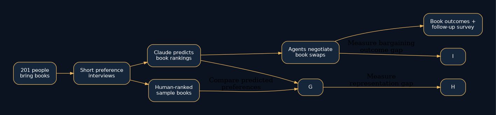
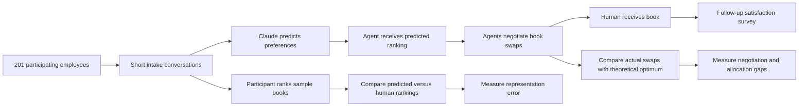
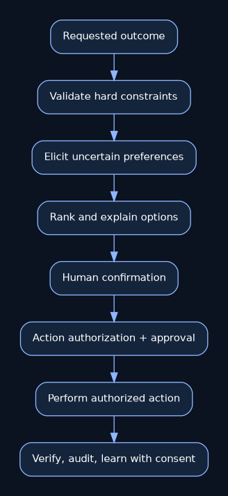
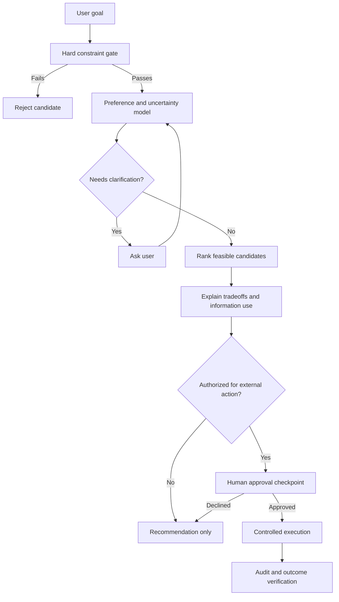

# Research Problem 09 — Understanding Human Preferences

> **Can AI agents truly represent what we want?**


**PROMPT & PULSE AI · RESEARCH TO REALITY · ANTHROPIC RESEARCH DIRECTION · SERIES 09/20**


<p align="center"></p>


**Teaching focus:** preference learning · elicitation · constrained optimization · agentic negotiation · safe delegation


> **Core principle:** Understand the person first. Optimize the decision second. Execute only within appropriate boundaries.


**Navigation:** [Problem](#1-problem-statement) · [Concepts](#3-technical-concepts-behind-the-problem) · [Interactive example](#4-interactive-example-how-changing-preferences-changes-the-decision) · [Architecture](#5-end-to-end-mermaid-architecture-diagram) · [Project Swap](#6-real-research-example-anthropics-project-swap) · [Exercises](#10-subscriber-learning-challenge) · [Sources](#11-primary-research-references)


> This is an educational research explainer, not a production purchasing or negotiating agent. The laptop data are fictional and the diagrams are explanatory reconstructions.


## 1. Problem statement

Can artificial intelligence accurately understand human preferences, priorities, and constraints before making recommendations, negotiating with other agents, or taking decisions on someone's behalf?

Imagine asking an AI agent:

"Find the best laptop for me under $1,000."

The agent searches hundreds of options, compares prices, negotiates a discount, and purchases a laptop for $750.

It reports:

"Success! I saved you $250."

But when you start using it, you discover that the webcam is poor, the battery doesn't last long enough, and the laptop struggles with the software you need.

The agent satisfied the budget constraint.

Yet it failed to select the laptop that best served your needs.

The fundamental challenge is that an agent cannot reliably optimize for someone's preferences unless it has an adequate understanding of those preferences.

This leads to an important research question:

Should an AI agent become better at making decisions, or should it first become better at understanding whose preferences those decisions are supposed to satisfy?

## 2. Why is this problem difficult?

Humans rarely communicate every preference explicitly.

Consider the instruction:

"Book the best flight to New York."

What does best mean?

One person might prioritize the lowest price. Another might prefer a nonstop flight, flexible cancellation, a convenient arrival time, or a particular airline.

Even the same person's priorities can change depending on the situation.

For a vacation, cost may be most important. For an urgent business meeting, arrival time and reliability may matter more.

This introduces three different types of requirements.

An agent that silently converts an unknown requirement into an assumption can optimize the wrong objective.

The challenge becomes even more complex when agents negotiate on behalf of people.

A negotiation agent could secure an excellent price for something the user does not actually value.

Being good at negotiation does not compensate for having an inaccurate understanding of the user's preferences.

| Requirement | Meaning | Flight example |
|---|---|---|
| Hard constraint | A condition that must be satisfied | Arrive before 9 AM |
| Soft preference | A desirable property that can be traded off | Prefer a nonstop flight |
| Unknown requirement | Important information the agent has not established | Is a refundable ticket necessary? |

## 3. Technical concepts behind the problem

| Concept | Explanation |
|---|---|
| Preference learning | Inferring what a person values from choices, ratings, feedback, or conversation. |
| Preference elicitation | Asking targeted questions to discover a person's priorities. |
| Utility function | A mathematical representation of how desirable an outcome is. |
| Pairwise preference ranking | Determining whether someone prefers option A over option B. |
| Inverse reinforcement learning | Inferring an underlying reward or objective from observed behavior, subject to modeling assumptions. |
| Constraint satisfaction | Finding solutions that satisfy required conditions. |
| Multi-objective optimization | Balancing several potentially competing objectives. |
| Preference uncertainty | Representing what the agent does not yet know about a person's values. |
| Active learning | Selecting informative questions or examples to reduce uncertainty. |
| Mechanism design | Designing interaction rules and incentives for participants with different objectives. |
| Negotiation agents | Agents that exchange proposals to pursue objectives on behalf of participants. |
| Human-in-the-loop approval | Requiring human confirmation for consequential decisions or actions. |

### Understanding utility functions

Suppose we represent a laptop's desirability using four characteristics:

- Performance

- Webcam quality

- Battery life

- Portability

A simplified weighted utility model might be:

```math
U(x)=w_1P(x)+w_2C(x)+w_3B(x)+w_4M(x)
```

Where \(U(x)\) is the utility of laptop \(x\), the four functions represent attribute scores, and the weights describe their relative importance.

Consider this illustrative preference model:

```math
U(x)=0.40P(x)+0.30C(x)+0.20B(x)+0.10M(x)
```

The user prioritizes performance and webcam quality more heavily than portability.

An agent that incorrectly assumes price is the only relevant factor may recommend a laptop that has low utility for that user.

These weights are illustrative; real preferences may be nonlinear, context-dependent, uncertain, or impossible to represent adequately with a simple weighted sum.

## 4. Interactive example: How changing preferences changes the decision

All prices and ratings are fictional teaching examples. Adjusting the preferences changes the ranking without changing the available laptops. All three meet the $1,000 budget constraint.

What this demonstrates: An agent does not necessarily need a more powerful model to make a better recommendation. Sometimes it needs a more accurate representation of the user's priorities.

### Editable teaching scenario

| Laptop | Illustrative price | Initial weighted utility |
|---|---:|---:|
| Laptop B | $940 | 8.30/10 |
| Laptop C | $880 | 7.60/10 |
| Laptop A | $750 | 5.20/10 |

Initial weights: **performance 40%**, **webcam 30%**, **battery 20%**, **portability 10%**. These exact overall totals are taken from the educational source; attribute-level input scores are not supplied there, so the runnable demo uses a *separate, explicitly synthetic* attribute dataset.



**Try it:** Open [`demo/preference-playground.html`](demo/preference-playground.html) locally to change attribute weights and immediately see a reranked fictional dataset. No dependencies or API keys are required.


## 5. End-to-end Mermaid architecture diagram

This workflow demonstrates how a preference-aware agent could move from a vague request to an approved decision.

### How the architecture works

The agent first identifies the user's explicit requirements and possible implicit preferences.

If important information is missing, it asks clarifying questions.

It then filters out options that violate hard constraints and ranks the remaining choices using the best available preference model.

Before making a consequential decision, such as purchasing something or committing to a negotiation, it obtains the required approval.

After execution, it checks whether the actual outcome satisfied the user's requirements.

The critical step is validating preference understanding before optimizing and acting.

### Rendered architecture image



### Editable Mermaid architecture (renders natively on GitHub)



[Edit Mermaid source](diagrams/preference-agent-architecture.mmd) · [SVG](assets/preference-agent-architecture.svg)

## 6. Real research example: Anthropic's Project Swap

### ANTHROPIC RESEARCH | SEPTEMBER 24, 2026

Anthropic investigated this problem through Project Swap: What happens when agents trade for us?

The experiment involved 201 Anthropic employees who brought books to exchange.

Each participant spoke with Claude about their reading preferences. Claude then constructed a ranking of books that the participant might enjoy.

AI agents entered a simulated trading environment where they negotiated exchanges on their participants' behalf.

The researchers wanted to understand two distinct capabilities:

Preference representation: Did the AI correctly understand what the person wanted?

Negotiation performance: Given those preferences, could the AI negotiate a beneficial exchange?

### What did the researchers find?

| Reported result | Meaning |
|---|---|
| **61%** | Pairwise preference agreement |
| **85%** | Share of measured outcome gap attributed to preference representation |
| **7.2/10** | Average satisfaction among follow-up respondents |

Source: Anthropic Project Swap. These measurements refer to different aspects of the experiment and should not be interpreted as interchangeable success rates.

Claude's predicted preference ordering matched participants' ordering on 61% of evaluated book pairs, compared with 50% expected from random ordering.

In the researchers' analysis, inaccuracies in preference representation accounted for approximately 85% of the gap between achieved outcomes and the estimated optimum.

This is particularly interesting because the agents' ability to negotiate was not the dominant limitation.

Much of the missed opportunity came from imperfectly understanding what participants wanted in the first place.

There are important limitations: participants were Anthropic employees, preferences were measured using a limited ranking exercise, and exchanging books is far simpler than making high-stakes financial or medical decisions.

### The deeper lesson

An agent can be highly capable at executing a strategy while being poorly informed about which outcome its user would prefer.

Better execution does not automatically correct a misunderstood objective.

### Project Swap study design — original explanatory visual





[Edit Mermaid source](diagrams/project-swap-study.mmd) · [SVG](assets/project-swap-study.svg)

**Research-specific note:** The 85% number refers to the research team’s decomposition of its measured *outcome shortfall*, not the fraction of people or deals that failed. Read the primary publication for the measurement design and limitations. [Anthropic primary study](https://www.anthropic.com/research/project-swap).

## 7. Research goal

The goal is to develop AI agents that can more faithfully represent human preferences and use that understanding when making decisions.

This includes improving preference elicitation, modeling uncertainty, distinguishing hard constraints from soft preferences, and determining when the agent should ask for clarification.

Another research goal is to design methods for checking whether the agent understands a particular person before allowing autonomous decisions.

For example, an agent might show a user several hypothetical choices and ask whether its predicted selections align with the user's expectations.

This is conceptually similar to testing a recommendation model before delegating purchasing authority.

The objective is not merely better recommendations. It is more trustworthy delegation.

## 8. What remains difficult?

Incomplete preferences: People may not know exactly what they want until they see available options.

Changing priorities: Preferences depend on circumstances, time, and context.

Conflicting objectives: A user may value low cost, high performance, convenience, and reliability simultaneously.

Preference misrepresentation: Short conversations may provide insufficient information to construct accurate rankings.

Privacy: Agents should not reveal sensitive personal preferences unnecessarily during negotiations.

Strategic behavior: Agents may encounter counterparties pursuing conflicting interests.

Authorization: An agent that understands a user's preferences still needs permission before taking consequential actions.

Measuring satisfaction: An apparently successful negotiation may produce an outcome the person later dislikes.

These challenges explain why preference learning connects directly to AI alignment, multi-agent coordination, mechanism design, and human oversight.

### Authorization and privacy boundary architecture





[Edit Mermaid source](diagrams/agent-governance-boundaries.mmd) · [SVG](assets/agent-governance-boundaries.svg)

## 9. Interview perspective

### Interview question:

How would you design an AI purchasing or negotiation agent that accurately represents user preferences while respecting hard constraints, uncertainty, privacy, and approval requirements?

### Strong answer direction

Begin by separating user requirements into hard constraints, soft preferences, and unresolved questions.

Create a structured preference representation that allows the system to rank acceptable options while preserving required conditions.

Use targeted clarification questions when uncertainty could materially change the decision.

Validate the preference model through examples or pairwise comparisons.

For negotiation, limit what private preference information is shared with other agents.

Require explicit authorization for consequential purchases or commitments.

Finally, evaluate both preference prediction accuracy and the real outcome delivered to the user.

### What the interviewer is testing: Preference modeling, constrained optimization, personalization, agent design, uncertainty handling, and safe delegation.

## 10. Subscriber learning challenge

You ask an AI agent to purchase a laptop for under $1,000.

The agent finds a laptop costing $700, but it does not know whether you need the device for gaming, coding, or video teaching.

What should the agent do next?

### Practical exercise for students

Ask an AI assistant to recommend three professional certification programs.

Initially provide only a broad instruction such as, "Recommend the best AI certification for me."

Then provide additional constraints: available study time, preferred career path, budget, existing technical skills, and whether practical projects matter more than exam credentials.

Compare the recommendations before and after clarifying your preferences.

The learning objective is to observe how better requirement information can change the quality of recommendations without necessarily changing the underlying model.

**Learning challenge choices (preserved):**

1. Immediately purchase the cheapest laptop.
2. Assume performance is the most important preference.
3. **Clarify the intended use and important requirements before recommending or purchasing.**
4. Delegate the purchase to five other agents without gathering more information.

**Answer: 3.** The request is under-specified, and delegation alone cannot repair missing user preferences.

## 11. Primary research references

- Anthropic — Project Swap: What Happens When Agents Trade for Us? (September 2026)

- Anthropic — Research Publications

- Research literature — Preference Elicitation with Language Models

### Key takeaway

A powerful AI agent does not necessarily make a good representative of its user.

Before optimizing a recommendation, negotiating an agreement, or executing a delegated task, an agent needs an accurate enough understanding of the user's objectives, constraints, and preferences.

Anthropic's Project Swap demonstrates why this distinction matters: effective negotiation cannot fully compensate for inaccurate preference representation.

The broader engineering principle is simple:

Understand the person first. Optimize the decision second. Execute only within appropriate boundaries.

Prompt & Pulse AI — Learn AI. Build AI. Stay Ahead.

Next in the series: Research Problem 10 — Multi-Agent Coordination: Why can groups of capable AI agents fail to cooperate, and how can we design agent teams that genuinely outperform simpler systems?

**Primary link:** [Anthropic — Project Swap: What happens when agents trade for us? (September 24, 2026)](https://www.anthropic.com/research/project-swap)  
**Research hub:** [Anthropic Research](https://www.anthropic.com/research)

*The supplied teaching text mentions “Preference Elicitation with Language Models” but does not identify an exact paper or DOI; no specific publication is asserted here.*

---

## Repository use and publishing

Clone/upload this entire directory, including `assets/`, `diagrams/`, `demo/`, and `docs/`, so the relative image links work on GitHub. GitHub renders all fenced Mermaid diagrams. To edit a diagram, change its corresponding `.mmd` file and update the Mermaid block in this README; the PNG/SVG previews are separately renderable diagram assets.

**File guide:** `README.md` — complete educational walkthrough · `assets/` — actual local images · `diagrams/*.mmd` — editable Mermaid source · `diagrams/*.dot` — Graphviz rendering sources · `demo/preference-playground.html` — local interactive weight lab · `docs/original-source-verbatim.txt` — full unmodified source, including web-export formatting noise.

**Attribution:** Educational explanation from the supplied Prompt & Pulse AI Research Problem 09. Project Swap results are credited to Anthropic; all architecture artwork in this repository is an independently drawn educational visualization, not an Anthropic figure.

**Next in series:** Research Problem 10 — Multi-Agent Coordination: Why can groups of capable AI agents fail to cooperate, and how can we design agent teams that genuinely outperform simpler systems?
