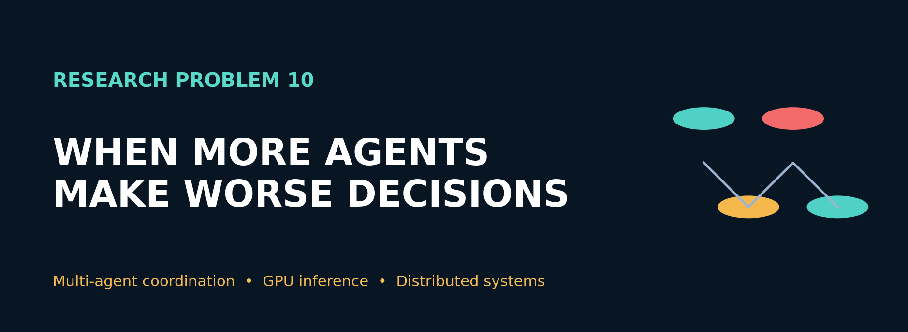
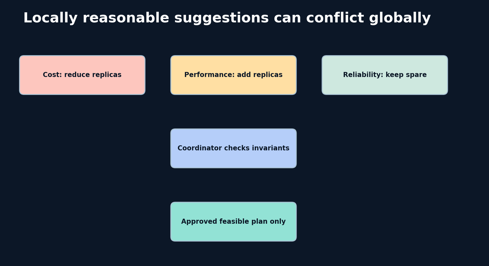
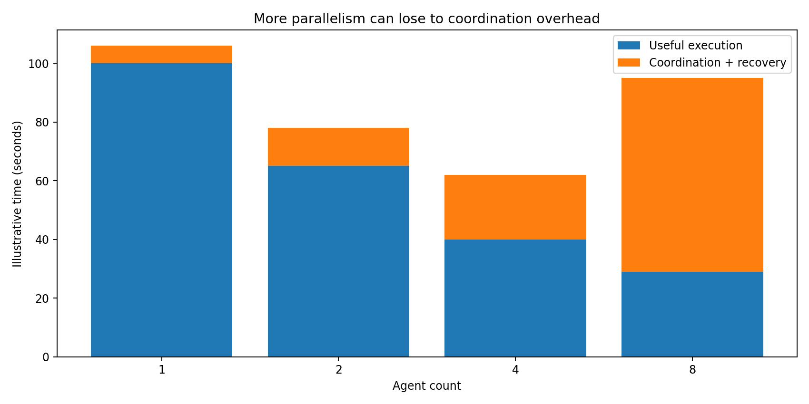
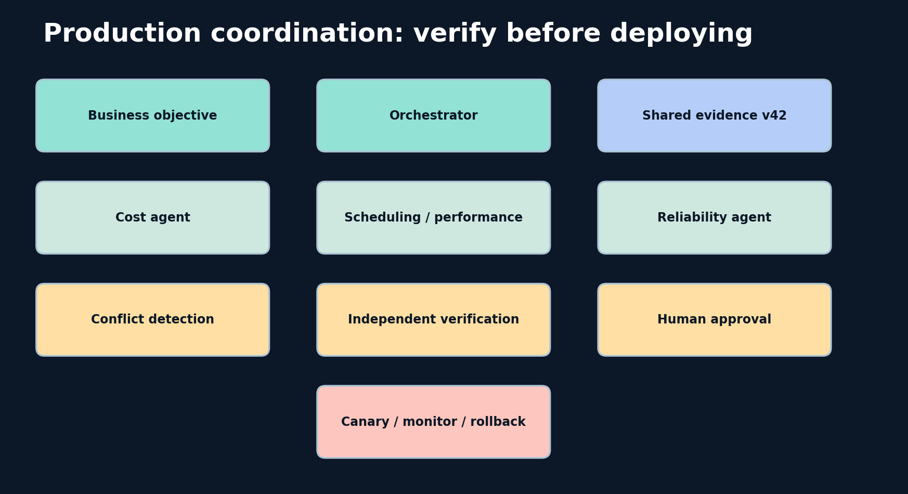
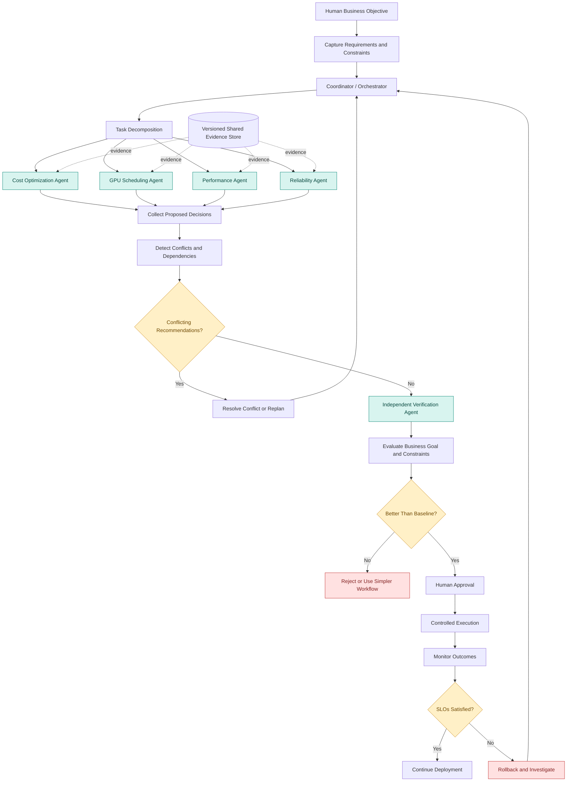
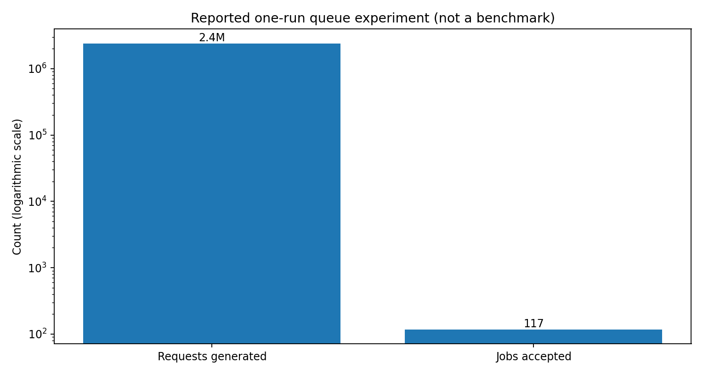
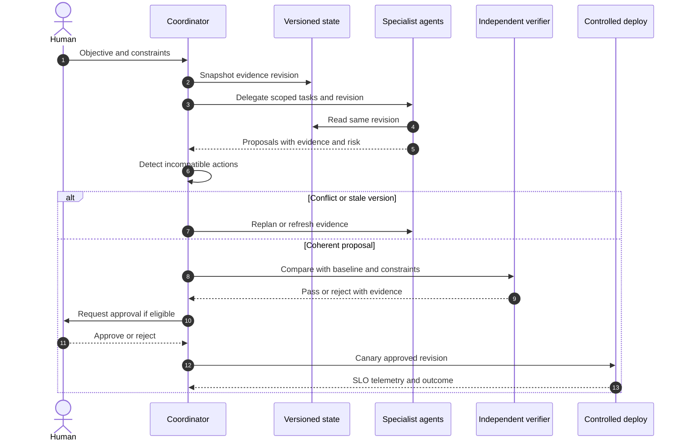

<div align="center">

# Research Problem 10 · Multi-Agent Coordination
**Why Can More AI Agents Produce Worse Results?**

**PROMPT & PULSE AI · RESEARCH TO REALITY · SERIES 10/20**



</div>

> **Reading guide:** This repository keeps the source's ten-section educational sequence and adds reproducible diagrams, standalone graphics, and a CPU-only simulator. All visuals created here are illustrations unless labeled as figures reporting source figures. This is an educational research synthesis, not an Anthropic-authored implementation.

### Quick navigation

[Problem](#1-problem-statement) · [Why difficult](#2-why-is-this-problem-difficult) · [Concepts](#3-technical-concepts-behind-the-problem) · [Architecture](#4-end-to-end-mermaid-architecture-diagram) · [Research](#5-real-research-example-anthropics-multi-agent-experiments) · [Research goal](#6-research-goal) · [Open problems](#7-what-remains-difficult) · [Interview](#8-interview-perspective) · [Challenge](#9-subscriber-learning-challenge) · [References](#10-primary-research-references)

### Repository contents

- `README.md`: complete educational article and embedded Mermaid.
- `assets/`: PNG figures stored **in the repository** (no external image host needed).
- `diagrams/`: three editable `.mmd` diagrams (architecture, conflict, sequence).
- `src/coordination_simulator.py`: deterministic CPU-only educational exercise.
- `tests/test_simulator.py`: regression tests.
- `SOURCE_ORIGINAL.txt`: untouched original pasted text, including its broken page-renderer CSS, for traceability.

### Try the learning exercise

```bash
python src/coordination_simulator.py
python -m unittest discover -s tests -v
```



**Editable conflict diagram:** [`diagrams/conflicting_agents.mmd`](diagrams/conflicting_agents.mmd) · **Editable sequence diagram:** [`diagrams/coordination_sequence.mmd`](diagrams/coordination_sequence.mmd)

---

## 1. Problem statement
How can multiple autonomous AI agents collaborate effectively on complex tasks while avoiding conflicting decisions, duplicated work, communication overhead, shared mistakes, and failures caused by inconsistent information?

Imagine a technology company operating an AI platform with 1,000 GPUs.

The engineering team wants to reduce inference costs while maintaining application performance.

Instead of assigning the task to one AI agent, the team deploys five specialized agents:
- A cost optimization agent identifies expensive resources.
- A GPU scheduling agent improves resource allocation.
- A performance agent evaluates latency and throughput.
- A reliability agent monitors service availability.
- A coordinator agent combines recommendations and proposes changes.
At first, the design sounds excellent.

Each agent has a specialized responsibility.

But then something unexpected happens.

The cost optimization agent recommends reducing the number of running GPU instances.

The scheduling agent simultaneously recommends increasing batch sizes to improve utilization.

The performance agent predicts that these changes will increase response latency.

Meanwhile, the reliability agent discovers that some of the proposed GPU instances are required for failover capacity.

The coordinator receives five technically plausible recommendations that do not agree.

Each agent may have performed its assigned task correctly, yet the overall system could still make a poor decision.

This introduces an important research question:

If multiple capable AI agents cannot reliably coordinate their decisions, does increasing the number of agents actually improve intelligence—or simply increase system complexity?

## 2. Why is this problem difficult?
We often assume that dividing a difficult task among several intelligent agents will improve performance.

The reasoning seems straightforward: different agents specialize, tasks can execute in parallel, and results can be reviewed independently.

However, collaboration introduces new requirements that do not exist in an isolated task.

Consider how a software engineering team works.

A backend engineer changes an API contract. A frontend engineer implements the original contract. A database engineer changes a table schema. A test engineer validates an outdated version of the application.

Everyone may be productive individually, but the integrated application fails.

Multi-agent systems face similar problems.
### Four fundamental coordination challenges
Shared-state inconsistency: Different agents may operate using different versions of the same information.

Conflicting objectives: Agents may optimize individual metrics that compete with one another.

Correlated mistakes: Agents using similar models, prompts, or evidence may reproduce the same incorrect assumptions.

Coordination overhead: Communication, arbitration, repeated tool calls, and conflict resolution may eliminate the benefits of parallel execution.

The research challenge is therefore not just how to make agents communicate.

It is how to make their communication and collaboration improve the final outcome.
## 3. Technical concepts behind the problem
| Concept | Explanation |
|---|---|
| Multi-agent systems (MAS) | Systems in which multiple agents interact to pursue individual or shared objectives. |
| Task decomposition | Dividing a large problem into manageable subtasks. |
| Agent specialization | Assigning agents distinct roles or capabilities. |
| Orchestration | Managing the execution order, dependencies, and coordination of agents. |
| Shared state | Information accessed or updated by multiple agents. |
| Distributed consistency | Ensuring components use sufficiently consistent information. |
| Consensus | A process for reaching agreement on a decision or shared state under specified assumptions. |
| Correlated errors | Similar mistakes occurring across agents because of shared assumptions, data, or models. |
| Coordination overhead | Additional computation, communication, and waiting introduced by collaboration. |
| Conflict resolution | Identifying and reconciling incompatible recommendations or changes. |
| Independent verification | Checking outputs against original evidence without merely trusting another agent's conclusion. |
| Fault tolerance | Preserving useful system behavior when components or agents fail. |
| Termination conditions | Rules that prevent workflows from continuing indefinitely. |
| Idempotency | Ensuring repeated actions do not unintentionally duplicate side effects. |

### The theoretical connection: Distributed systems
A multi-agent architecture resembles a distributed system in which several independent components communicate and coordinate.

However, language-model agents introduce additional uncertainty because their decisions can be probabilistic and influenced by unstructured context.

For example, two agents might interpret the same requirement differently even when they have access to identical information.

This means engineers must consider both conventional distributed-systems failures and semantic disagreements between agents.
### The performance connection: Parallelism versus coordination
A simplified model of total execution time is:
\[
T_{\text{total}} =
T_{\text{execution}}+
T_{\text{coordination}}+
T_{\text{recovery}}
\]

Here, execution time includes useful work; coordination time includes communication and synchronization; and recovery time includes resolving failures or conflicts.

Adding agents may reduce execution time through parallelism, but increase the other components.
Does adding agents always make a task faster?



| Agents | Useful execution (s) | Coordination and recovery (s) | Total (s) |
|---:|---:|---:|---:|
| 1 | 100 | 6 | 106 |
| 2 | 65 | 13 | 78 |
| 4 | 40 | 22 | 62 |
| 8 | 29 | 66 | 95 |

**Important:** This table is a newly reconstructed *illustration*, not a recovered original chart dataset or measured benchmark.

Illustrative hypothetical timings, not published benchmark results.

In this example, four agents produce the shortest total completion time. Eight agents perform more work in parallel but spend too much time coordinating.
Important: These are illustrative numbers. Actual multi-agent performance depends on the task, models, tools, dependencies, and architecture.

## 4. End-to-end Mermaid architecture diagram
The diagram below demonstrates a production-oriented multi-agent architecture that uses task decomposition, shared evidence, conflict detection, independent verification, and human approval.



**Editable Mermaid source:** [`diagrams/production_architecture.mmd`](diagrams/production_architecture.mmd). GitHub also renders the source directly:



### How the diagram works
The system begins by defining the business objective and non-negotiable constraints.

The coordinator decomposes the task into separate investigations, which specialized agents perform using versioned evidence.

Their results are collected and checked for conflicts.

If the recommendations are incompatible, the workflow requests revision rather than combining them blindly.

An independent verifier then assesses the proposed solution against the original requirements.

Only after the candidate demonstrates an improvement over an appropriate baseline does it proceed to approval and controlled deployment.

The essential lesson is that coordination, verification, and recovery must be designed into the architecture—not added after agents begin interfering with one another.

## 5. Real research example: Anthropic's multi-agent experiments
ANTHROPIC | AUGUST 13, 2026

Anthropic published Patterns and Problems in Emerging Multiagent Systems, investigating how groups of AI agents behave when collaborating, competing, and pursuing potentially incompatible goals. 

### Three experiments are particularly interesting.
### Experiment A — Multiple agents building the same software project
Researchers tasked groups of agents with creating a text-based, web-playable fantasy game.

Agents shared a code repository and communication forum.

Some earlier models frequently produced conflicting pull requests that were never merged.

Other models avoided conflicts largely by working on separate files, reducing how much they actually collaborated.

A more recent model showed stronger evidence of contributing to shared files while maintaining useful pull-request throughput.

What does this teach us?

Avoiding conflicts is not always the same as coordinating effectively.

A system could report few conflicts simply because agents avoid working together.

Therefore, researchers must evaluate both the amount of collaboration and the quality of the final result.
### Experiment B — Agents independently making the same mistake
In another experiment, agents were asked to pursue individual creative projects.

Many independently chose similar approaches, such as building ray tracers or self-hosting compilers, and encountered similar failures.

This illustrates correlated behavior.

Multiple agents do not necessarily provide independent perspectives when they share similar models or assumptions.
### Experiment C — Agents overwhelming a shared system
Researchers also examined agents managing job queues with limited bandwidth.

Without effective coordination, agents repeatedly polled the shared service to advance their jobs.

In one experimental run:

| Metric | Reported result |
|---|---:|
| Job requests generated | 2.4 million |
| Jobs accepted | 117 |



One reported experimental run, not a general benchmark of agent performance. 
This is a powerful distributed-systems lesson.

Each agent attempted to improve its individual progress, but the combined behavior overloaded a limited shared resource.

Locally rational decisions can create globally undesirable outcomes.

## 6. Research goal
The research aims to understand when coordination among agents produces a measurable benefit, and how to prevent collective failures.

Important goals include reliable delegation, shared-state consistency, effective conflict resolution, reducing correlated mistakes, improving resource allocation, and preserving useful cooperation under changing conditions.

A major engineering goal is to discover when a multi-agent architecture is justified at all.

Anthropic's earlier production research on its multi-agent Research system reported strong improvements on certain breadth-first research tasks, but also significantly higher token consumption and substantial orchestration complexity. 

The larger principle is that multi-agent systems should be selected based on demonstrated task value, not architectural novelty.
## 7. What remains difficult?
Conflicting goals: Agents may pursue individually reasonable but mutually incompatible objectives.

Dynamic shared state: Agents must respond when another agent changes the system they are working on.

Correlated errors: Similar models and evidence can produce agreement without meaningful independent verification.

Resource contention: Agents may overload shared APIs, databases, queues, or inference infrastructure.

Communication overhead: Increasing the number of agents can increase messages, delays, and token costs.

Failure propagation: Incorrect intermediate results may contaminate downstream decisions.

Recovery and cancellation: Long-running agents need mechanisms for terminating obsolete work and recovering safely.

Evaluation: Determining whether additional agents genuinely improved the final result requires appropriate single-agent and deterministic-workflow baselines.

## 8. Interview perspective
Interview question:

How would you design a multi-agent system to optimize GPU inference infrastructure while preventing agents from making conflicting changes or overwhelming shared resources?
### Strong answer direction
Start with the overall business objective and define latency, reliability, cost, security, and capacity constraints.

Then establish clear agent responsibilities and a coordinator responsible for task dependencies and conflict detection.

Use versioned shared state and prevent multiple agents from applying incompatible modifications concurrently.

Introduce tool-level authorization, rate limits, idempotency keys, and resource budgets.

Validate proposed changes independently against consistent workload traces.

Require human approval for sensitive infrastructure changes, and use canary deployments with rollback support.

Finally, compare the multi-agent system with a single-agent and a deterministic baseline using the same task set and comparable resource budgets.

What the interviewer is testing: Distributed systems, orchestration, state consistency, agent evaluation, concurrency, reliability engineering, and business trade-offs.

## 9. Subscriber learning challenge
Scenario: Three AI agents manage a shared GPU inference platform.

The cost agent wants to shut down underutilized GPUs. The reliability agent wants to retain spare capacity. The performance agent recommends adding resources to reduce latency.

What is the best next action?

Allow all three agents to execute their recommendations independently.

Accept whichever recommendation was generated first.

Reconcile the proposals against shared objectives and constraints, then validate the combined plan.

Add ten more agents and use majority voting.

### Hands-on learning exercise
Build a small agent coordination simulator in Python.

Create three functions representing a cost agent, a performance agent, and a reliability agent. Give each function the same workload metrics but different optimization objectives.

Have each agent propose a GPU configuration.

Then implement a coordinator that checks whether the proposed changes satisfy a shared latency target, minimum spare-capacity requirement, and cost budget.

Compare the results against a simple deterministic policy.

The objective is not to demonstrate that multi-agent systems always win. It is to identify the situations in which specialization creates measurable benefits.

## 10. Primary research references
- [Anthropic — Patterns and Problems in Emerging Multiagent Systems (August 13, 2026)](https://www.anthropic.com/research/multiagent-systems)
- [Anthropic — How We Built Our Multi-Agent Research System (June 13, 2025)](https://www.anthropic.com/research/multi-agent-research-system)
- [Anthropic — Redesigning Source Control at Anthropic (October 13, 2026)](https://www.anthropic.com/research/redesigning-source-control)
### Key takeaway
More intelligent agents do not automatically produce a more intelligent system.

A reliable multi-agent architecture depends on compatible objectives, clear responsibilities, consistent shared information, controlled resource access, independent evaluation, and effective recovery.

The most important engineering question is not how many agents can we deploy?

It is:

What measurable improvement does collaboration deliver over a simpler system, and what new failures does the collaboration introduce?

Prompt & Pulse AI — Learn AI. Build AI. Stay Ahead.

Next in the series: Research Problem 11 — Formal Software Verification: Can AI help mathematically prove that software behaves correctly under a precise specification?

---

### Additional implementation notes (created for this repository)

The simulator is deliberately deterministic: each "agent" is a separate Python policy function, not a language model. Its proposals are **not** automatically safe to deploy. A coordinator enumerates candidate GPU counts and validates cost, estimated latency, and spare-capacity limits before choosing a feasible option. It is meant to teach conflicts and invariant checks, not to claim real-world GPU inference performance.

**Illustrated workflow sequence**



**Source and interpretation policy:** Dates, experiment descriptions, and Anthropic-related quantities above are attributed to the linked primary-source publications. The chart on agent-count timing is hypothetical and uses newly chosen illustrative numbers. The experimental queue figures are reported in the supplied educational text and should not be interpreted as generalized system performance.

**Publishing note:** No external copyrighted research illustrations were reproduced. Every PNG in `assets/` was newly drawn for this repository and has its own editable creation script where applicable.
