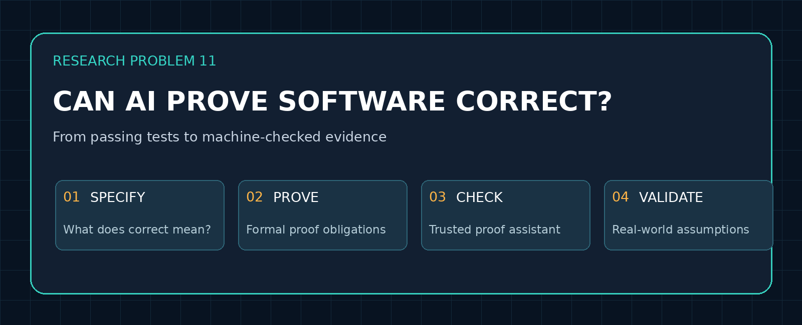
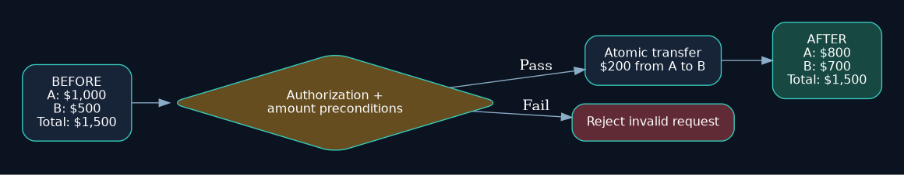
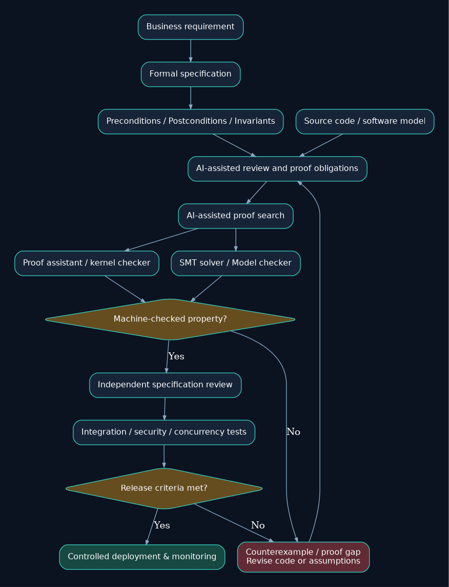
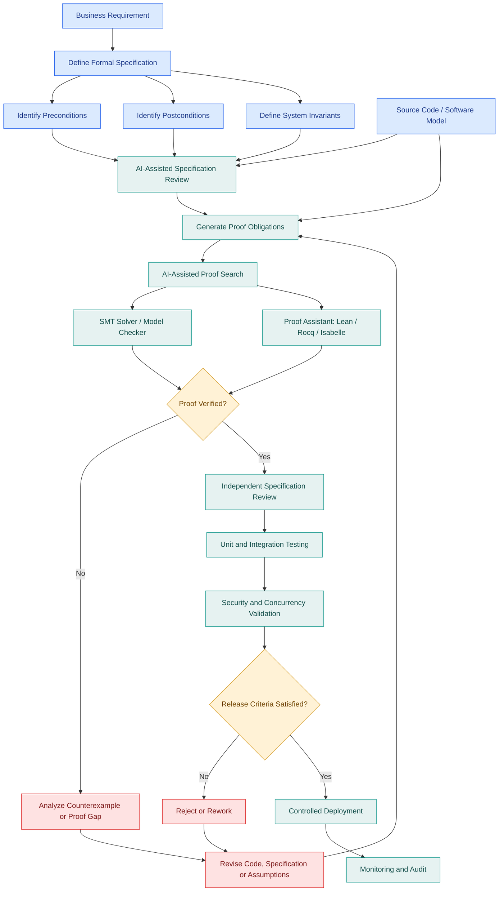
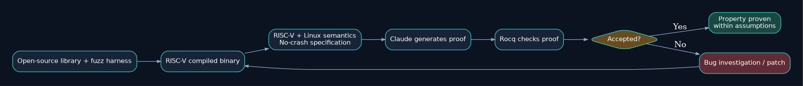
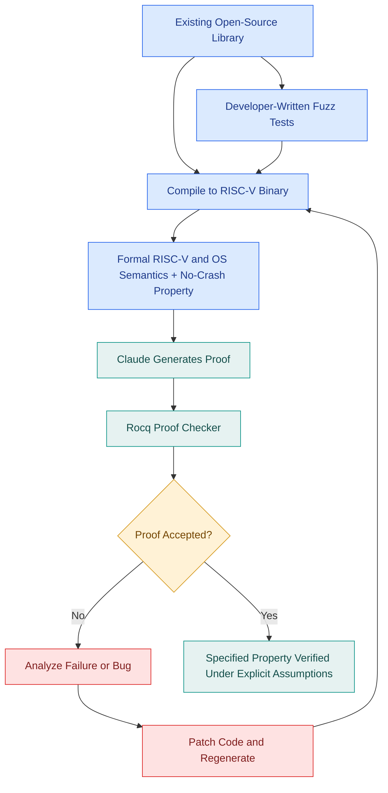

# Research Problem 11: Formal Software Verification — Can AI Mathematically Prove That Software Is Correct?

**PROMPT & PULSE AI | RESEARCH TO REALITY | ANTHROPIC RESEARCH DIRECTION | SERIES 11/20**




> **Source preservation:** This README follows all 10 sections of the supplied educational explanation, including the banking scenario, formal definitions, mathematical derivation, Anthropic's reported results, interview question, learning challenge, references and next-series note. The pasted source exported diagrams as CSS and node labels rather than editable Mermaid definitions, so their flows have been reconstructed as new editable Mermaid files and locally rendered diagrams.

**Jump to:** [Problem](#1-problem-statement) · [Theory](#3-technical-concepts-behind-the-problem) · [Architecture](#4-end-to-end-mermaid-architecture-diagram) · [Anthropic research](#5-real-research-example-anthropics-ai-assisted-formal-verification) · [Practice](#9-subscriber-learning-challenge) · [References](#10-primary-research-references)

---

PROMPT & PULSE AI | RESEARCH TO REALITY | ANTHROPIC RESEARCH DIRECTION | SERIES 11/20
## 1. Problem statement
Can artificial intelligence help engineers generate, understand, and verify mathematical proofs that software satisfies precisely defined requirements, reducing reliance on testing alone?

Imagine a bank operating a payment-processing platform that handles millions of financial transactions.

The engineering team deploys an AI coding agent to improve its payment transfer service.

The agent modifies the application, runs 10,000 unit tests, and reports:

"All tests passed. The updated payment service is ready for production."

That sounds reassuring.

But the engineering team has an important question:

**Do 10,000 passing tests prove that the application will behave correctly for every possible transaction?**

**No.**

Tests evaluate particular inputs and execution conditions. They may miss rare boundary cases, concurrency problems, unexpected state transitions, or subtle arithmetic errors.

Consider a transfer between two accounts.

**Before the transfer:**
- Account A has $1,000.
- Account B has $500.
- Total balance is $1,500.
The application transfers $200 from A to B.



[Editable transfer diagram](diagrams/bank-transfer-contract.mmd)

**After the transfer:**
- Account A should have $800.
- Account B should have $700.
- Total balance should remain $1,500.
The business expects the system to preserve the total balance.

But what if a concurrency defect causes the money to be deducted twice? What if the transfer succeeds even though the user lacks authorization?

Testing can help discover these problems.

Formal verification investigates whether we can establish stronger guarantees for specified properties using mathematics.

The central research question is not whether AI can write code that passes tests, but whether AI can help produce machine-checkable evidence that important software properties hold under explicitly defined assumptions.

## 2. Why is this problem difficult?
Most software development relies on several forms of validation.

Developers write unit tests, integration tests, system tests, and regression tests.

These methods are essential, but they generally evaluate selected executions.

Imagine a function with a 64-bit integer input.

There are potentially \(2^{64}\) different input values for that variable alone.

Testing every possible value may be impractical, especially when the software also depends on databases, concurrent requests, network failures, and external services.

Formal methods take a different approach.

Rather than examining only individual examples, researchers describe properties that should hold across an entire defined class of program states or executions.

For example:

"For every valid transfer, money must not be created or destroyed."

Or:

"A user without the required permission must never execute a protected operation."

The difficulty is that real software contains complex state, concurrency, external dependencies, and assumptions that must be modeled correctly.

AI research explores whether models can help engineers construct these specifications and proofs more efficiently.
### Three different kinds of evidence
| Approach | Question it answers | Limitation |
|---|---|---|
| Testing | Does the software behave correctly for the tested cases? | Untested cases may fail. |
| Formal verification | Does the formalized system satisfy a specified property under its assumptions? | The specification or model may omit important requirements. |
| Production monitoring | Is the deployed system behaving acceptably in observed operation? | Detection may occur after a failure, and some failures may remain unobserved. |

These approaches complement one another.

A formally verified property does not eliminate the need for integration testing, operational monitoring, or appropriate security controls.

## 3. Technical concepts behind the problem
| Technical concept | What students should understand |
|---|---|
| Formal methods | Mathematical techniques for specifying and reasoning about software behavior. |
| Formal specification | A precise mathematical description of required system properties. |
| Hoare logic | A framework for reasoning about program correctness through preconditions and postconditions. |
| Precondition | A condition assumed to hold before executing an operation. |
| Postcondition | A property required to hold after execution, under the relevant assumptions. |
| Invariant | A property that remains true throughout specified system states or transitions. |
| SMT solver | A tool for determining satisfiability of logical formulas involving theories such as arithmetic and arrays. |
| Model checking | Systematically exploring a model's states or transitions to verify specified properties. |
| Symbolic execution | Executing a representation of a program with symbolic rather than only concrete inputs. |
| Dependent types | Types that can express properties involving values. |
| Proof assistant | Software that supports construction and checking of formal mathematical proofs. |
| Lean 4 | A theorem prover and programming language used for machine-checked formal reasoning. |
| Proof obligations | Conditions that must be established for a verification claim to hold. |
| Soundness | The property that a proof system's valid derivations establish statements according to its formal rules and assumptions. |

### Understanding Hoare logic
One foundational expression in program verification is:
\[
\{P\}\ C\ \{Q\}
\]

Where:
- \(P\) is the precondition.
- \(C\) is the program or operation.
- \(Q\) is the postcondition.
A Hoare triple expresses partial correctness: if the precondition holds and the operation terminates normally, the postcondition holds. Proving termination requires additional reasoning for total correctness.

Let's apply this to a banking transfer.

Suppose:
\[
A=1000,\quad B=500,\quad t=200
\]

The transfer operation is:
\[
A'=A-t
\]

\[
B'=B+t
\]

The required conservation property is:
\[
A'+B'=A+B
\]

Substituting:
\[
(A-t)+(B+t)=A+B
\]

The transfer amount cancels, establishing the property mathematically under the assumed arithmetic semantics.

This small proof illustrates the idea behind formal verification.

However, it does not establish that the transaction was authorized, that the database update was atomic, or that arithmetic overflow cannot occur.

Those require additional specifications and proofs.

## 4. End-to-end Mermaid architecture diagram
The following architecture demonstrates how AI-assisted formal verification could work in a production software engineering environment.


[Editable Mermaid source](diagrams/verification-architecture.mmd) | [SVG image](assets/verification-architecture.svg)




### How the architecture works
The team begins with a business requirement and translates it into a precise formal specification.

The specification identifies assumptions, preconditions, postconditions, and invariants.

An AI system may help identify proof obligations, propose invariants, or generate candidate proof steps.

Solvers and proof assistants then check the relevant mathematical claims.

If a proof fails, engineers investigate whether the implementation contains a defect, the assumptions are insufficient, or the specification needs correction.

Even when a proof succeeds, independent review must confirm that the theorem captures the actual business requirement.

The verified components then proceed through integration testing, security validation, and operational release checks.

The most important principle is that proving the wrong specification correctly does not make the software correct for the user's actual needs.

## 5. Real research example: Anthropic's AI-assisted formal verification
**ANTHROPIC RESEARCH | OCTOBER 22, 2026**


Anthropic published a research report titled LLMs Are Making Formal Software Verification Feasible at a Much Larger Scale.

The research addresses a major limitation of traditional formal methods: constructing mathematical proofs for real-world software has historically required enormous amounts of specialized engineering effort.

Anthropic collaborated with Theorem to investigate whether Claude could automate much of that proof construction.
### What did the researchers demonstrate?
| Reported metric | Value |
|---|---:|
| Open-source libraries covered | **123** |
| Fuzz-test entry points proved | **239** |
| Approximate lines of Rocq proof code | **180 million** |


The researchers reported generating machine-checked proofs for no-crash properties of compiled RISC-V binaries under specific conditions, including inputs smaller than 64 MB, a single-threaded execution model, and defined operating-system assumptions. 


The distinction is important: this was not a proof that all 123 libraries were completely bug-free. It established particular properties for specified entry points under a formal execution model.
### How did the process work?


[Editable Mermaid source](diagrams/anthropic-proof-pipeline.mmd) | [SVG image](assets/anthropic-proof-pipeline.svg)




This illustrates a promising division of responsibilities:

AI proposes and constructs a proof; a separate proof checker verifies the formal argument.

The verification guarantee still depends on the formal specification, the proof checker, and the modeled hardware and operating-system semantics being appropriate.
### Why is this research significant?
Formal verification is often expensive because proving a program property can require detailed reasoning about many execution paths.

AI can help automate repetitive proof construction, investigate difficult proof obligations, and identify defects that ordinary tests may miss.

In Anthropic's experiments, the verification process also helped reveal previously undetected bugs.

This research suggests a direction in which formal verification could become more accessible to ordinary software development teams, although its generality, costs, and practical limitations still require further investigation.

## 6. Research goal
The long-term goal is to make rigorous software verification practical at a much larger scale.

Specifically, researchers want AI systems to help translate requirements into formal properties, construct mathematical proofs, discover defects during proof attempts, and reuse verification artifacts across software components.

The intended benefit is stronger confidence in critical software properties without requiring engineers to manually construct every proof step.

However, AI-generated proofs should remain subject to independent checking, specification review, and validation against real-world execution assumptions.

## 7. What remains difficult?
Specification completeness: A mathematically valid proof may establish a property that is narrower than the actual business requirement.

Trusted computing base: Proof correctness depends on the relevant verifier, semantics, and assumptions.

Concurrency: Many production systems contain threads, asynchronous operations, distributed state, and race conditions that complicate verification.

External dependencies: Real applications interact with databases, networks, operating systems, and third-party services.

Scalability: Formal proofs may be extremely large and computationally expensive to generate.

Behavior preservation: If an AI system modifies code to make a proof succeed, engineers must verify that the modification has not removed required functionality.

Deployment differences: A proof about one compiled binary and execution model does not automatically apply to a different architecture or runtime environment.

These are not reasons to avoid formal verification. They define where future research and engineering improvements are needed.

## 8. Interview perspective
**Interview question:**

How would you use AI-assisted formal verification to improve the reliability of a mission-critical banking transfer service? What guarantees would you expect, and what would remain unverified?
### Strong answer direction
Begin with the business requirements and identify properties that can be expressed precisely.

For example, define balance conservation, transfer authorization, valid amount handling, and protection against duplicate operations.

Translate those requirements into preconditions, postconditions, and invariants.

Use AI to assist with specification development and proof construction, but rely on trusted verification tools to check the resulting formal arguments.

Clearly identify the assumptions governing arithmetic, concurrency, database transactions, and external services.

After formal checking, conduct integration tests, security reviews, and operational validation.

Finally, explain which properties have actually been proved and which risks remain outside the verification scope.

What the interviewer is testing: Formal reasoning, software correctness, security, specification design, verification tooling, and the ability to distinguish mathematical guarantees from operational assumptions.

## 9. Subscriber learning challenge
Scenario: An AI agent generates a formal proof showing that a banking transfer function preserves the combined balance of two accounts.

The proof checker accepts the theorem.

**Can the engineering team conclude that the banking application is completely secure and correct?**

- **A.** Yes. A machine-checked proof guarantees that no software bugs exist.
- **B.** Yes. Formal verification automatically includes authorization and concurrency safety.
- **C.** No. The proof establishes only its specified property under its assumptions.
- **D.** No. Mathematical proofs cannot establish useful software properties.

<details><summary>Reveal answer</summary>

**C is correct.** A checked theorem proves only the specified property under its stated assumptions; security, authorization, concurrency, and deployment behavior require separate analysis.

</details>


### Practical experiment for students
Consider this simple Python function:
```python
def transfer(balance_a: int, balance_b: int, amount: int):
    return balance_a - amount, balance_b + amount
```


Try to establish the invariant:
\[
A'+B'=A+B
\]

Then investigate what happens when the amount is negative, exceeds the available balance, or is represented using a fixed-width integer type.

Next, write down separate properties that the original conservation equation does not capture.

For example, requiring the sender to have sufficient funds is a different property from preserving the total balance.

For students who want to explore machine-checked proofs, Lean provides an accessible starting point for learning formal reasoning.

## 10. Primary research references
- Anthropic — [LLMs Are Making Formal Software Verification Feasible at a Much Larger Scale](https://www.anthropic.com/research/formal-verification) (October 22, 2026)
- Lean — [Official Learning Resources](https://lean-lang.org/learn/)
- Rocq — [Official Proof Assistant Documentation](https://rocq-prover.org/)
- Anthropic — Formalizing Fermat's Last Theorem (September 2026; source link not supplied)
## Key takeaway
Passing tests provides evidence that software works for tested cases. Formal verification can establish specified properties across a mathematically defined set of behaviors. AI may help make those proofs substantially easier to construct.

The most important engineering lesson is that correctness must be defined before it can be proved.

A machine-checked proof is powerful evidence, but its guarantee extends only as far as the theorem, assumptions, and execution model justify.

Prompt & Pulse AI — Learn AI. Build AI. Stay Ahead.

Next in the series: Research Problem 12 — Mathematical Discovery and Formalization: Can AI generate mathematical conjectures, construct proofs, and help turn complex mathematical reasoning into independently checkable results?

---

## Reproducible learning lab (additional material)

The original classroom example uses mathematical integers and proves only **balance conservation**. Explore it with the runnable script in [`examples/transfer_lab.py`](examples/transfer_lab.py):

```bash
python examples/transfer_lab.py
python -m unittest discover -s examples -p 'test_*.py' -v
```

A stronger banking contract additionally requires a nonnegative transfer amount, sufficient funds, authorization, bounded arithmetic, idempotency, and atomic database updates. The runnable example checks only a subset of these. It is **not** a proof of production banking safety.

### Diagram editing

The diagram code is present both as GitHub-rendered `mermaid` blocks in this README and standalone [`diagrams/*.mmd`](diagrams/) files. You can edit the `.mmd` files in any text editor or Mermaid Live Editor; the PNGs and SVGs under `assets/` are already rendered and work offline. Graphviz `.dot` files are also included for regenerating the shipped visual assets.

### Research scope and source notes

The October 22, 2026 Anthropic article reports **123 libraries**, **239 fuzz entry points**, and approximately **180 million lines** of Rocq proofs. These are research-team-reported figures, **not results reproduced by this educational repository**. The no-crash guarantees apply to modeled, single-threaded static RISC-V/Linux binaries for inputs below 64 MB under the documented assumptions, not to every property of the libraries. See the [primary source](https://www.anthropic.com/research/formal-verification). The source's phrase “no-crash” should not be mistaken for total functional correctness or blanket security certification.

**License note:** Original educational text supplied by the repository author. Locally generated diagrams and illustrations may be modified. The third-party Anthropic research is linked, not copied into the repository.
