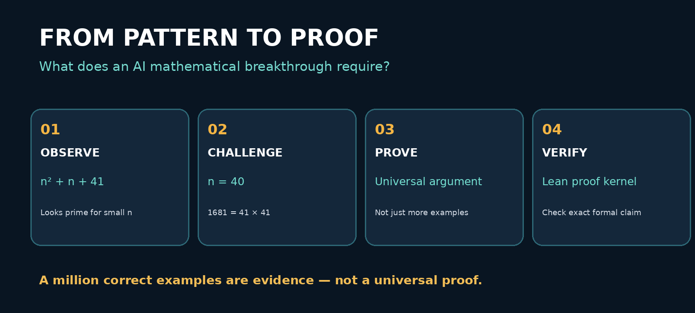
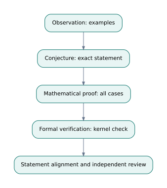
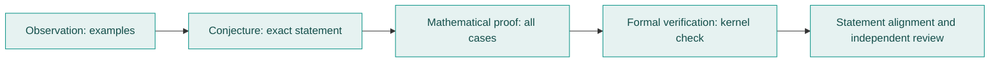
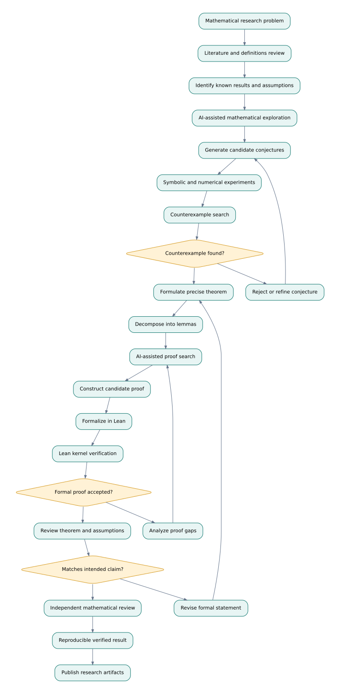
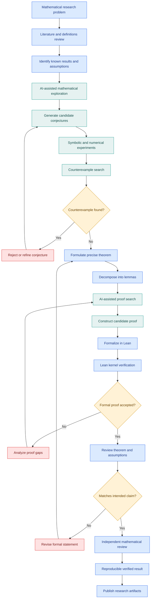
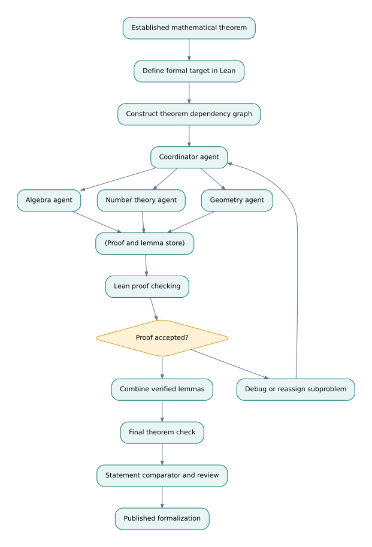
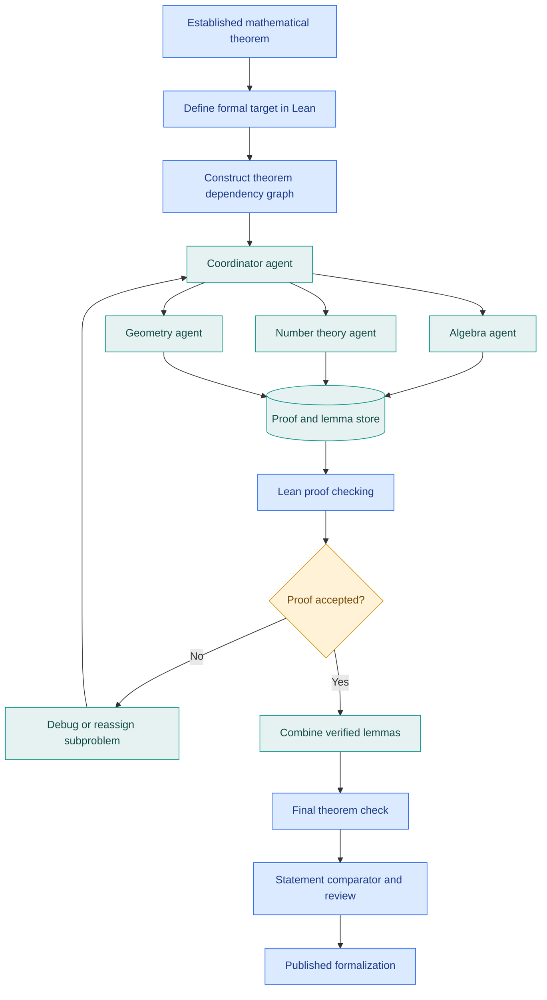

# Research Problem 12 — Mathematical Discovery and Formalization

### Can AI Discover and Prove New Mathematics?

**PROMPT & PULSE AI | RESEARCH TO REALITY | ANTHROPIC RESEARCH DIRECTION | SERIES 12/20**

<p align="center"></p>



**Scope:** Complete educational narrative from the supplied Research Problem 12 manuscript, with editable diagram sources, rendered image assets, and a runnable introductory Lean example.

**Contents:** [Problem](#1-problem-statement) · [Evidence](#2-why-is-this-problem-difficult) · [Concepts](#3-technical-concepts-behind-the-problem) · [Workflow](#4-end-to-end-mermaid-architecture-diagram) · [Anthropic study](#5-real-research-example-anthropics-formalization-of-fermats-last-theorem) · [Goals](#6-research-goal) · [Limits](#7-what-remains-difficult) · [Interview](#8-interview-perspective) · [Challenge](#9-subscriber-learning-challenge) · [References](#10-primary-research-references)





---


## 1. Problem statement

Can artificial intelligence independently discover mathematical patterns, generate useful conjectures, construct rigorous proofs, and translate complex mathematical reasoning into machine-checkable formal statements?

Imagine a mathematician investigating a problem that has remained unsolved for decades.

They have studied hundreds of papers, explored thousands of examples, and attempted several proof strategies.

An AI research agent examines the problem and proposes an unexpected mathematical relationship.

It appears correct for every example tested.

The agent then produces a convincing explanation describing why the relationship should always hold.

But a critical question remains:

Does finding a pattern across thousands of examples prove that the pattern holds universally?

No.

Consider the expression:
\[
n^2+n+41
\]

For many small nonnegative integer values of \(n\), this expression produces prime numbers.

For example:
- \(n=0\): 41, prime.
- \(n=1\): 43, prime.
- \(n=2\): 47, prime.
A researcher might conjecture that it always produces primes.

But when \(n=40\):
\[
40^2+40+41=1681=41^2
\]

The expression is composite.

This example demonstrates a fundamental distinction:

Discovering a mathematical pattern is different from proving a mathematical theorem.

Modern AI research investigates whether language models can contribute to both activities—and whether formal proof systems can make the resulting mathematics independently auditable.


## 2. Why is this problem difficult?

Mathematical discovery involves several different intellectual processes.

A researcher first needs to identify a potentially interesting statement.

Next, they must determine whether that statement is correct.

If it appears correct, they need to construct a proof that covers every case within the theorem's assumptions.

A computer may verify millions of examples without establishing a universal theorem.
### Four levels of mathematical evidence
| Level | What it demonstrates | Example |
|---|---|---|
| Observation | A pattern appears in selected examples | An expression generates primes for many inputs |
| Conjecture | A precise statement is proposed as potentially true | The expression always generates primes |
| Mathematical proof | A logical argument establishes the statement under stated assumptions | A derivation covering all permitted inputs |
| Formal verification | A proof checker validates a formal proof of the exact encoded statement | Lean accepts a theorem and proof term |

A major difficulty is moving reliably from one level to the next.

AI systems can generate persuasive mathematical explanations, but an explanation may contain hidden assumptions, invalid deductions, or incorrect generalizations.

Formalization creates another challenge.

A natural-language theorem must be translated into an exact mathematical statement. If the formal statement differs from the original claim, a machine-checked proof may validate the wrong theorem.

The research problem therefore has two complementary parts: discovering mathematical knowledge and establishing trustworthy evidence for it.


## 3. Technical concepts behind the problem

| Technical concept | Explanation |
|---|---|
| Mathematical conjecture | A precise statement believed to be true but not yet proved. |
| Conjecture generation | Proposing mathematical relationships based on reasoning, examples, or patterns. |
| Symbolic computation | Manipulating mathematical expressions using exact algebraic rules. |
| Proof search | Exploring sequences of valid logical deductions that could establish a theorem. |
| Theorem proving | Constructing a rigorous argument that establishes a mathematical statement. |
| Formalization | Expressing mathematical objects, assumptions, and theorems in a formal language. |
| Proof assistant | Software such as Lean or Rocq that supports machine-checked proofs. |
| Dependent type theory | A mathematical foundation in which types can depend on values and express propositions. |
| Curry–Howard correspondence | A connection between propositions and types, and between proofs and programs. |
| Proof term | A formal object representing evidence that a proposition holds. |
| Proof kernel | The trusted component that checks whether proof terms satisfy formal rules. |
| Counterexample search | Looking for an instance that disproves a universal conjecture. |
| Proof obligations | Smaller claims that must be established to complete a larger proof. |
| Formal-to-informal alignment | Checking that the formal theorem accurately represents the intended mathematical claim. |

### Understanding the difference between proof discovery and proof verification
Suppose an AI proposes:

"For every natural number \(n\), the sum of the first \(n\) odd positive integers equals \(n^2\)."

The mathematical statement is:
\[
\sum_{k=1}^{n}(2k-1)=n^2
\]

The agent can test this identity for many values.

But a mathematical proof can establish it for all natural numbers.

Using induction:

Base case: For \(n=1\), the sum is 1, which equals \(1^2\).

Inductive step: Assume the identity holds for \(n\). Adding the next odd number gives:
\[
n^2+(2n+1)=(n+1)^2
\]

Therefore, the identity holds for \(n+1\), completing the induction.

This demonstrates the difference between testing examples and constructing a general proof.
### What does Lean contribute?
Lean is an interactive theorem prover based on dependent type theory.

A mathematical proposition can be represented as a type, while a proof provides a term inhabiting that type.

Lean's kernel checks that the proof is valid under the formal rules and accepted assumptions. 


The important distinction is that Lean validates the formal argument; it does not automatically establish that the researcher encoded the intended real-world or mathematical question correctly.


## 4. End-to-end Mermaid architecture diagram

This architecture follows the journey from a research question to a candidate theorem, proof construction, formal checking, and independent mathematical review.





**Editable diagram:** [`diagrams/research-workflow.mmd`](diagrams/research-workflow.mmd) | [PNG](assets/research-workflow.png) | [SVG](assets/research-workflow.svg)


### How the diagram works
The process begins with a mathematical research question.

An AI agent reviews existing knowledge and explores candidate relationships.

Those relationships undergo symbolic experiments, numerical tests, and counterexample searches.

If a conjecture survives preliminary investigation, the system translates it into a precise theorem and attempts to construct a proof.

A proof assistant checks the formal proof.

Finally, independent reviewers examine whether the exact theorem, assumptions, and proof artifacts support the original research claim.

A successfully checked proof is a major milestone—but independent scientific scrutiny remains essential.


## 5. Real research example: Anthropic's formalization of Fermat's Last Theorem

**Anthropic research | September 4, 2026**


Anthropic reported that Claude, working with a multi-agent research system, produced a complete machine-checked formalization of Fermat's Last Theorem in Lean. 

### What is Fermat's Last Theorem?
The theorem states that no positive integers \(a,b,c\) satisfy:
\[
a^n+b^n=c^n
\]

for any integer \(n>2\).

The case \(n=2\) allows familiar solutions, such as:
\[
3^2+4^2=5^2
\]

But Fermat's Last Theorem establishes that corresponding positive-integer solutions do not exist for exponents greater than two.

Andrew Wiles, with work involving Richard Taylor, established the first accepted proof in the 1990s.

Anthropic's project was primarily about formalizing an established theorem, rather than discovering Fermat's Last Theorem for the first time.
### What did Anthropic report?
**11**
Days of AI-assisted formalization


**13M**
Lines of Lean code generated


**29,500**
Intermediate theorems used in the final proof


Anthropic describes how multiple Claude agents collaborated using a theorem dependency graph maintained through Prove2Me. The system helped divide the proof into smaller tasks, manage dependencies, and reuse previously established results. The final formal proof was checked using Lean, and Anthropic reports that its theorem statement was compared with the corresponding Mathlib statement. 


This is a powerful connection between mathematical formalization, multi-agent coordination, dependency graphs, proof checking, and long-running AI workflows.
### How the research process connects to an agent architecture





**Editable diagram:** [`diagrams/multi-agent-formalization.mmd`](diagrams/multi-agent-formalization.mmd) | [PNG](assets/multi-agent-formalization.png) | [SVG](assets/multi-agent-formalization.svg)


A theorem dependency graph is important because complicated proofs are rarely one uninterrupted chain of reasoning.

They contain many smaller results that depend on other results.

Once an intermediate theorem is verified, other agents can safely reuse that theorem within the formal system, subject to its assumptions.

The research significance: Multi-agent AI can help construct extremely large formal proofs, while a separate checker determines whether the resulting proof satisfies the encoded theorem.


## 6. Research goal

This research direction has two complementary goals.

Mathematical discovery: Help AI systems identify new conjectures, algorithms, relationships, and theorems that mathematicians can investigate.

Mathematical formalization: Make it easier to translate mathematical reasoning into machine-checkable proofs, reducing the effort required to audit complex arguments.

The long-term ambition is a research workflow where AI can assist with exploration and proof construction while formal systems provide rigorous logical checks.

This could support mathematics, algorithm design, cryptography, scientific computing, and formal software verification.

## 7. What remains difficult?

Conjecture correctness: A pattern that survives many tests may still have a counterexample.

Proof construction: Finding a complete proof can require mathematical concepts far beyond those initially apparent.

Formalization accuracy: The encoded theorem may unintentionally omit assumptions or weaken the intended claim.

Proof dependencies: Large formal proofs require thousands of intermediate results and careful dependency management.

Computational cost: Proof search and formal compilation can consume substantial resources.

Trusted foundations: Machine-checking depends on the soundness of the proof kernel, accepted axioms, and imported definitions.

Independent review: A technically accepted artifact should still be inspected for reproducibility, statement alignment, and scientific significance.

An additional distinction matters: formalizing an already-known theorem demonstrates a different capability from proving an entirely new mathematical result.

Anthropic has also reported work on a related problem involving bounds for zeros of the Riemann zeta function, which illustrates the separate challenge of AI-assisted mathematical discovery. 


## 8. Interview perspective

Interview question:

How would you design an AI-assisted mathematical research platform that generates conjectures, searches for proofs, formally verifies the results, and supports independent scientific review?
### Strong answer direction
Start with the research question and existing mathematical definitions.

Use literature retrieval and symbolic tools to identify relevant previous results.

Introduce a conjecture-generation component and a counterexample-search process.

For promising conjectures, create a formal theorem statement and decompose the proof into intermediate lemmas.

A coordinator can distribute independent proof tasks among specialized agents, while a shared dependency graph tracks which results have been established.

Use a proof assistant such as Lean to check the resulting proof terms.

Finally, compare the formal theorem with the original mathematical claim and publish reproducible proof artifacts.

What the interviewer is testing: Agent architecture, symbolic reasoning, formal methods, graph-based orchestration, proof verification, reproducibility, and scientific evaluation.


## 9. Subscriber learning challenge

An AI research agent discovers a mathematical formula that produces correct results for one million tested inputs.

It then generates a convincing natural-language proof.

What is the strongest next step before announcing a mathematical breakthrough?

Publish immediately because one million examples are sufficient.

Ask another AI model whether the proof sounds convincing.

Precisely formulate the claim, verify the proof, and seek independent review.

Measure how quickly the AI generated the proof.


### Practical exercise: Write your first Lean theorem
This example demonstrates a simple universal identity over natural numbers.

```lean
theorem add_zero_example (n : Nat) : n + 0 = n := by
  simp
```


Although this theorem is simple, it introduces an essential idea: Lean checks that the proof establishes the declared proposition.

For further practice, try proving an identity involving addition, multiplication, or mathematical induction.


## 10. Primary research references

- [Anthropic — Formalizing Fermat's Last Theorem (September 4, 2026)](https://www.anthropic.com/research/formalizing-fermats-last-theorem)
- [Anthropic — Learning More About Claude's Mathematical Capabilities (August 10, 2026)](https://www.anthropic.com/research/riemann-zeta)
- [Lean — Official Learning Resources](https://lean-lang.org/learn/)
- [Lean — Language and Proof System Reference](https://lean-lang.org/doc/reference/latest/)
### Key takeaway
The future of AI-assisted mathematics is not simply about generating convincing mathematical arguments. It is about discovering useful results and producing evidence that those results withstand rigorous verification.

Mathematical discovery asks whether a new statement is true.

Proof construction attempts to establish why it is true.

Formal verification checks whether a precise proof satisfies the encoded theorem.

Together, these capabilities could make AI a more useful collaborator in scientific and mathematical research.

Prompt & Pulse AI — Learn AI. Build AI. Stay Ahead.

Next in the series: Research Problem 13 — GPU Kernel and Scientific-Model Optimization: Can AI make complex scientific computations faster without sacrificing numerical correctness?

---

## Repository files and how to edit

| File | Purpose |
|---|---|
| `README.md` | Complete GitHub article and embedded Mermaid diagrams |
| `assets/pattern-to-proof.png` | Standalone educational infographic |
| `assets/*.svg` / `assets/*.png` | Actual locally bundled diagrams (not remote placeholders) |
| `assets/prompt-pulse-logo.png` | Supplied Prompt & Pulse logo |
| `diagrams/*.mmd` | Editable Mermaid diagram source files |
| `diagrams/*.dot` | Editable Graphviz source used for SVG/PNG illustrations |
| `examples/ResearchProblem12.lean` | Example introductory Lean theorem |
| `SOURCE_TEXT.txt` | Original source text, verbatim, for archival completeness |

Edit any `mermaid` block directly in `README.md` or edit its `.mmd` counterpart. GitHub renders Mermaid diagrams natively; SVG/PNG assets still display where Mermaid isn't supported. Images are embedded using relative local paths and must be committed alongside README.

### Verification and editorial notes

- The Anthropic Fermat formalization is a **reported result** from Anthropic, not independently reproduced in this repository. Its cited figures are attributed to its publication.
- The Fermat theorem was already established mathematically: **formalization is distinct from discovering a new theorem**.
- A Lean kernel checking a proof does not by itself ensure the stated theorem expresses the original mathematical intention; that needs statement comparison and expert review.
- The image diagrams in this package were newly drawn from the source's architecture descriptions. They are not screenshots or official Anthropic figures.
- This repository provides a learning example, **not the full Lean formalization of Fermat's Last Theorem**.

**Prompt & Pulse AI — Learn AI. Build AI. Stay Ahead.**
