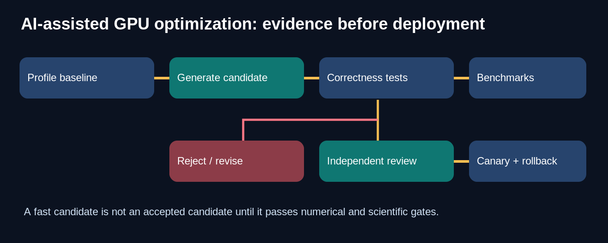
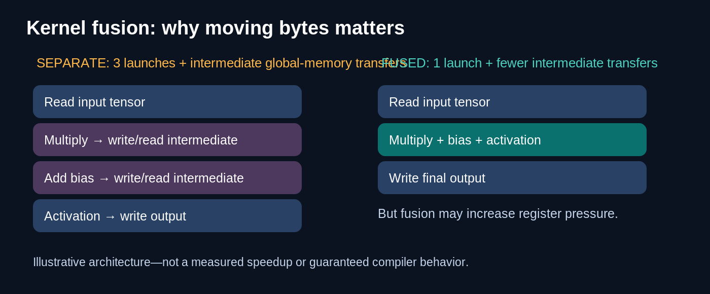
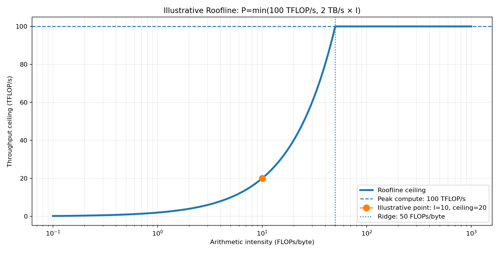
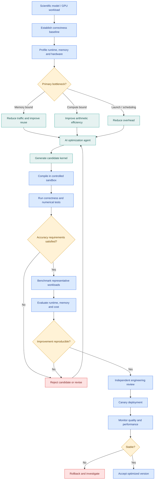

# Research Problem 13 — GPU Kernel & Scientific-Model Optimization

> **Can AI make scientific computing faster without sacrificing accuracy?**

**PROMPT & PULSE AI · RESEARCH TO REALITY · ANTHROPIC RESEARCH DIRECTION · SERIES 13/20**



This repository is a GitHub-native educational adaptation of the complete supplied Research Problem 13. It retains all ten numbered source sections and the closing transition to Problem 14. Locally bundled PNG/SVG illustrations are actual image files; editable Mermaid is embedded below and supplied in `.mmd` files. The unmodified imported text remains in [`SOURCE_ORIGINAL.txt`](SOURCE_ORIGINAL.txt), including the original rendered-diagram CSS that cannot be edited as Mermaid.

**Navigation:** [Problem](#1-problem-statement) · [GPU bottlenecks](#2-why-is-this-problem-difficult) · [Roofline](#3-technical-concepts-behind-the-problem) · [Architecture](#4-end-to-end-mermaid-architecture-diagram) · [Anthropic study](#5-real-research-example-anthropic-accelerating-biomolecular-modeling) · [Research goals](#6-research-goal) · [Open challenges](#7-what-remains-difficult) · [Interview](#8-interview-perspective) · [Lab](#9-subscriber-learning-challenge) · [References](#10-primary-research-references)

---

## 1. Problem statement

Can artificial intelligence automatically analyze, rewrite, and optimize GPU kernels and scientific computing algorithms to reduce execution time, memory consumption, and infrastructure costs while preserving numerical accuracy and scientific correctness?

Imagine a biotechnology company developing AI models to predict protein structures.

Its researchers have trained a powerful scientific model, but running a single large experiment takes several hours.

Each experiment requires expensive GPU resources.

Now imagine running thousands of experiments to explore different molecular configurations.

The research team faces an important decision.

Should they purchase more GPUs, or can they make the existing computation significantly more efficient?

An AI coding agent proposes a different implementation of the expensive calculations.

The original program takes 10 hours. The optimized version takes 2 hours.

That sounds like a breakthrough.

But there is an important question:

What if the optimized program runs five times faster but introduces small numerical errors that change the scientific conclusions?

In scientific computing, faster execution is valuable only when the results remain sufficiently correct for the intended scientific task.

This is the central challenge behind GPU kernel and scientific-model optimization.

---

## 2. Why is this problem difficult?

Modern scientific AI depends on large amounts of numerical computation.

Examples include molecular simulations, protein structure prediction, fluid dynamics, genomics, climate modeling, and LLM inference.

GPUs are designed to execute many operations in parallel, but a program does not automatically run efficiently just because it executes on a GPU.

Its performance depends on several interacting constraints.
**Consider a simple computation**
A scientific model performs three consecutive tensor operations:
1. Multiply every element by a constant.
2. Add a bias.
3. Apply a nonlinear activation function.
A straightforward implementation may launch three GPU kernels.

After each operation, the intermediate result may be written to GPU global memory.

The following operation then reads that intermediate result.

That repeated movement of data can become expensive.
Three separate kernels versus one fused kernel



[Editable fusion diagram](diagrams/kernel_fusion.mmd)

Conceptual example. Fusion may reduce intermediate global-memory traffic and launch overhead, but it is not always faster: register pressure, occupancy, synchronization, and compiler behavior also matter.
The optimization question is not only how many arithmetic operations the GPU performs.

It is also how much information the GPU must move, where it is stored, and how efficiently threads execute.
**Three fundamental GPU bottlenecks**
Compute-bound workloads: Performance is primarily constrained by the GPU's arithmetic throughput.

Memory-bound workloads: Performance is primarily constrained by how quickly data moves through the memory hierarchy.

Launch, synchronization, and scheduling overhead: Even when neither peak compute nor memory bandwidth is fully utilized, execution may be limited by small kernels, insufficient parallel work, dependencies, or poor scheduling.

This distinction is central to GPU performance engineering. NVIDIA's profiling documentation uses the Roofline model to help identify compute and memory limits. 
NsightCompute

---

## 3. Technical concepts behind the problem

**Technical concept	What students should understand**
GPU kernel	A function executed in parallel by many GPU threads.
CUDA	NVIDIA's parallel computing platform and programming model.
Triton	A programming language and compiler for writing GPU kernels.
Thread block / warp	Groups of threads organized and scheduled for GPU execution.
Kernel fusion	Combining operations to reduce intermediate data movement or launch overhead.
Memory coalescing	Organizing thread memory accesses into efficient memory transactions.
Arithmetic intensity	The ratio of floating-point work to bytes transferred at a chosen memory level.
Roofline model	A performance model relating arithmetic intensity, memory bandwidth, and compute throughput.
Tiling	Dividing computations into blocks to improve locality and reuse.
Register pressure	Demand for registers that can reduce occupancy or cause spills.
Occupancy	The proportion of the GPU's supported active warps residing on a multiprocessor.
Mixed precision	Using numerical formats such as FP32, FP16, BF16, or FP8, subject to accuracy requirements.
Numerical stability	Sensitivity of computed results to floating-point rounding and other numerical errors.
Profiling	Measuring runtime, memory traffic, hardware utilization, and execution bottlenecks.
Benchmark reproducibility	Measuring performance under controlled, repeatable conditions.

**The Roofline model**
A useful starting point is arithmetic intensity:
\[
I=\frac{\text{Floating-point operations}}{\text{Bytes transferred}}
\]

For example, suppose a kernel performs 2 trillion floating-point operations while transferring 1 terabyte of data at the memory level being measured.

Then:
\[
I=2\ \text{FLOPs/byte}
\]

This indicates relatively little computation for each byte moved.

The Roofline model estimates a performance ceiling:
\[
P_{\max}(I)=\min(P_{\text{compute}}, B_{\text{memory}}\times I)
\]

Where:
- \(P_{\text{compute}}\): Theoretical peak arithmetic throughput.
- \(B_{\text{memory}}\): Sustained or specified memory bandwidth.
- \(I\): Arithmetic intensity.
A kernel is memory-bound relative to this simple model when the bandwidth ceiling is lower than the compute ceiling. It is compute-bound when the compute ceiling is lower.

The model is a useful first-order guide, not an exact runtime predictor. 
[NVIDIA Nsight Compute Roofline documentation](https://docs.nvidia.com/nsight-compute/ProfilingGuide/#roofline-charts)

**Interactive example: Why arithmetic intensity matters**



- Peak compute: 100 TFLOP/s
- Memory bandwidth: 2 TB/s
- Arithmetic intensity: 10 FLOPs/byte
- Roofline throughput ceiling: 20 TFLOP/s; bandwidth-bound under this model
- Ridge point: 50 FLOPs/byte

These are hypothetical hardware characteristics, not measured results.

What this teaches: Increasing arithmetic intensity can raise the theoretical performance ceiling for a memory-bound kernel. Once the compute ceiling is reached, increasing arithmetic intensity alone does not raise that ceiling.

---

## 4. End-to-end Mermaid architecture diagram


GitHub renders the **editable Mermaid source** below. Standalone files: [optimization pipeline](diagrams/optimization_pipeline.mmd), [fusion](diagrams/kernel_fusion.mmd), [validation gate](diagrams/validation_gate.mmd).



This diagram illustrates an AI-assisted optimization system that starts with performance profiling and ends with independently validated improvements.

**How the architecture works**
The process starts with a known implementation and a correctness baseline.

Profiling tools identify where the workload spends time and which resources constrain its performance.

An optimization agent then proposes candidate code changes, such as kernel fusion, tiling, modified memory access patterns, or alternative numerical implementations.

Each candidate must compile and pass correctness tests before performance benchmarks are meaningful.

Promising candidates undergo repeated measurement and engineering review.

Only verified improvements progress to controlled deployment.

The key principle: Performance improvement is meaningful only when measured against a reliable baseline and accompanied by acceptable correctness.

---

## 5. Real research example: Anthropic accelerating biomolecular modeling

**ANTHROPIC RESEARCH | SEPTEMBER 17, 2026**


Anthropic published How Claude Is Uplifting Biomolecular Modeling.

The project explored how Claude could improve the computational efficiency of open-source models used in molecular structure prediction and design.

Anthropic reported optimizing more than 30 biomolecular models in just under four weeks, achieving approximately fourfold average speedups. It also described a low-memory mode supporting prediction of biomolecular systems larger than 10,000 tokens on a single NVIDIA GPU node. 
[Anthropic original research](https://www.anthropic.com/research/claude-uplifts-biomolecular-modeling)

30+
Scientific models optimized


~4×
Reported average speedup


10K+
Biomolecular tokens in the reported low-memory scenario


These are reported results in the study's evaluation setting, not guarantees for arbitrary scientific models or hardware.
**Why is this significant?**
Scientific researchers often operate under fixed GPU and compute budgets.

If an existing model can run faster without compromising required accuracy, scientists may be able to explore more experiments with the same resources.

A memory-efficient implementation may also enable experiments that previously exceeded hardware capacity.

For example, a model that requires more memory than a GPU can provide may be impossible to run in that configuration, even if sufficient arithmetic throughput is available.

An optimization that reduces peak memory can therefore expand scientific capabilities, not merely reduce cost.
**What should students learn from this?**
AI-assisted optimization is especially valuable when improvements are measurable.

A research agent must answer three questions:

Is the optimized implementation correct?

Is the performance improvement reproducible?

Does the improvement matter for real scientific workloads?

This connects agentic coding, GPU architecture, mathematical optimization, scientific validation, and infrastructure engineering.

---

## 6. Research goal

The research goal is to make scientific models computationally more efficient while maintaining acceptable accuracy and scientific validity.

This includes reducing unnecessary memory movement, improving GPU utilization, accelerating important kernels, lowering memory requirements, and reducing infrastructure costs.

Another goal is to automate parts of the performance engineering process through AI-assisted code analysis, candidate generation, testing, and benchmarking.

The broader ambition is to make scientific computing more accessible by increasing the amount of useful research that can be performed with available computing resources.

---

## 7. What remains difficult?

Numerical correctness: Floating-point operations are not always associative. Changing execution order may change numerical results.

Hardware specificity: An optimization effective on one GPU architecture may perform poorly on another.

Memory hierarchy complexity: Registers, shared memory, cache, and global memory have different performance characteristics.

Kernel fusion trade-offs: Eliminating intermediate memory transfers may increase register pressure and reduce occupancy.

Benchmark reliability: Short benchmarks can be distorted by GPU warm-up, clock behavior, compilation, background workloads, and input selection.

Scientific validity: Numerically similar outputs do not always imply equivalent scientific conclusions.

Optimization overfitting: A kernel optimized for one tensor shape may perform worse for other inputs.

Energy and cost: Faster execution does not necessarily minimize energy usage or total operating cost.

An optimization agent must therefore consider the complete workload rather than a single attractive benchmark result.

---

## 8. Interview perspective

Interview question:

You are given an AI inference workload running on NVIDIA GPUs. GPU utilization appears low, inference latency is high, and infrastructure costs are increasing. How would you identify the bottleneck and safely optimize the system?
**Strong answer direction**
Start by defining the measurements and the workload.

Determine whether the problem involves training, inference prefill, inference decoding, or scientific simulation. Each may have different performance characteristics.

Establish a reproducible baseline with representative input shapes, concurrency, batch sizes, and hardware configurations.

Then profile the workload using tools such as NVIDIA Nsight Systems and Nsight Compute.

Investigate GPU compute throughput, memory bandwidth, kernel execution time, memory transfers, occupancy, and launch overhead.

Use the Roofline model to understand whether a kernel is potentially memory-bound or compute-bound.

For memory-bound workloads, consider kernel fusion, improved data locality, coalesced memory access, and reducing unnecessary transfers.

For compute-bound workloads, consider appropriate tiling, parallel execution strategies, tensor-core utilization, and supported numerical precision.

Every optimization should be followed by correctness checks and repeated benchmarks.

Finally, evaluate end-to-end latency, throughput, cost, memory usage, and numerical quality before deployment.

What the interviewer is testing: GPU architecture, CUDA, Triton, performance modeling, profiling, numerical correctness, experimentation, and production AI infrastructure.
**Follow-up interview question**
Why might a fused GPU kernel perform worse than three separate kernels?

A strong answer explains that fusion may increase register usage, lower occupancy, create spills, or introduce more complex execution dependencies.

Reducing kernel launches and global-memory traffic is useful, but performance depends on the overall balance of hardware resources.

---

## 9. Subscriber learning challenge

An AI optimization agent rewrites a scientific GPU kernel.

The original implementation completes an experiment in 100 milliseconds. The new kernel completes it in 40 milliseconds.

However, the new implementation produces unacceptable errors in scientific results.

Should the engineering team deploy the optimized kernel?

Yes, because the new implementation is 2.5 times faster.

Yes, if GPU utilization is higher.

No, because the optimized implementation violates required correctness or accuracy criteria.

Yes, provided the code was generated by a sufficiently capable AI model.


**Hands-on experiment: GPU kernel fusion**
For students, here's a small PyTorch example.

The goal is to compare separate tensor operations against an expression that PyTorch's compiler may fuse when supported.
```python
import torch

device = "cuda" if torch.cuda.is_available() else "cpu"
x = torch.randn(1_000_000, device=device)

def baseline(x):
    a = x * 2.0
    b = a + 3.0
    return torch.relu(b)

def optimized_candidate(x):
    return torch.relu(x * 2.0 + 3.0)

expected = baseline(x)
actual = optimized_candidate(x)
torch.testing.assert_close(actual, expected)
print("Correctness check passed. Device:", device)

# The shorter expression alone does NOT guarantee fusion.
# See examples/kernel_fusion.py for compiler and benchmark options.
```

Run the example on a CPU if a GPU is not available. It verifies numerical behavior, but meaningful GPU kernel performance comparisons require GPU profiling and carefully controlled timing.

For advanced experimentation, implement the fused operation directly in Triton and compare it against the PyTorch baseline.

Record measured latency, output differences, memory traffic, and the tensor shapes tested.

---

## 10. Primary research references

- [Anthropic — How Claude Is Uplifting Biomolecular Modeling (September 17, 2026)](https://www.anthropic.com/research/claude-uplifts-biomolecular-modeling)
- [NVIDIA — Nsight Compute Profiling Guide](https://docs.nvidia.com/nsight-compute/ProfilingGuide/)
- [NVIDIA — CUDA Programming Guide](https://docs.nvidia.com/cuda/cuda-programming-guide/)
- [Triton — Official GPU Kernel Tutorials](https://triton-lang.org/main/getting-started/tutorials/index.html)
- [NERSC — Roofline Performance Analysis](https://docs.nersc.gov/tools/performance/roofline/)
**Key takeaway**
The goal of GPU optimization is not simply to execute more operations per second. It is to produce scientifically valid results using computing resources as efficiently as possible.

AI agents may help discover kernel improvements, but every candidate must be evaluated against correctness, numerical accuracy, memory requirements, performance, and reproducibility.

The deeper lesson connects directly to our earlier research problems:
- Problem 05 — Reward Hacking: A faster benchmark is not automatically a better outcome.
- Problem 10 — Multi-Agent Coordination: Multiple optimization agents need consistent objectives and independent evaluation.
- Problem 11 — Formal Verification: Specified correctness properties must survive implementation changes.
- Problem 12 — Mathematical Discovery: Proposed algorithmic improvements need rigorous evidence.
The next generation of scientific computing will benefit not only from faster GPUs, but also from better algorithms, efficient memory usage, reliable evaluation, and AI-assisted optimization.

Prompt & Pulse AI — Learn AI. Build AI. Stay Ahead.

Next in the series: Research Problem 14 — Quantum Circuit Optimization: Can AI discover quantum algorithms and circuit designs that require fewer gates, fewer qubits, and less computation while preserving correctness?

---

## Run the exercises

```bash
python -m pip install -r requirements.txt
python examples/roofline.py
python examples/kernel_fusion.py
```

The PyTorch lab runs on CPU when CUDA is unavailable. It uses synchronization for GPU timings and makes no claim that an eager expression is automatically fused. `torch.compile` is optional and may require a compatible software stack.

## Files and editable assets

| File | Purpose |
|---|---|
| `README.md` | Complete formatted educational explanation |
| `SOURCE_ORIGINAL.txt` | Supplied source preserved verbatim |
| `assets/*.png` | Local images (also bundled in GitHub) |
| `assets/*.svg` | Vector illustrations editable in Inkscape or a text editor |
| `diagrams/*.mmd` | Editable Mermaid source |
| `examples/roofline.py` | CPU-only Roofline calculation and plot |
| `examples/kernel_fusion.py` | CPU/GPU PyTorch correctness and benchmark |

**Source integrity:** Reported Anthropic speedups and scale are results reported by Anthropic, not independently reproduced by this repository. All illustrative speedups and Roofline hardware parameters are hypothetical; no GPU benchmark measurements are claimed.
