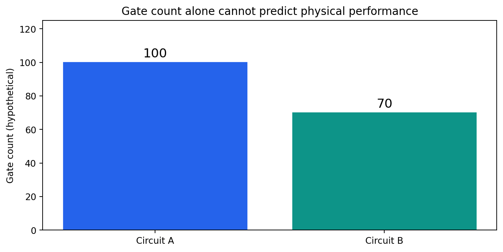
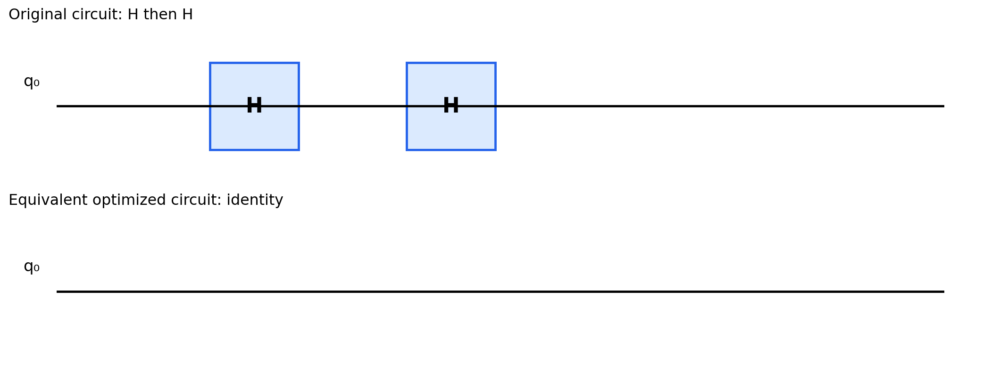
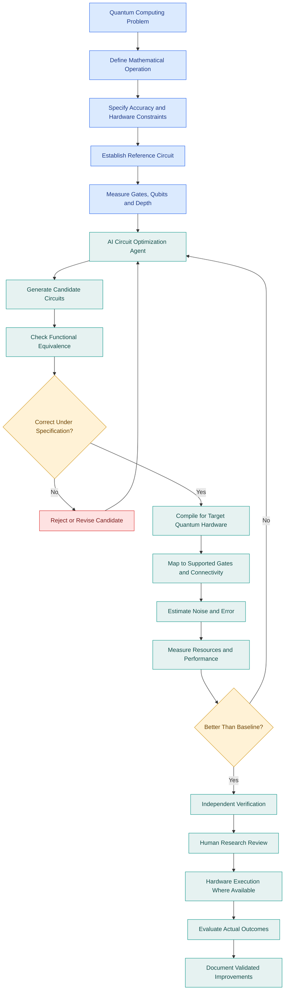
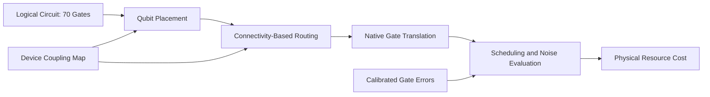

# Research Problem 14 — Quantum Circuit Optimization


**Prompt & Pulse AI · Research to Reality · Anthropic research direction · Series 14/20**

> **Central question:** Can AI discover quantum circuits that preserve the required computation while reducing gates, qubits, depth, and hardware costs without compromising correctness?

**Read the full educational walkthrough below.** This repository also contains locally stored images, rendered architectures, editable Mermaid sources, and a CPU-only Qiskit exercise. The full original provided text is archived verbatim in [`SOURCE_ORIGINAL.txt`](SOURCE_ORIGINAL.txt).

## Contents

1. [Problem statement](#1-problem-statement)
2. [Why is this problem difficult?](#2-why-is-this-problem-difficult)
3. [Technical concepts](#3-technical-concepts-behind-the-problem)
4. [End-to-end architecture](#4-end-to-end-mermaid-architecture-diagram)
5. [Anthropic research example](#5-real-research-example-anthropics-quantum-circuit-optimization)
6. [Research goal](#6-research-goal)
7. [Open challenges](#7-what-remains-difficult)
8. [Interview perspective](#8-interview-perspective)
9. [Learning challenge and experiment](#9-subscriber-learning-challenge)
10. [References](#10-primary-research-references)

---


## 1. Problem statement


Can artificial intelligence discover, synthesize, and optimize quantum circuits that perform the same mathematical computation while using fewer quantum gates, fewer qubits, shorter circuit depths, and fewer physical resources—without sacrificing correctness?

Imagine a research laboratory developing a quantum algorithm for molecular simulation.

The researchers successfully design a quantum circuit that performs the required mathematical operation.

However, their circuit requires thousands of quantum gates.

Every gate takes time to execute and may introduce errors.

By the time the computation finishes, noise may have significantly degraded the quantum state.

Now imagine an AI optimization agent proposes an alternative circuit.

Both circuits implement the same intended operation, but the new version uses fewer gates and potentially executes faster.

That sounds promising.

But an important question arises:

If the optimized circuit uses fewer gates, does that automatically mean it will produce more reliable results on a real quantum computer?

Not necessarily.

A shorter circuit might require operations between qubits that are not directly connected. It may use gates with higher error rates or require additional routing operations.

The real research challenge is not simply minimizing gate count.

It is finding quantum circuits that preserve the intended computation while reducing the resources and errors relevant to the target hardware.


## 2. Why is this problem difficult?


Before understanding quantum optimization, consider the difference between classical and quantum computation.

Classical computing

A classical bit has a value of either 0 or 1.

Classical logic gates such as AND, OR, and NOT manipulate these values to perform computations.

Quantum computing

A quantum computer operates on qubits.

A pure qubit state can be represented as:

$$

|\psi\rangle=\alpha|0\rangle+\beta|1\rangle

$$

Where:

$$

|\alpha|^2+|\beta|^2=1

$$

The coefficients \(\alpha\) and \(\beta\) are complex amplitudes.

Unlike a classical bit, a qubit can exist in a superposition of computational basis states.

However, measuring a qubit produces a classical outcome according to probabilities determined by its state.

Quantum circuits manipulate qubit states through quantum gates.

Why circuit design matters

Consider two implementations of the same quantum operation.

**Circuit A:** 100 quantum gates (original implementation).

**Circuit B:** 70 quantum gates (illustrative AI alternative).

Hypothetical example. Gate counts alone do not establish which circuit performs better on a physical device.Circuit B uses 30% fewer gates.

But suppose Circuit B requires many operations between distant qubits, while Circuit A uses mostly nearby connections.

The quantum compiler may have to insert additional SWAP operations to execute Circuit B.

After hardware mapping, the supposedly shorter circuit could become more expensive.

This introduces a fundamental principle:

A mathematically efficient quantum circuit is not necessarily the most efficient circuit on physical quantum hardware.



*Illustrative numbers, not physical-device performance measurements.*


## 3. Technical concepts behind the problem


| Technical concept | What students should understand |
|---|---|

| Qubit | The basic unit of quantum information. |

| Superposition | A quantum state expressed as a combination of basis states. |

| Entanglement | Quantum correlations that cannot generally be represented as independent states of individual qubits. |

| Quantum gate | An operation that transforms quantum states. |

| Unitary operation | A reversible, norm-preserving transformation represented by a unitary matrix. |

| Quantum circuit | An ordered arrangement of quantum operations. |

| Circuit depth | The number of sequential operation layers along the circuit's critical path. |

| Gate count | The total number of gates used by the circuit. |

| Two-qubit gates | Operations involving two qubits, often relatively expensive or noisy on real hardware. |

| Qubit connectivity | Which physical qubits can interact directly on a particular device. |

| Circuit synthesis | Constructing a gate sequence implementing a desired operation. |

| Circuit optimization | Rewriting a circuit to reduce resources while preserving the intended behavior. |

| Equivalence checking | Establishing whether two circuits implement the same specified operation, exactly or within a defined tolerance. |

| Noise model | A mathematical representation of errors affecting quantum operations. |

| Fault tolerance | Techniques enabling reliable quantum computation despite physical errors. |

Understanding quantum gates

One common quantum gate is the Hadamard gate, denoted \(H\).

Its matrix representation is:

$$

H=\frac{1}{\sqrt{2}}

\begin{bmatrix}

1&1\\

1&-1

\end{bmatrix}

$$

Applying it to the state \(|0\rangle\) produces:

$$

H|0\rangle=\frac{|0\rangle+|1\rangle}{\sqrt{2}}

$$

Now consider applying the Hadamard gate twice.

$$

H^2=I

$$

Where \(I\) is the identity matrix.

Therefore:

$$

H(H|0\rangle)=|0\rangle

$$

This means two consecutive Hadamard gates on the same qubit, with no intervening operation affecting their composition, can be eliminated.

Simple quantum circuit simplification

A simple exact circuit identity. Real optimization involves much more complicated gate interactions, connectivity constraints, and hardware noise.

This small example illustrates how quantum circuit optimizers can eliminate redundant operations.

For complex circuits, the search space becomes much larger.

AI-assisted optimization attempts to discover transformations that may be difficult to identify manually.




## 4. End-to-end Mermaid architecture diagram


**Editable diagram:** [`diagrams/optimization-architecture.mmd`](diagrams/optimization-architecture.mmd)



The following workflow describes an AI-assisted quantum circuit optimization platform. It combines circuit generation, mathematical correctness checks, resource evaluation, hardware-aware compilation, and independent review.

### How the diagram works

The process begins with a mathematical problem and a reference quantum circuit.

Researchers define the behavior the circuit must implement and the resources available.

An AI agent generates alternative designs, potentially changing the underlying algorithm rather than merely removing redundant gates.

Each candidate undergoes correctness checks. For general quantum circuits, these checks may involve unitary equivalence, state simulation, formal reasoning, or other specialized validation methods.

Candidates that satisfy the specification are compiled for the intended quantum hardware, where gate availability, qubit connectivity, circuit depth, and noise may change the effective cost.

Promising designs undergo independent verification and, where practical, execution on actual devices.

The key principle: Quantum circuit optimization requires correctness and hardware-aware resource evaluation, not simply a smaller circuit diagram.


### Hardware-aware compilation (additional explanatory diagram)




A source-level gate-count improvement is not the same as reduced physical cost: layout, routing, native gate decomposition, scheduling and calibrated noise must be considered.


## 5. Real research example: Anthropic's quantum circuit optimization


ANTHROPIC RESEARCH | OCTOBER 16, 2026

Anthropic published Designing More Efficient Quantum Circuits with Claude.

The researchers investigated whether Claude could discover quantum circuit designs more efficient than previously published approaches.

Rather than providing complete implementations, they gave Claude descriptions of the mathematical tasks along with a programmatic evaluator.

The system operated through a feedback loop:


Anthropic reported improvements across eight quantum-circuit design tasks spanning fields such as chemistry, optimization, quantum simulation, number theory, and numerical computation.

anthropic.com

### Two especially interesting findings

17×

Fewer gates

Elliptic-curve computation

In one design trade-off, Anthropic reported a circuit with approximately 17 times fewer gates than a prior small-qubit design while using 12% more qubits. This demonstrates why optimizing multiple resources produces a trade-off rather than one universally best circuit.

12×

Gate reduction

Quantum optimization decoder

Claude helped redesign a Reed–Solomon decoding circuit by replacing an extended Euclidean algorithm approach with a Berlekamp–Massey-based design and improving how intermediate information was managed.

These are results reported for particular circuit constructions, not demonstrated speedups across all quantum applications.

anthropic.com+1

### Why is reversibility so important?

Ordinary programs routinely overwrite intermediate variables and discard temporary data.

Quantum computing is different because unitary operations must be reversible.

If a quantum circuit generates temporary intermediate information, it often must restore auxiliary qubits to their required states through uncomputation.

That creates a trade-off:

- Keeping intermediate values may require more qubits.

- Recomputing or uncomputing values can require more gates.

Anthropic's research illustrates how redesigning algorithms around these constraints can produce meaningful improvements.

The deeper insight: AI can sometimes discover a different computational structure, rather than merely optimize an existing sequence of instructions.


## 6. Research goal


The research aims to develop AI-assisted methods for discovering quantum circuits that preserve the required mathematical behavior while using fewer resources.

Key goals include reducing gate count and circuit depth, improving qubit efficiency, discovering new reversible algorithms, and identifying favorable trade-offs between quantum memory and computation.

Another objective is to use automated evaluators to guide AI toward measurable improvements rather than relying on plausible-looking generated designs.

Ultimately, this work could help make some useful quantum computations more practical on resource-constrained devices.

However, reduced theoretical resource estimates do not automatically demonstrate practical quantum advantage over classical computing.


## 7. What remains difficult?


Quantum correctness: Candidate circuits must implement the required transformation, possibly within a specified error tolerance.

Qubit limitations: Physical qubits and high-quality logical qubits remain expensive resources.

Reversible computation: Intermediate values cannot always be discarded as ordinary classical programs would discard them.

Hardware connectivity: Operations between nonadjacent qubits may require extra routing.

Noise and decoherence: Real hardware introduces errors not captured by ideal circuit simulations.

Fault-tolerance overhead: Logical operations may require substantial physical error-correction resources.

Benchmark comparability: Circuit improvements must be compared under consistent assumptions and resource models.

Multi-objective trade-offs: A circuit may use fewer qubits but more gates, or vice versa.

IBM Quantum's transpiler documentation illustrates why routing, hardware gate sets, and optimization passes can significantly affect circuit depth and effective cost.

IBM Quantum Documentation


## 8. Interview perspective


Interview question:

How would you design an AI-powered quantum circuit optimizer that reduces computational resources while preserving correctness and accounting for hardware limitations?

Strong answer direction

Start by defining the quantum operation and its correctness requirements.

Establish a baseline circuit with measurements for qubit count, total gates, circuit depth, and expensive two-qubit operations.

Use an AI model or search algorithm to generate alternative circuits.

Apply appropriate correctness checks, including simulation or equivalence testing.

Compile valid candidates for the target hardware to account for supported gate sets, qubit connectivity, and routing overhead.

Evaluate resource costs, expected errors, and practical execution constraints.

Finally, use independent evaluation to compare candidates before selecting a design.

What the interviewer is testing: Quantum computing fundamentals, reversible computation, program synthesis, optimization, verification, and hardware-aware engineering.

Follow-up question

Why might a quantum circuit with fewer gates perform worse than a larger circuit?

Because gate type, circuit depth, hardware connectivity, operation fidelity, and routing overhead can matter more than the raw number of gates.


## 9. Subscriber learning challenge


An AI optimization agent produces two implementations of the same quantum computation.

Circuit A: 100 gates, 20 qubits.

Circuit B: 70 gates, 25 qubits.

Both pass the relevant idealized correctness checks.

Can we conclude that Circuit B will perform better on real quantum hardware?

Yes, because fewer gates always means lower error.

Yes, because the qubit count does not matter.

No. We must also examine circuit depth, connectivity, gate types, hardware noise, and the required resource trade-offs.

No, because quantum circuits cannot be optimized.

Practical experiment: Your first quantum circuit optimizer

Students can explore circuit simplification without owning a quantum computer.

Using a supported Qiskit environment:

```python
from qiskit import QuantumCircuit, transpile
from qiskit.quantum_info import Operator

original = QuantumCircuit(1)
original.h(0)
original.h(0)
optimized = QuantumCircuit(1)

assert Operator(original).equiv(Operator(optimized))
compiled = transpile(original, optimization_level=3)
print("Original gates:", original.size())
print("Compiled gates:", compiled.size())
print("Original depth:", original.depth())
print("Compiled depth:", compiled.depth())
print("Equivalent:", Operator(original).equiv(Operator(compiled)))
```

This CPU-only experiment demonstrates gate cancellation and ideal circuit equivalence.

For advanced study, add multi-qubit gates, specify a target device's connectivity, and compare the circuit before and after hardware-aware transpilation.

**Run the downloadable version:** `python examples/quantum_optimizer_demo.py`. See [requirements](requirements.txt).


## 10. Primary research references


- Anthropic — Designing More Efficient Quantum Circuits with Claude (October 16, 2026)

- IBM Quantum — Transpiler Stages and Circuit Optimization

- IBM Quantum — Transpiler Optimization Levels

- Google Quantum AI — A New Quantum Toolkit for Optimization (November 2025)

### Key takeaway

The research challenge is not merely reducing the number of gates in a quantum circuit. It is discovering computational designs that satisfy the intended mathematical operation while using quantum resources more efficiently.

AI-assisted circuit optimization combines concepts from mathematical discovery, program synthesis, automated verification, reversible computing, and hardware-aware optimization.

This also connects to the previous research problems:

Problem 12: AI discovers mathematical and algorithmic structures.

Problem 13: AI optimizes computational kernels under hardware constraints.

Problem 14: AI explores quantum algorithms and circuit architectures under correctness, reversibility, and resource constraints.

The common lesson is that a meaningful optimization must preserve the required outcome, not simply improve one attractive metric.

Prompt & Pulse AI — Learn AI. Build AI. Stay Ahead.

Next in the series: Research Problem 15 — Drug-Development Assistance: Can AI agents help scientists identify promising molecules, design experiments, and accelerate drug discovery while preserving scientific and clinical validity?


---

## Reproduction, scope, and accuracy notes

The **100-versus-70-gate comparison is hypothetical**, not measured hardware performance. The **17× / 12× figures are attributed to Anthropic's published task-specific report**, not independent benchmarks performed by this repository. `Operator.equiv` compares ideal unitary operators up to global phase; it does not establish noisy-device fidelity, hardware advantage, or general-purpose formal equivalence for arbitrary large circuits. The diagram files describe a **proposed research architecture**; no AI circuit-search engine or hardware-backed optimizer is implemented here. The included Python example is a **local educational compiler demonstration**, not replication of the Anthropic results.

## Project structure

```text
README.md
SOURCE_ORIGINAL.txt
requirements.txt
examples/quantum_optimizer_demo.py
diagrams/*.mmd       # editable Mermaid source
diagrams/*.dot       # editable Graphviz source
assets/*.png         # locally embedded GitHub images
assets/*.svg         # scalable architecture images
```

## How to edit the figures

Modify `.mmd` files in GitHub's editor or [Mermaid Live Editor](https://mermaid.live/) and update the fenced Mermaid blocks in this README. For high-resolution static architecture exports, edit the `.dot` files and run `dot -Tsvg diagrams/optimization-architecture.dot -o assets/optimization-architecture.svg` (or `-Tpng`). All README images are relative paths, so they work after you upload the entire repository folder to GitHub.

**Prompt & Pulse AI — Learn AI. Build AI. Stay Ahead.**
