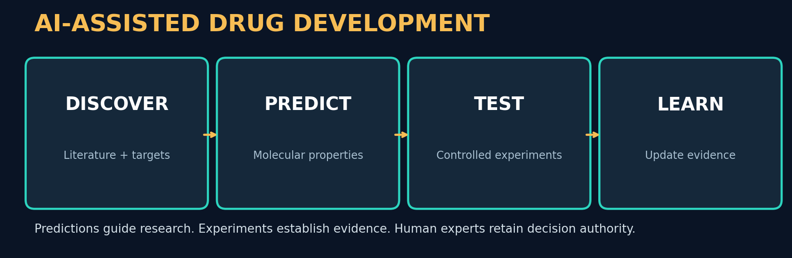
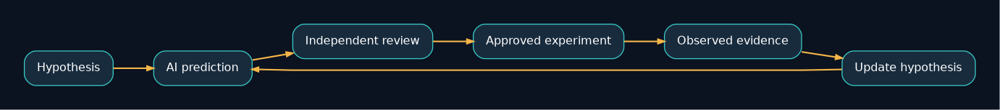
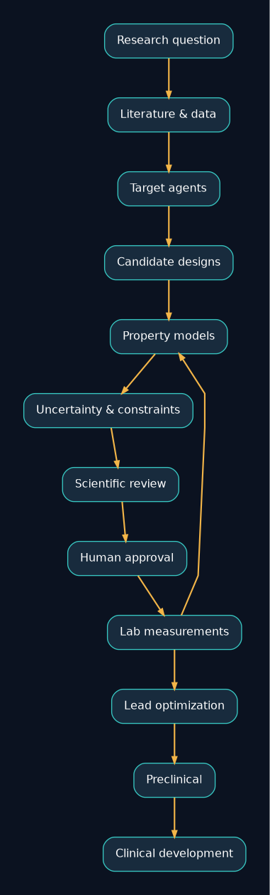
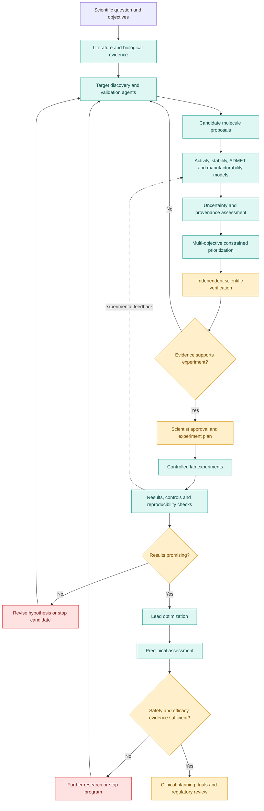

# Research Problem 15 — Drug-Development Assistance

**Can AI Help Scientists Discover Medicines Faster?**  
**PROMPT & PULSE AI | RESEARCH TO REALITY | ANTHROPIC RESEARCH DIRECTION | SERIES 15/20**

> **Educational research case study.** This repository is about research methods, architecture, uncertainty and scientific validation. It is not medical advice, clinical guidance, a validated molecule-ranking system, or a claim that any AI-designed drug is approved.

## Repository map

- `README.md` — complete learning narrative, examples, interview prompt and student challenge.
- `assets/` — real local PNG/SVG illustrations included in the repository; diagrams are original schematic visualizations, not experimental photographs.
- `diagrams/*.mmd` — independently editable Mermaid sources; modify in GitHub or [Mermaid Live](https://mermaid.live/).
- `diagrams/*.dot` — editable Graphviz originals used to render the bundled diagram images.
- `source/original_research_problem_15.txt` — exact provided textual source, including the original diagram-rendering CSS dump, preserved as an archive.

## Diagram gallery

| Research pipeline | Evidence feedback | Decision framework |
|---|---|---|
|  |  |  |

---

## 1. Problem statement
Can artificial intelligence help scientists identify promising drug targets, design candidate molecules, prioritize laboratory experiments, analyze experimental evidence, and improve drug-development decisions while preserving scientific validity and patient safety?

Imagine a biotechnology company researching a treatment for a rare disease.

Its scientists have identified a protein associated with the disease. They now need to find a molecule that can interact with the target in a therapeutically useful way.

The research team may investigate thousands of possibilities.

Some molecules bind to the intended target but are unstable. Others appear promising computationally but fail laboratory tests. Some may have undesirable biological effects.

Now imagine an AI research agent that can analyze the literature, inspect experimental results, recommend promising candidates, and suggest the next experiments.

That could help scientists spend less time evaluating unpromising ideas.

But consider this:

What if an AI identifies a molecule that binds extremely well to the intended target, yet that molecule turns out to be toxic or ineffective in a living organism?

The AI may have optimized one useful property without solving the entire drug-development problem.

This introduces the central research challenge:

How can AI accelerate scientific decisions across drug development without confusing predicted molecular success with demonstrated medical effectiveness?

## 2. Why is this problem difficult?
Drug development is not one problem. It is a sequence of connected scientific and operational challenges.
### The journey from biological discovery to a potential medicine

[Editable Mermaid](diagrams/drug_development_stages.mmd)

Simplified educational pipeline. Actual development is iterative, with overlapping workstreams, failed candidates, and repeated experiments.
A candidate that performs well at one stage may fail at the next.
### Example: Strong binding does not guarantee a good drug
Suppose a candidate molecule binds tightly to a disease-related protein.

That is encouraging.

But scientists must also investigate whether the molecule reaches the intended tissue, stays active long enough, produces the intended biological response, avoids unacceptable toxicity, and can be manufactured consistently.

A candidate may satisfy one of these requirements but fail several others.

The central lesson is that drug development is a multi-objective optimization problem under substantial scientific uncertainty.

The research goal is not simply to generate more molecules.

It is to improve decisions about which candidates and experiments are worth pursuing.

## 3. Technical concepts behind the problem
| Technical concept | What students should understand |
| --- | --- |
| Drug target identification | Identifying a biological molecule or pathway that may be useful to influence therapeutically. |
| Target validation | Establishing evidence that acting on a target could produce a desirable disease-related effect. |
| Molecular representation learning | Encoding molecular structures or sequences into representations useful for prediction. |
| Structure-based modeling | Using molecular structures to investigate possible interactions. |
| Binding affinity | A measure related to how strongly two molecules associate under defined conditions. |
| Lead optimization | Improving promising compounds or biologics across several relevant properties. |
| ADMET | Absorption, distribution, metabolism, excretion, and toxicity. |
| Bayesian optimization | Selecting promising evaluations using a predictive model and uncertainty estimates. |
| Active learning | Choosing informative examples or experiments to improve a model. |
| Multi-objective optimization | Balancing several potentially conflicting goals. |
| Uncertainty quantification | Estimating how uncertain a prediction or experimental conclusion is. |
| High-throughput screening | Experimentally evaluating many candidates using systematic laboratory processes. |
| Experimental design | Choosing measurements that can test a scientific hypothesis. |
| Causal inference | Investigating whether an intervention produces an effect rather than merely correlating with it. |
| Preclinical validation | Testing hypotheses and candidates before human trials using appropriate experimental systems. |
| Clinical validation | Establishing safety and effectiveness in humans through suitable clinical evidence. |

### Understanding the optimization problem
Suppose an AI system evaluates a candidate molecule \(x\).

The scientists care about its predicted activity, stability, toxicity risk, and manufacturing feasibility.

A simplified utility function might be:
\[
U(x)=w_1A(x)+w_2S(x)-w_3T(x)+w_4M(x)
\]

Where:
- \(A(x)\): Predicted biological activity.
- \(S(x)\): Predicted stability.
- \(T(x)\): Predicted toxicity risk.
- \(M(x)\): Predicted manufacturability.
- \(w_i\): Relative weights.
This is an illustrative mathematical model, not a validated drug-development scoring function.

In practice, some properties should be treated as hard constraints rather than traded against other objectives.

For instance, extremely high predicted activity would not justify ignoring unacceptable safety evidence.
### Why uncertainty matters
Imagine two candidate molecules.
### Hypothetical candidate comparison
| Property | Candidate A | Candidate B |
| --- | --- | --- |
| Predicted activity | 9/10 | 8/10 |
| Prediction uncertainty | High | Low |
| Experimental evidence | Limited | Several tests |
| Next decision | Investigate | Investigate |

Invented values for teaching. The ranking cannot be determined reliably without the scientific objective, safety requirements, and strength of evidence.
Candidate A has higher predicted activity, but the prediction is less certain.

Candidate B has slightly lower predicted activity and more experimental support.

Which should be tested next?

That depends on the purpose of the experiment.

If researchers want to exploit promising existing evidence, Candidate B may be attractive. If they want to reduce uncertainty and investigate a potentially stronger candidate, Candidate A may be informative.

[Editable Mermaid](diagrams/candidate_decision.mmd)

This is the exploration versus exploitation trade-off, a foundational concept in active learning, Bayesian optimization, and reinforcement learning.

## 4. End-to-end Mermaid architecture diagram
This diagram illustrates how an AI-assisted drug-development system can combine scientific agents, predictive models, laboratory feedback, verification, and human oversight.

**Editable Mermaid source:** [architecture.mmd](diagrams/architecture.mmd)

### How the architecture works
The system begins with a scientific question and a clearly defined research objective.

AI agents retrieve relevant evidence, propose targets or candidate molecules, and generate predictions.

Uncertainty estimates help scientists identify which proposals deserve further investigation.

Independent scientific checks and human approval determine which experiments should be conducted.

Laboratory results provide new evidence, which can then inform another cycle of modeling and prioritization.

Promising candidates may progress into more extensive preclinical testing.

Clinical development requires separate scientific, medical, ethical, and regulatory processes.

The critical principle is that computational predictions should guide experimental investigation, not substitute for experimental evidence.

## 5. Real research example: Anthropic's AI-assisted drug development
**Anthropic research | October 27, 2026**

On October 27, 2026, Anthropic published Early Progress on Accelerating Drug Development with Claude.

The research describes collaborations with six drug-development organizations and Anthropic's own early-stage research programs. Rather than focusing only on molecule generation, these projects investigate how AI can help across laboratory research, experimental planning, candidate optimization, manufacturing documentation, and clinical development planning.

### Example A — BigHat Biosciences: Improving antibody candidates
BigHat and Anthropic investigated how Claude could help improve promising antibody fragments.

The team needed to balance three important properties: binding strength, stability, and resistance to aggregation (unwanted clumping).
**~1,010** — Molecular variants manufactured and tested

**~10 weeks** — Research and optimization period

According to Anthropic, the strongest improved variants achieved more than tenfold tighter binding relative to their original designs. The team also reported improvements in stability and aggregation behavior.

An especially interesting part of the study occurred when the researchers suspected their original evaluation metrics were misleading. Claude helped reanalyze the data and propose alternative measurements that were subsequently tested in the laboratory.

What students should learn: AI can potentially help not only generate candidate solutions, but also question whether the measurements used to evaluate those solutions are appropriate.
### Example B — Divergence Labs: Exploring candidate designs
Divergence Labs investigated antibody designs for a possible food-allergy treatment approach.

Claude helped translate scientific goals into a design plan and generated approximately 35,000 candidate antibody designs.

The laboratory then tested selected candidates and identified initial promising results for the intended molecular functions.

This is an example of an important distinction:

Generating 35,000 designs is not the same as discovering 35,000 effective medicines.

Only a subset may demonstrate useful experimental properties, and even those remain far from establishing a safe, effective treatment.
### Example C — Enveda: Improving scientific documentation workflows
Drug development also involves substantial documentation.

Enveda used Claude to analyze manufacturing records and identify issues that needed attention.

In a reported evaluation of 1,061 pages, the AI-assisted process identified all 11 issues found by human reviewers, as well as seven additional issues they had missed. Anthropic reported that review time decreased substantially in that evaluation.

This illustrates why drug-development AI extends beyond molecular science.

Some of the most valuable opportunities may involve reducing delays in reviewing information, organizing evidence, and supporting scientific operations.
### What has actually been demonstrated?
These are encouraging early research results, but they should not be interpreted as evidence that AI has produced approved medicines.

Anthropic explicitly describes much of the work as preclinical. Further biological experiments, clinical trials, and regulatory evaluation are needed before candidate treatments can be considered established therapies.

## 6. Research goal
The overarching goal is to improve how scientists allocate effort, experiments, and resources across the drug-development process.

Researchers want AI systems to support more effective target investigation, candidate design, experimental prioritization, interpretation of results, and scientific coordination.

[Editable Mermaid](diagrams/evidence_feedback_loop.mmd)

A particularly important goal is to establish a reliable feedback loop:

Scientific hypothesis → AI prediction → human-reviewed experiment → observed evidence → updated hypothesis.

The ambition is not to eliminate scientists from the process.

It is to help scientific teams investigate more promising possibilities while preserving experimental rigor.
## 7. What remains difficult?
Biological uncertainty: A model may predict a molecule's properties inaccurately because the underlying biology is more complicated than its representation.

Multiple objectives: Activity, stability, manufacturability, and safety may conflict.

Limited experimental data: Many biological questions have too little high-quality data for dependable predictions.

Distribution shift: A molecule that works in one experimental system may behave differently in another.

Uncertainty calibration: AI systems must distinguish confident predictions from uncertain hypotheses.

Causal validity: Statistical association does not establish that modifying a target will improve disease outcomes.

Laboratory reproducibility: Observations should be repeatable under appropriately controlled conditions.

Clinical translation: Successful laboratory or animal results do not establish safety and effectiveness in humans.

Regulatory requirements: Drug-development decisions must be supported by appropriate scientific documentation, quality processes, and human accountability.

The key challenge is to maintain a reliable connection between computational predictions and real biological evidence.

## 8. Interview perspective
Interview question:

How would you design an AI-assisted drug-discovery platform that recommends promising candidate molecules, manages uncertainty, integrates laboratory results, and prevents unverified predictions from being treated as established scientific findings?
### Strong answer direction
Begin with the scientific objective and the target properties that matter.

Describe a system that retrieves existing research, maintains evidence provenance, and uses suitable predictive models to estimate candidate properties.

Introduce multi-objective ranking and uncertainty estimation to prioritize candidates.

Explain how approved laboratory experiments produce new observations that update the models and candidate rankings.

Include independent evaluation, reproducibility checks, secure access to scientific data, audit trails, and scientist-controlled decision gates.

Finally, clearly separate computational predictions, laboratory findings, preclinical evidence, and clinical results.

What the interviewer is testing: Applied machine learning, uncertainty quantification, data pipelines, scientific evaluation, agent orchestration, domain constraints, and human-in-the-loop system design.
### Follow-up question
Why shouldn't an AI drug-discovery agent simply select the molecule with the highest predicted binding affinity?

Because binding affinity is only one property among many. The molecule may have problems with stability, toxicity, delivery, selectivity, or other requirements.

A useful system must account for multiple scientific objectives and assess the quality of the supporting evidence.

## 9. Subscriber learning challenge
Scenario: An AI model predicts that a candidate molecule binds very strongly to a disease-associated target.

The prediction is supported by computational modeling but has not yet been confirmed in laboratory experiments.

What is the most scientifically appropriate next conclusion?

The molecule is already proven to be a safe and effective medicine.

The molecule is a promising hypothesis that requires appropriate experimental validation.

The molecule should immediately enter widespread clinical use.

The agent should ignore all uncertainty because the predicted binding score is high.

### Practical exercise for students
Build a small candidate prioritization dashboard using entirely synthetic data.

Create 50 fictional candidates with normalized predicted activity, stability, toxicity-risk, and uncertainty scores.

Use Python, pandas, and Streamlit to filter candidates according to hard constraints and compare several ranking strategies.

Then introduce uncertainty: increase the uncertainty score for candidates with little supporting data, and compare how the rankings change.

Your deliverable should explain which criteria are used, why candidates are prioritized, what information is missing, and which findings remain unverified.

This teaches constrained optimization and scientific evaluation without requiring biological experiments.

## 10. Primary research references
- Anthropic — Early Progress on Accelerating Drug Development with Claude (October 27, 2026)
- Anthropic — AI for Science Research
- Anthropic — Claude Discovers a Novel Enzyme System (September 2026)
- FDA — The Drug Development Process
### Key takeaway
The greatest opportunity for AI in drug development is not simply generating more candidate molecules. It is helping scientists make better, evidence-informed decisions at each stage of discovery and development.

This research also connects directly to our earlier topics.

Problem 05 — Reward Hacking: Optimizing a single laboratory metric may miss the broader therapeutic objective.

Problem 09 — Preference Learning: The system must understand which properties and constraints matter to the research team.

Problem 10 — Multi-Agent Coordination: Scientific agents must coordinate literature review, data analysis, experiment planning, and verification.

Problem 13 — GPU Optimization: Efficient scientific computation makes it possible to evaluate more research hypotheses with limited computing resources.

The common lesson is that AI-generated predictions should accelerate scientific investigation, while experimental evidence determines what those predictions actually establish.

Prompt & Pulse AI — Learn AI. Build AI. Stay Ahead.

Next in the series: Research Problem 16 — Human Judgment and Oversight: Can AI recommendations influence human experts so strongly that approval becomes a formality rather than a meaningful independent decision?

### Verified source links and evidence notes

- [Anthropic — Early progress on accelerating drug development with Claude (2026-10-27)](https://www.anthropic.com/research/early-progress-drug-development). Primary source for BigHat, Divergence Labs and Enveda numbers; these are **reported findings**, not evidence of approved medicines.
- [Anthropic — Science research index](https://www.anthropic.com/science). Research context and related science posts.
- [FDA — Drug development process](https://www.fda.gov/patients/drug-development-process/step-1-discovery-and-development). Overview of discovery, preclinical, clinical, review and post-market monitoring.

**Evidence distinction:** Anthropic reports ~1,010 *unique* BigHat variants across 1,232 samples; its more-than-tenfold binding improvement applied to the **tightest binders**, not necessarily the two selected balanced finalists. Divergence's ~35,000 designs were computational proposals; selected designs were tested for early molecular functions, not clinical efficacy. Enveda's document-review results are an evaluation of a particular workflow, not a universal accuracy guarantee.

---

*Prompt & Pulse AI — Learn AI. Build AI. Stay Ahead.*
