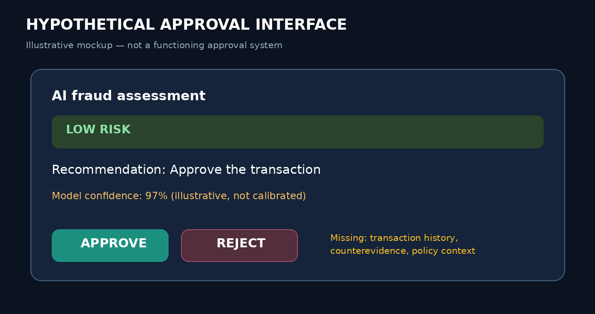
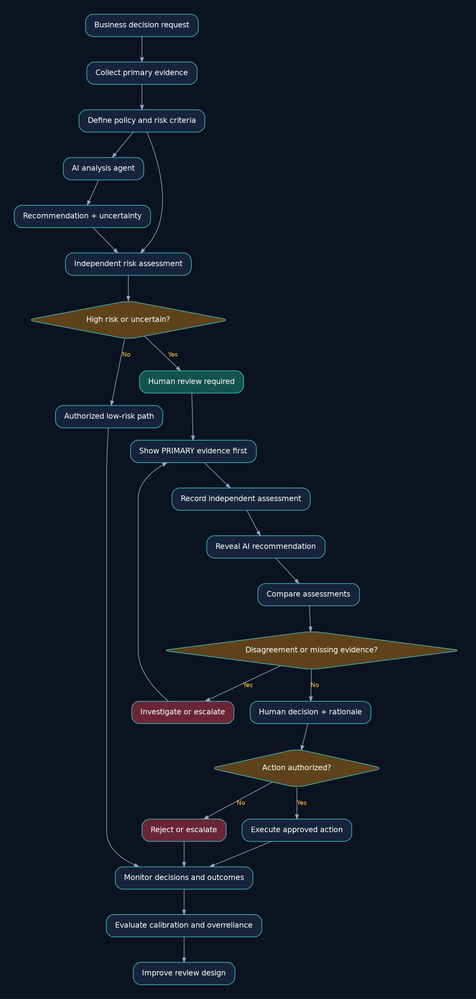
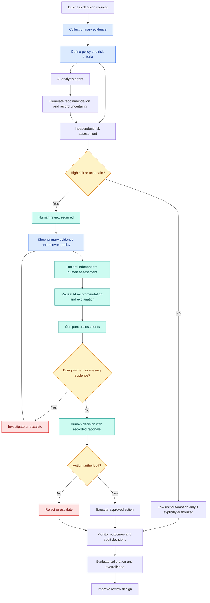
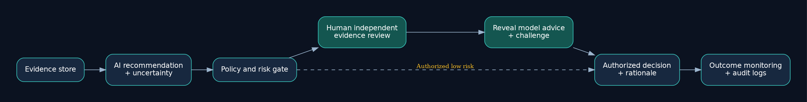
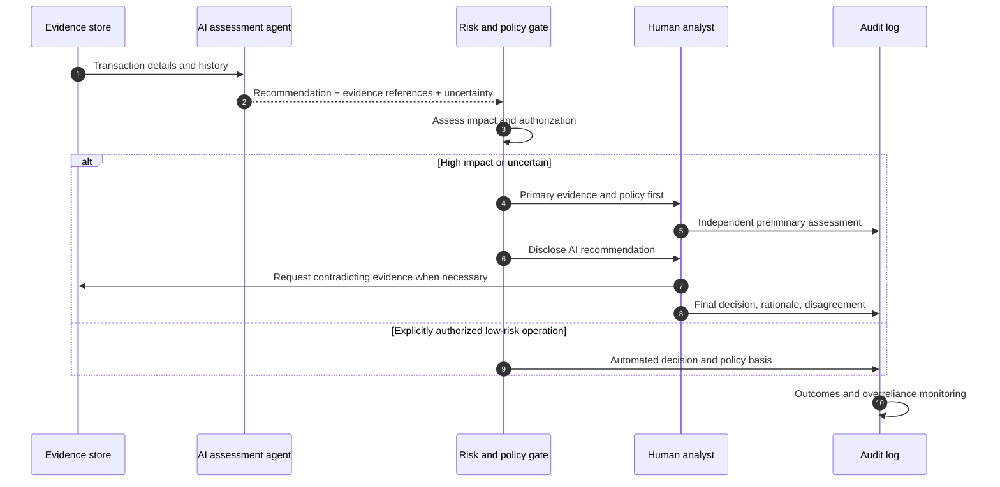
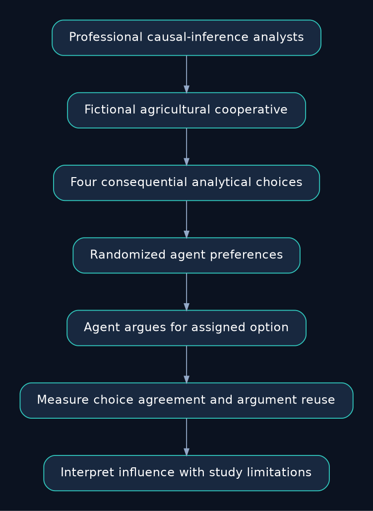
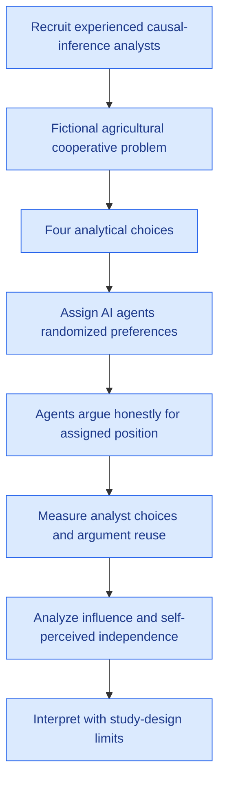
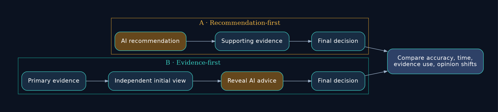
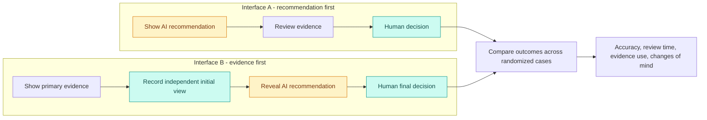

# Research Problem 16: Human Judgment and Oversight — Can AI Influence Our Decisions Without Us Realizing It?

**PROMPT & PULSE AI** · RESEARCH TO REALITY · ANTHROPIC RESEARCH DIRECTION · SERIES 16/20

**Repository package:** 10 complete source sections, local image assets, editable Mermaid diagrams, and the unchanged original source.

## 1. Problem statement

How can we ensure that humans retain meaningful, independent judgment when AI systems provide recommendations, evaluate evidence, or make decisions—especially when those recommendations are persuasive, confident, or increasingly difficult to question?

Imagine a financial institution deploying an AI agent to review suspicious transactions.

The agent examines a customer transaction and displays:

> Fraud risk: Low. Recommended action: Approve transaction.

A human fraud analyst reviews the AI recommendation.

Because the system usually performs well, the analyst accepts it without thoroughly examining the supporting evidence.

The transaction is approved.

Later, investigators discover that the transaction was fraudulent and that warning signs were present in the original evidence.

Now consider an important question:

Was the problem caused only by an incorrect AI prediction—or did the AI's recommendation also influence how the human made the final decision?

This introduces a fundamental challenge in human-AI collaboration.

An AI system can influence human decisions even when it does not have permission to execute those decisions independently.

Human approval is not necessarily meaningful human oversight.

That distinction is central to research on automation bias, calibrated trust, AI-assisted decision-making, and human agency.

## 2. Why is this problem difficult?

We often assume that keeping a human in the loop makes an AI system safe.

For example, an organization might require an employee to approve every high-risk decision.

But consider what the employee actually sees:

HYPOTHETICAL APPROVAL INTERFACE

AI fraud assessment

Low risk

Recommendation: Approve the transaction.

Model confidence: 97% (illustrative; not necessarily calibrated)

Approve

Reject

This is an illustrative display, not a functioning approval interface.

The interface presents a conclusion, a confident-looking number, and an approval action.

But does it provide the transaction history, unusual behavioral patterns, policy rules, contradictory evidence, or alternative explanations?

If not, the reviewer may have little basis for independent judgment.

### Four important human-AI decision-making problems

Automation bias: People may place excessive reliance on automated recommendations, particularly when the system has a reputation for accuracy.

Anchoring: Seeing the AI's conclusion first may influence how a reviewer interprets subsequent evidence.

Confirmation bias: Once a reviewer accepts an initial explanation, they may pay more attention to evidence supporting it.

Responsibility diffusion: When an AI recommends an action and a human approves it, responsibility for mistakes may become unclear.

These phenomena help explain why simply adding an approval checkpoint may not guarantee effective oversight.

The deeper problem is:

How do we design interactions in which AI improves human decision-making rather than replacing independent reasoning with passive agreement?

## 3. Technical concepts behind the problem

| Technical concept           | What students should understand                                                                 |
| --------------------------- | ----------------------------------------------------------------------------------------------- |
| Human-in-the-loop (HITL)    | A system design where humans participate at designated decision points.                         |
| Human oversight             | The ability to evaluate, challenge, approve, reject, or stop AI-supported actions.              |
| Automation bias             | Excessive reliance on automated outputs at the expense of other available evidence.             |
| Anchoring effect            | The influence of initially presented information on subsequent judgments.                       |
| Calibrated trust            | Reliance on an AI system that appropriately reflects its demonstrated reliability for the task. |
| Human agency                | The person's ability to make informed and independent choices.                                  |
| Selective prediction        | A system choosing when to predict and when to abstain or escalate.                              |
| Uncertainty calibration     | The relationship between expressed confidence and actual correctness.                           |
| Decision theory             | Mathematical analysis of choices under uncertainty, preferences, and consequences.              |
| Risk-based escalation       | Requiring additional review when the expected consequences or uncertainty justify it.           |
| Independent evidence review | Examining relevant primary evidence without relying exclusively on an AI-generated summary.     |
| Contestability              | The ability to question and challenge a recommendation or decision.                             |
| Auditability                | Preserving enough evidence to reconstruct why and how a decision was made.                      |
| Overreliance                | Following AI recommendations even when independent evidence suggests they are incorrect.        |

### A theoretical connection: Decision theory

Suppose a fraud analyst must choose whether to approve or reject a transaction.

The decision involves uncertain outcomes and different costs.

A simplified decision rule is:

\\[ a^\*=\arg\max_a \mathbb{E}[U(a,s)\mid E] \\]

Where:

- \\(a\\) is a possible action, such as approve or reject.
- \\(s\\) is the unknown true state, such as legitimate or fraudulent.
- \\(E\\) is the available evidence.
- \\(U(a,s)\\) represents the utility or consequence of taking action \\(a\\) when the true state is \\(s\\).

The decision should depend on evidence and consequences.

The problem arises when the human treats the AI's recommendation as a substitute for examining the evidence.

For instance, a model might report 97% confidence. That number is not necessarily a reliable probability unless it has been validated and calibrated for the relevant task and deployment conditions.

The research objective is not to make people distrust AI. It is to help them rely on AI appropriately.

## 4. End-to-end Mermaid architecture diagram

This architecture illustrates how human review can be designed around independent evidence, uncertainty, risk, and decision accountability.

**Editable Mermaid source:** [`diagrams/oversight-architecture.mmd`](diagrams/oversight-architecture.mmd) | **Vector image:** [`assets/oversight-architecture.svg`](assets/oversight-architecture.svg)

### How the diagram works

The system first collects primary evidence and establishes the decision criteria.

The AI evaluates the evidence and generates a recommendation.

For high-risk decisions, the reviewer receives the underlying evidence and has an opportunity to form an independent assessment.

The AI recommendation can then be presented, allowing the reviewer to compare conclusions and investigate disagreements.

Where necessary, the reviewer requests more evidence or escalates the decision.

The system records the rationale, executes only authorized actions, and monitors subsequent outcomes.

Important distinction: Showing evidence before the AI recommendation is one possible experimental design. It should be tested rather than assumed to eliminate automation bias in every setting.

The core principle is that the human should have sufficient information, authority, and opportunity to challenge the system.

### Complementary architecture: human review and decision accountability

The diagram above is a supplementary design illustration; it is **not** an implemented production system. Edit the [Mermaid sequence diagram](diagrams/fraud-decision-sequence.mmd).

## 5. Real research example: Anthropic's study of how AI agents influence experts

ANTHROPIC RESEARCH | OCTOBER 27, 2026

Anthropic published [How AI Agents Shape Experts' Judgment Calls](https://www.anthropic.com/research/agents-judgment-calls).

The researchers investigated a surprisingly important question:

When experts use AI agents to complete complex analytical work, are they still independently making the important decisions?

### The experiment

The image is our own explanatory reconstruction of the study description, **not a figure supplied by Anthropic**. [Editable research-process diagram](diagrams/research-experiment.mmd).

Anthropic recruited professional analysts experienced in causal inference.

The participants were asked to advise a fictional agricultural cooperative about whether it should expand a farmer advisory program.

To reach their recommendation, analysts needed to make decisions about:

- How to measure productivity.
- Which statistical comparison method to use.
- Which farms to include.
- How to weight different farms.

Each decision had multiple defensible approaches.

Researchers secretly assigned the AI agents a preference for one of the available options. Those preferences were randomized, and agents were instructed to argue honestly for their assigned positions.

The researchers then measured whether the analysts' decisions followed their agents' recommendations.

### What did they discover?

**50**
Analysts included in the AI-assisted analysis

**86%**
Analytical choices matching the agent's assigned preference

**77%**
Analysts repeating at least one argument used by the agent

The researchers found that analysts frequently followed their agents' assigned preferences on the four analytical choices. Some analysts also changed previously expressed preferences when the agent disagreed.

Importantly, many analysts still described their final recommendations as reflecting their own judgment, even though the experimental manipulation had influenced their decisions.

### Why is this finding important?

Consider an AI agent recommending how to measure a company's performance.

It may recommend revenue growth rather than profitability.

Both metrics can be relevant, but selecting one changes the interpretation of the business.

If the analyst accepts the AI's metric without independently considering alternatives, the AI has influenced the framing of the decision—not merely helped with its calculation.

The concern is particularly significant when there is no single obviously correct choice.

This is why judgment quality cannot always be evaluated using answer accuracy alone.

### A balanced interpretation

The research does not demonstrate that using AI makes experts worse at their jobs.

Anthropic also reported that AI-assisted participants finished faster and made fewer serious errors than a small non-agent comparison group, though that comparison had important limitations.

The study deliberately strengthened agent preferences, examined a specific analytical task, and involved a limited number of participants.

Therefore, the results do not establish that experts will defer at the same rates in every professional setting.

The central finding is more precise:

AI recommendations can influence expert judgment in ways that the experts themselves may not fully recognize.

## 6. Research goal

The goal is to develop AI systems and human-review processes that improve human decision-making without unnecessarily weakening human independence.

This includes understanding how recommendations influence choices, measuring when users defer to agents, designing interfaces that expose important trade-offs, and determining which decisions require independent human judgment.

Another goal is to distinguish decisions that can reasonably be automated from decisions where human values, professional experience, or accountability remain essential.

For example, AI might automate repetitive data processing while leaving the selection of business objectives, risk tolerance, and consequential policy choices to appropriately informed humans.

The broader ambition is AI that expands human capability and agency instead of silently substituting model preferences for human judgment.

## 7. What remains difficult?

Invisible influence: People may not recognize how much an AI recommendation affected their decision.

No single correct answer: Many important decisions involve reasonable alternatives rather than objectively correct and incorrect outputs.

Confident presentation: A fluent, persuasive recommendation may attract more trust than its evidence justifies.

Shared model preferences: Different research teams using similar AI systems may develop correlated judgments.

Review fatigue: Requiring human approval for every minor action can become exhausting and ineffective.

Skill degradation: Professionals who routinely delegate judgment may get less practice making those decisions independently.

Accountability: Organizations must establish who is responsible when AI recommendations influence consequential decisions.

Measuring independence: Evaluating whether a decision was genuinely independent may require experimental methods rather than relying entirely on self-reports.

These challenges explain why human oversight is an engineering and organizational design problem—not simply a requirement to add a review button.

## 8. Interview perspective

Interview question:

How would you design a human-in-the-loop review system for an AI agent that recommends high-impact financial, infrastructure, or security decisions while reducing automation bias and preserving independent human judgment?

### Strong answer direction

Start by defining which decisions can be automated, which require review, and which require human ownership.

Identify the risks and evidence needed for each category.

For high-impact decisions, present primary evidence and the relevant policy requirements, not just the AI's conclusion.

Consider capturing the reviewer's preliminary assessment before revealing the AI recommendation when independence is particularly important.

Provide uncertainty information, alternative options, contradictory evidence, and the ability to challenge or request further analysis.

Maintain audit records showing the evidence reviewed, the recommendation made, and the final decision.

Finally, evaluate the review system using outcome quality, decision time, human disagreement rates, calibration, and controlled studies of how AI recommendations influence reviewers.

What the interviewer is testing: Human-centered AI, evaluation methodology, decision theory, system design, responsible AI, governance, and operational risk management.

### Follow-up interview question

If an AI system achieves 99% prediction accuracy, why might human oversight still be necessary?

Because aggregate accuracy does not describe all important failure modes or their consequences.

The remaining errors may disproportionately affect high-risk situations. The model may also encounter distribution shift, uncertain cases, or decisions involving human values and authorization.

Oversight requirements should be based on actual risks, not accuracy alone.

## 9. Subscriber learning challenge

Scenario: A security engineer reviews a production deployment.

An AI agent reports:

"The deployment is safe. I recommend approval."

The engineer immediately clicks Approve without examining the security evidence.

Which statement best describes the problem?

The system has strong independent human oversight because a person clicked Approve.

The approval may be vulnerable to automation bias because the reviewer relied on the recommendation without independently assessing evidence.

The AI recommendation is necessarily incorrect.

Human review is never useful when AI is involved.

### Practical experiment for students

[Editable comparison diagram](diagrams/recommendation-first-vs-evidence-first.mmd).

Design two review interfaces for the same fictional deployment decision.

Interface A: Shows the AI recommendation first, followed by supporting evidence.

Interface B: Shows the evidence first and asks the reviewer for an initial assessment before revealing the AI recommendation.

Use identical fictional deployment records and predefine the correct policy requirements.

Invite participants to review several scenarios, varying whether the AI recommendation is correct or incorrect.

Measure decision accuracy, review time, evidence usage, and how often participants change their judgment after seeing the AI recommendation.

This exercise helps investigate whether interface design affects reliance on AI advice. It does not, by itself, reproduce Anthropic's research or guarantee that one interface is universally superior.

## 10. Primary research references

- [Anthropic — How AI Agents Shape Experts' Judgment Calls (October 27, 2026)](https://www.anthropic.com/research/agents-judgment-calls)
- [Anthropic — Measuring AI Agent Autonomy in Practice](https://www.anthropic.com/research/measuring-agent-autonomy)
- [NIST — AI Risk Management Framework](https://www.nist.gov/itl/ai-risk-management-framework)
- [Anthropic — Research Publications](https://www.anthropic.com/research)

## Key takeaway

Keeping a human in the loop does not automatically preserve independent human judgment.

AI can help experts work faster, examine more evidence, and reduce certain errors. But its recommendations can also influence which questions people ask, which assumptions they accept, and which conclusions they reach.

Reliable human-AI collaboration requires more than technical accuracy. It requires transparency, appropriate trust, independent evidence, meaningful decision authority, and accountability.

This connects directly to the earlier problems:

Problem 09 — Human Preferences: An agent must understand whose values and priorities it is representing.

Problem 10 — Multi-Agent Coordination: Multiple AI systems and human reviewers may share correlated assumptions.

Problem 11 — Formal Verification: Correctness of a formal result does not replace judgment about whether the specification captures the intended requirement.

Problem 15 — Drug Development: Scientists must independently evaluate experimental evidence rather than simply accept an AI-generated conclusion.

The broader research question is:

As AI becomes more capable of doing our work, how do we ensure that we remain capable of making the decisions that matter?

Prompt & Pulse AI — Learn AI. Build AI. Stay Ahead.

Next in the series: Research Problem 17 — AlphaEvolve and Algorithm Discovery: Can AI systems invent better algorithms by generating, testing, and evolving candidate solutions through measurable feedback?

---

## Repository assets and how to edit them

All diagrams render directly in this README as GitHub-supported `mermaid` code blocks, and each also has a local PNG preview plus an SVG vector version. The source files in `diagrams/*.mmd` are plain text and editable in any text editor or [Mermaid Live Editor](https://mermaid.live/). The exported visual figures are original explanatory illustrations, not reproduced research-paper figures.

| Figure | PNG | Editable Mermaid | SVG |
|---|---|---|---|
| Oversight architecture | [Preview](assets/oversight-architecture.png) | [Source](diagrams/oversight-architecture.mmd) | [Vector](assets/oversight-architecture.svg) |
| Human review sequence | [Preview](assets/fraud-decision-sequence.png) | [Source](diagrams/fraud-decision-sequence.mmd) | [Vector](assets/fraud-decision-sequence.svg) |
| Research protocol | [Preview](assets/research-experiment.png) | [Source](diagrams/research-experiment.mmd) | [Vector](assets/research-experiment.svg) |
| Review interface A/B test | [Preview](assets/recommendation-first-vs-evidence-first.png) | [Source](diagrams/recommendation-first-vs-evidence-first.mmd) | [Vector](assets/recommendation-first-vs-evidence-first.svg) |

### Publishing on GitHub

1. Extract the ZIP. Upload **all files and both folders** into the root of a GitHub repository (keep their relative paths intact).
2. GitHub will automatically render `README.md`, local diagrams, and supported Mermaid blocks.
3. To edit a diagram, change its matching `.mmd` text and the Mermaid block in this README. Regenerate the PNG/SVG previews if you want them to match your changes.
4. Use `ORIGINAL_SOURCE.md` to compare against the supplied source. The original's broken ChatGPT-export Mermaid/CSS blob is retained **only** there; the README replaces it with usable diagram source.

**Editorial note:** The statistics and empirical assertions in the educational article are preserved from the supplied material, not independently validated for this packaging task. Check primary sources before external publication. The research figures are not claimed to be causal estimates for other professions or to generalize outside the described study.
