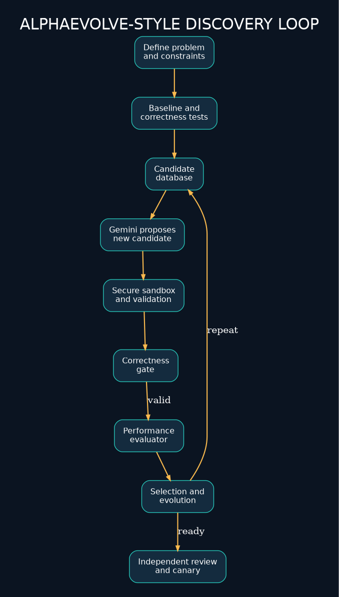
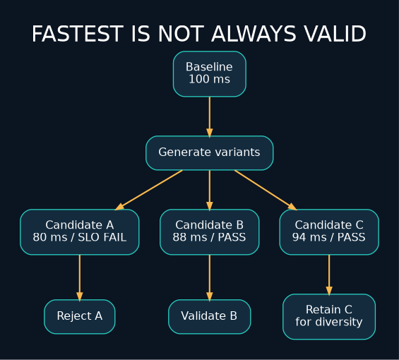
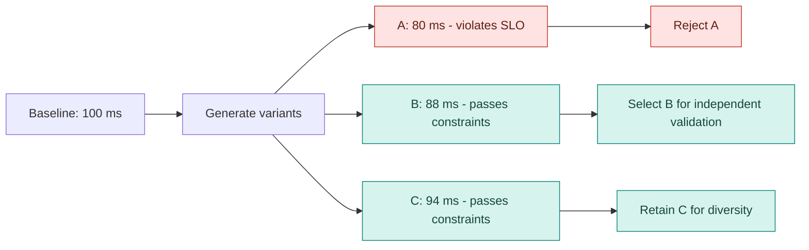
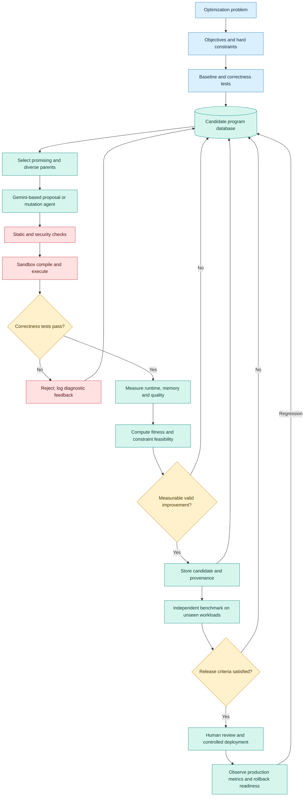
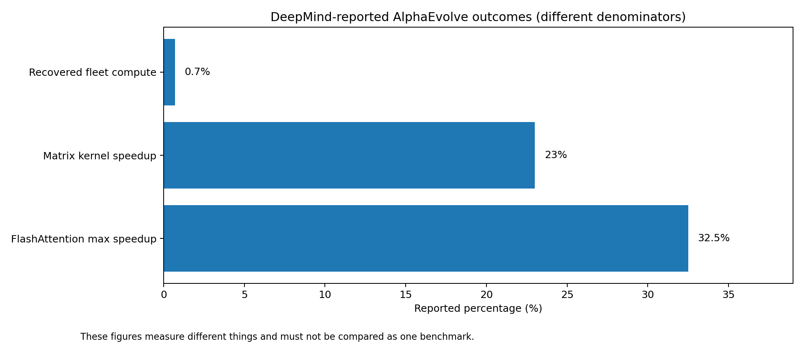
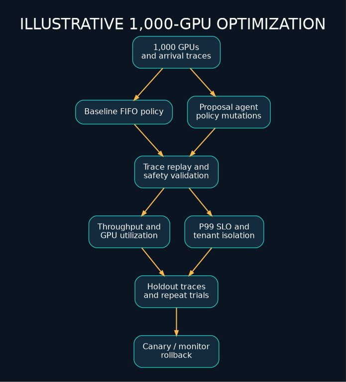
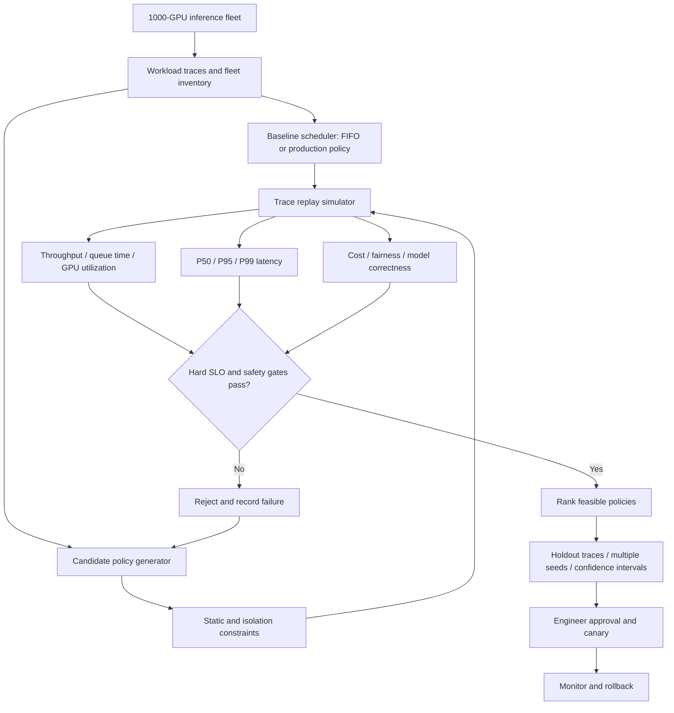

<div align="center">


# Research Problem 17 — AlphaEvolve and Algorithm Discovery

### Can AI Invent Better Algorithms?

**PROMPT & PULSE AI · RESEARCH TO REALITY · SERIES 17/20**

[Original 2025 research](https://deepmind.google/blog/alphaevolve-a-gemini-powered-coding-agent-for-designing-advanced-algorithms/) · [2026 research update](https://deepmind.google/blog/alphaevolve-impact/) · [Hands-on Python](examples/mini_evolution.py)
</div>



> **Reading guide:** This repository faithfully preserves the instructional text in the supplied Research Problem 17 source. The broken copy/pasted diagram and one-line Python program were reconstructed as valid, editable files. Diagrams here are **educational illustrations**, not reverse-engineered or official AlphaEvolve internals. Reported performance results are attributed to Google DeepMind and are not independently reproduced here.

## Contents
1. [Problem statement](#1-problem-statement)
2. [Why this is difficult](#2-why-is-this-problem-difficult)
3. [Technical concepts](#3-technical-concepts-behind-the-problem)
4. [Architecture](#4-end-to-end-mermaid-architecture-diagram)
5. [Research results](#5-real-research-examples-what-has-alphaevolve-actually-achieved)
6. [Research goal](#6-research-goal)
7. [Open difficulties](#7-what-remains-difficult)
8. [Interview perspective](#8-interview-perspective)
9. [Learning challenge](#9-subscriber-learning-challenge)
10. [References](#10-primary-research-references)

---

PROMPT & PULSE AI | RESEARCH TO REALITY | GOOGLE DEEPMIND RESEARCH DIRECTION | SERIES 17/20

## 1. Problem statement

Can artificial intelligence autonomously discover new algorithms, improve existing software, and identify more efficient computational strategies by repeatedly generating candidate solutions, testing them, and learning from measurable feedback?

Imagine a technology company running thousands of servers that support AI applications.

Its engineers have already optimized the infrastructure using traditional algorithms.

The system works reliably, but the company wants to process more workloads without purchasing additional hardware.

An AI optimization agent examines the scheduling logic and proposes a small change.

The change passes correctness tests, and simulations indicate that the scheduler can accommodate more workloads with the same resources.

The company validates the improvement and deploys it.

Now consider the interesting part.

The AI did not simply explain how the existing algorithm worked. It discovered an alternative that performed better under the evaluation criteria.

That is the central idea behind AlphaEvolve.

Google DeepMind introduced AlphaEvolve in May 2025 as a Gemini-powered coding agent that combines code generation, automated evaluation, and evolutionary search.

The broader research question is:

Can AI move beyond generating plausible code to discovering reproducible algorithmic improvements that human engineers or researchers have not previously found?

## 2. Why is this problem difficult?

Consider a software engineer optimizing a function.

The engineer can inspect the code, identify an inefficient loop, propose a better implementation, and benchmark the result.

But many optimization problems involve enormous search spaces.

A GPU kernel might have many possible combinations of block sizes, memory layouts, instruction sequences, and synchronization strategies.

A scheduling algorithm may have numerous possible heuristics.

A mathematical algorithm may have entirely different computational formulations that are difficult to discover manually.

Testing every possible implementation is infeasible.

AI-assisted algorithm discovery attempts to search these spaces more intelligently.

### Traditional code generation versus algorithm discovery

| Traditional AI code generation | AI-assisted algorithm discovery |
|---|---|

| Generate code from a request | Generate multiple candidate implementations |

| Often stop after a plausible solution | Run automated correctness and performance evaluations |

| Human initiates most revisions | Use feedback to guide further search |

| Focus on producing an implementation | Focus on discovering a measurable improvement |

| Success may be judged by code quality and tests | Success requires validity and comparison with a baseline |

The critical difference is the feedback loop.

A model generates possible solutions. An external evaluator measures them. The search process uses those measurements to guide subsequent candidates.

That feedback can make the system more effective than generating one solution and stopping.

However, the evaluator must be reliable. If it measures the wrong objective, the agent may discover shortcuts that score well while violating the intended requirements.

This connects directly to Research Problem 05: Reward Hacking and AI Alignment.

## 3. Technical concepts behind the problem

| Technical concept | What students should understand |
|---|---|

| Algorithm discovery | Finding new computational methods for solving problems. |

| Program synthesis | Automatically constructing programs that satisfy requirements or examples. |

| Evolutionary algorithms | Search methods that generate and select candidate solutions across iterations. |

| Mutation | Changing a candidate program to create a variation. |

| Fitness function | A measurement that determines how useful a candidate is for the search objective. |

| Candidate population | A collection of possible solutions maintained during search. |

| Selection | Choosing promising candidates for further exploration. |

| Automated evaluation | Running correctness tests and objective scoring without manually reviewing every candidate. |

| Search space | The set of possible algorithms or implementations being considered. |

| Exploration | Investigating unfamiliar candidates that may reveal better approaches. |

| Exploitation | Refining solutions already known to perform well. |

| Baseline comparison | Comparing a candidate with an established reference implementation. |

| Reproducibility | Obtaining consistent results under documented conditions. |

| Pareto optimization | Identifying trade-offs where no objective can be improved without worsening another. |

| Sandbox execution | Running generated programs within controlled environments. |

### The fitness-function concept

Suppose an AI optimization agent generates candidate programs \(c\).

A simple scoring function could be:

\[

S(c)=\alpha Q(c)-\beta T(c)-\gamma M(c)

\]

Where:

- \(Q(c)\) represents a quality score.

- \(T(c)\) represents execution time.

- \(M(c)\) represents memory consumption.

- \(\alpha,\beta,\gamma\) represent the relative importance of these measurements.

This is an illustrative model, not AlphaEvolve's universal scoring formula.

For software optimization, correctness often should not be traded against speed.

A safer formulation is:

\[

\min_c T(c)

\]

subject to:

\[

\operatorname{Correct}(c)=\text{True}

\]

and:

\[

M(c)\leq M_{\max}

\]

The agent searches for the fastest valid implementation that satisfies the required memory constraint.

This is constrained optimization.

### Why evolutionary search?

Suppose the system starts with program A.

It generates three modifications:





[Edit candidate-selection Mermaid](diagrams/candidate-selection.mmd)

Conceptual evolutionary selection. The fastest valid candidate becomes a promising starting point for additional search.

The system does not necessarily choose the newest or most complicated implementation.

It selects candidates based on measured performance and correctness.

Over many iterations, this approach can explore solutions that differ substantially from the original program.

## 4. End-to-end Mermaid architecture diagram

The following is **editable Mermaid code** rendered directly by GitHub. A PNG preview is stored locally as a fallback.




[Edit Mermaid source](diagrams/alphaevolve-architecture.mmd)

This diagram illustrates the generate–evaluate–select–evolve process and extends it with safeguards needed for practical engineering.

### How the diagram works

The process begins with a clearly defined optimization problem.

Engineers establish a baseline and provide tests or evaluators that can measure important properties.

The agent selects promising previous programs and generates modifications.

Each candidate runs in a controlled environment.

Invalid candidates are rejected or retained only as diagnostic search feedback. Valid candidates receive measurable performance scores.

The evolutionary search selects promising and diverse candidates for future exploration.

Once a candidate demonstrates a useful improvement, engineers perform independent validation before deployment.

The key principle: A generative model proposes ideas, but a trustworthy evaluator determines which ideas deserve to survive.

Google DeepMind's published AlphaEvolve architecture follows this general pattern of language-model proposals, automated evaluators, a program database, and evolutionary selection.

## 5. Real research examples: What has AlphaEvolve actually achieved?



*Google DeepMind | May 2025 – May 2026*

Google DeepMind's original AlphaEvolve research and its May 2026 follow-up describe applications in data-center scheduling, AI training, GPU optimization, mathematics, genomics, and commercial computing.

### Example A — Improving Google's data-center scheduling

Imagine thousands of machines running jobs with different resource demands.

Some jobs need large amounts of memory. Others require compute capacity, specialized accelerators, or particular placement constraints.

A scheduling algorithm determines where those jobs run.

AlphaEvolve discovered an improved scheduling heuristic for Google's Borg infrastructure.

**Reported production result:**

**0.7%**

Average worldwide compute resources recovered.

Google reported this sustained efficiency gain from a scheduling heuristic developed with AlphaEvolve.

At first, 0.7% may sound small.

But at the scale of a large data-center fleet, even a modest improvement can represent significant computing capacity.

Technical concepts: Resource allocation, bin packing, scheduling heuristics, optimization constraints, distributed systems.

Research lesson: A simple, measurable algorithmic improvement can create substantial value when applied repeatedly at scale.

### Example B — Optimizing AI training and inference

AlphaEvolve also investigated lower-level computational operations used in neural networks.

Google reported that one optimization improved a Gemini matrix-multiplication kernel by 23%, contributing to a 1% reduction in training time in the evaluated setting.

It also reported speedups of up to 32.5% in an optimized FlashAttention kernel implementation.

**23%**

Reported speedup in a matrix-multiplication kernel.

**32.5%**

Maximum reported FlashAttention kernel speedup.

This connects directly to Problem 13: GPU kernel optimization.

But note the distinction between a kernel-level improvement and an entire application's improvement.

A 23% faster kernel does not necessarily make the whole training pipeline 23% faster, because other operations still consume time.

### Example C — Discovering matrix-multiplication algorithms

Matrix multiplication is fundamental to neural networks, scientific computing, graphics, and many numerical applications.

AlphaEvolve discovered a method for multiplying \(4\times4\) complex-valued matrices using 48 scalar multiplications, improving on a previously best-known construction for the stated setting.

This is an algorithmic discovery rather than merely a hardware-specific code optimization.

Why it matters: Improving the mathematical structure of an algorithm can potentially create benefits that are different from compiler or GPU-level improvements.

### Example D — Expanding to other fields in 2026

Google's May 2026 update reported additional applications:

| Domain | Reported improvement |
|---|---|

| Genomics | 30% reduction in variant-detection errors in a DeepConsensus optimization |

| Electricity-grid optimization | Feasible solution rate increased from 14% to over 88% for a specific model and problem setting |

| Google Spanner | 20% reduction in write amplification from improved compaction heuristics |

| Logistics | 10.4% routing-efficiency improvement in a reported customer application |

These are domain-specific, reported outcomes rather than evidence that AlphaEvolve automatically improves all algorithms.

The bigger pattern is that a search system combining code generation with objective evaluation can be applied across different domains when suitable evaluators are available.

## 6. Research goal

AlphaEvolve's broader research goal is to make algorithm discovery and optimization more systematic and scalable.

The intended capabilities include generating novel implementations, automatically testing candidates, discovering improvements over established baselines, and using feedback to investigate increasingly promising solutions.

One especially interesting long-term ambition is to reduce the human effort required to explore difficult optimization spaces.

Instead of engineers manually trying a handful of alternatives, an AI-assisted system can search many candidates using automated evaluations.

However, AlphaEvolve is particularly suited to problems with clear, executable evaluation criteria. Problems whose success depends on subjective or difficult-to-measure outcomes require different safeguards or may not be suitable for this approach.

## 7. What remains difficult?

Evaluator correctness: An imperfect evaluator can reward invalid solutions.

Overfitting: A candidate may work exceptionally well on benchmark inputs but poorly on unseen workloads.

Search cost: Generating, compiling, and testing many programs can consume considerable computation.

Hardware dependence: A solution optimized for one accelerator or server configuration may not generalize.

Reproducibility: Reported improvements must survive repeated measurements under controlled conditions.

Security: AI-generated code must execute in appropriately restricted environments.

Multi-objective trade-offs: Faster execution might increase memory requirements, energy consumption, or other costs.

Scientific validity: A computationally promising result may still require a mathematical proof or domain-specific validation.

The research challenge is not simply generating more candidate programs. It is selecting candidates using evaluations that meaningfully represent the intended objective.

## 8. Interview perspective

Interview question:

How would you design an AlphaEvolve-style optimization agent to improve an LLM inference scheduling algorithm running across 1,000 GPUs?





[Edit GPU scheduler Mermaid](diagrams/gpu-scheduling-case.mmd)

### Strong answer direction

Begin by defining the business problem.

Suppose the goal is to reduce cost per successful inference request while preserving P99 latency, model quality, reliability, and tenant isolation.

Build a representative workload dataset containing arrival rates, prompt lengths, output lengths, model requirements, and hardware capacities.

Establish a baseline scheduling policy, such as FIFO or an existing production heuristic.

Create an evaluation environment that replays workload traces and measures throughput, queueing delay, latency, utilization, cost, and constraint violations.

Use an agent to generate candidate scheduling policies.

Run every candidate through correctness and safety checks, then benchmark valid candidates.

Retain promising implementations and use their results to guide later search.

Finally, conduct independent validation on unseen traces, obtain review approval, and deploy using a limited canary rollout.

What the interviewer is testing: Algorithm design, optimization, agent orchestration, benchmarking, scheduling, GPU infrastructure, software testing, and production reliability.

### Follow-up interview question

What if the agent discovers a scheduling policy that improves GPU utilization but increases P99 latency?

The answer depends on the constraints.

If P99 latency exceeds a hard SLO, the candidate must be rejected or revised even if utilization improves.

This is the same underlying principle explored in Problem 05: optimizing a metric does not guarantee achievement of the real goal.

## 9. Subscriber learning challenge

An AI optimization agent generates two implementations of a scheduling algorithm.

Candidate A: 20% faster than the baseline, but violates the required latency SLO for some workloads.

Candidate B: 12% faster than the baseline and satisfies all required constraints in the evaluation.

Which candidate is preferable for further validation?

Candidate A, because it is the fastest.

Candidate B, because it improves performance while satisfying the evaluated constraints.

Whichever candidate was generated most recently.

Both should immediately be deployed without further testing.

### Hands-on Python experiment: Build a miniature evolutionary optimizer

This CPU-only example searches for a better value of \(x\) for a known mathematical objective.

It illustrates mutation, selection, and evaluation. It is not a reproduction of AlphaEvolve's full architecture.

```python

"""CPU-only illustration of evolutionary numeric search, NOT AlphaEvolve itself."""
import random

random.seed(42)

def objective(x: float) -> float:
    return (x - 7) ** 2 + 3

population = [random.uniform(-20, 20) for _ in range(20)]
for generation in range(30):
    population.sort(key=objective)
    elite = population[:5]
    offspring = []
    for _ in range(15):
        parent = random.choice(elite)
        child = parent + random.gauss(0, 2)
        offspring.append(child)
    population = elite + offspring

best = min(population, key=objective)
print("Best solution:", round(best, 4))
print("Objective value:", round(objective(best), 4))
print("Known optimum: x = 7, f(x) = 3")

```

The experiment uses numerical optimization rather than code generation.

An advanced extension would replace the numerical candidates with different implementations of a Python algorithm, execute correctness tests, and benchmark each implementation.

That would more closely resemble the program-search aspect of AlphaEvolve.

## 10. Primary research references

- [Google DeepMind — AlphaEvolve: A Gemini-Powered Coding Agent (May 2025)](https://deepmind.google/blog/alphaevolve-a-gemini-powered-coding-agent-for-designing-advanced-algorithms/)

- [Google DeepMind — AlphaEvolve: Scaling Impact Across Fields (May 2026)](https://deepmind.google/blog/alphaevolve-impact/)

- [Google DeepMind — Research](https://deepmind.google/research/)

- [Google DeepMind — AI for Science](https://deepmind.google/science/)

### Key takeaway

AlphaEvolve demonstrates how generative AI can be combined with automated evaluation and evolutionary search to discover computational improvements—not simply generate code that looks plausible.

The underlying principle is:

Generate candidate → Test correctness → Measure performance → Select promising candidates → Improve and repeat.

The quality of the outcome depends on the quality of the evaluation process.

This connects the previous research problems:

Problem 05 — Reward Hacking: A flawed objective can reward undesirable shortcuts.

Problem 10 — Multi-Agent Coordination: Specialized agents and evaluators need clear responsibilities and reliable information exchange.

Problem 12 — Mathematical Discovery: A new algorithmic claim requires rigorous verification.

Problem 13 — GPU Optimization: Better algorithms can reduce computation and memory costs.

Problem 14 — Quantum Circuit Optimization: AI-assisted search can explore hardware-aware computational designs.

The most important question for students is:

If an AI system claims to have discovered a better algorithm, what evidence would convince you that the improvement is correct, reproducible, and useful beyond its benchmark?

Prompt & Pulse AI — Learn AI. Build AI. Stay Ahead.

Next in the series: Research Problem 18 — World Models and Embodied Intelligence: How can AI learn to predict the physical consequences of its actions and use those predictions to plan more reliably?

---

## Run the CPU-only learning lab

```bash
python examples/mini_evolution.py
```

The example optimizes a *number*, rather than modifying program source code. It demonstrates mutation, elitism and fitness evaluation only; it is intentionally not a reproduction of the proprietary AlphaEvolve platform. See [the original uploaded text](SOURCE_ORIGINAL.txt) for provenance.

## Repository assets and editing

| Location | What it contains |
|---|---|
| `README.md` | Complete educational walkthrough and GitHub-rendered Mermaid |
| `assets/*.png` | Actual bundled images (no external image links required) |
| `diagrams/*.mmd` | Source Mermaid diagrams, editable in GitHub or Mermaid Live Editor |
| `diagrams/*.dot` | Editable Graphviz source of the PNG architecture previews |
| `examples/mini_evolution.py` | Runnable CPU-only experiment |
| `SOURCE_ORIGINAL.txt` | Unmodified source, including damaged exported diagram/style markup, for completeness |

**Important editorial distinctions:** the numeric performance improvements refer to different workload settings and denominators; they are not interchangeable. Test and security gates in the architecture are a recommended engineering design, not a claim that every AlphaEvolve deployment uses exactly this pipeline. The article's multiple-choice learner challenge has **Candidate B** as the correct response for further validation, not automatic release.

**License and attribution:** Original explanatory text supplied by the newsletter author. The repository includes new educational diagrams, not Google-owned article images. AlphaEvolve and Gemini are associated with Google DeepMind. Verify all production or research claims against the primary references above.
