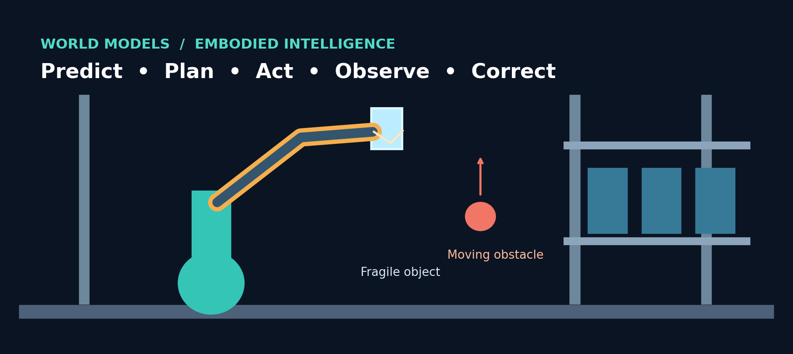
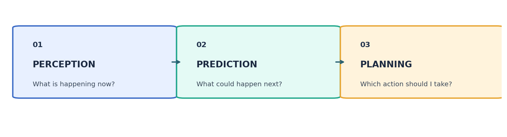
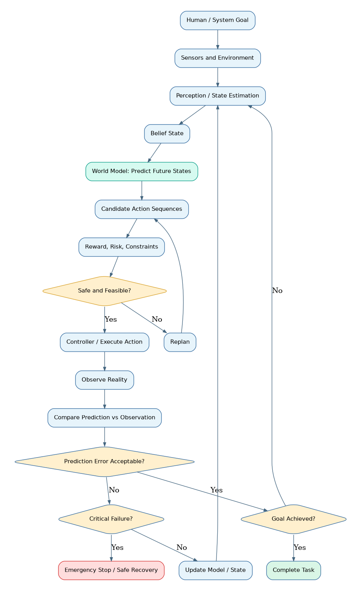
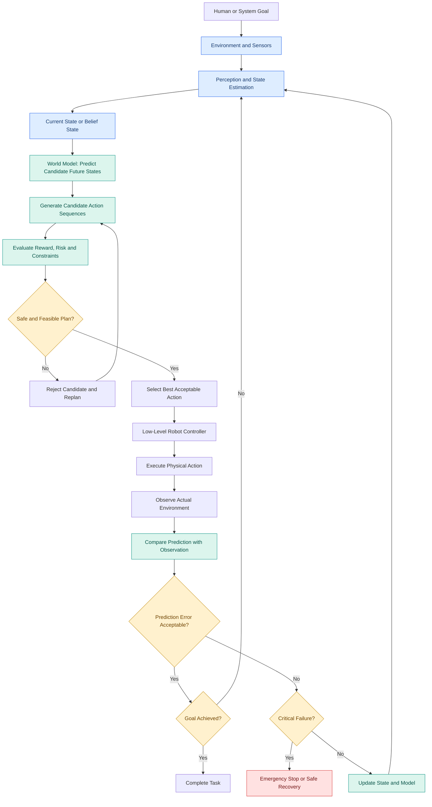
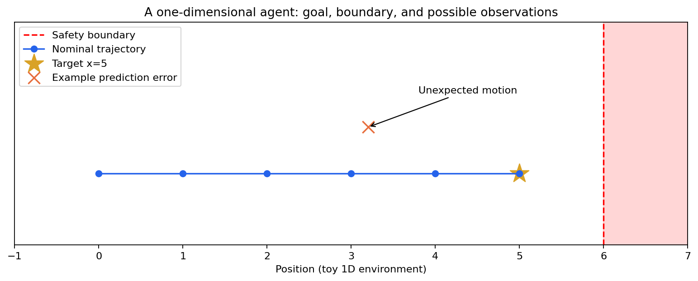
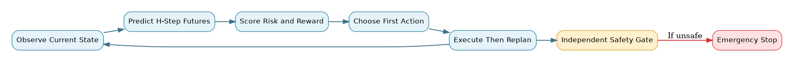
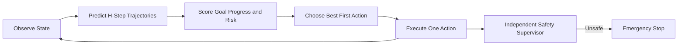
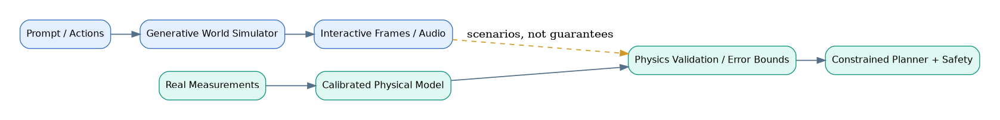
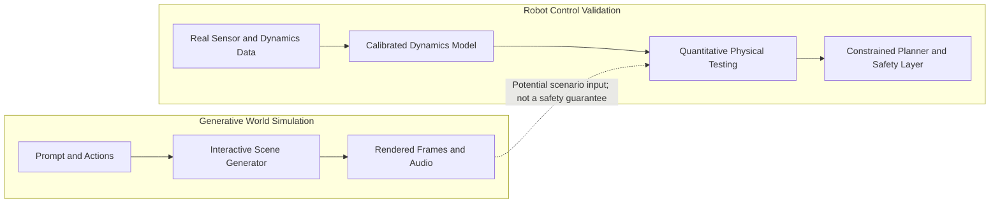

# Research Problem 18: World Models and Embodied Intelligence — Can AI Predict What Happens Before It Acts?

**Prompt & Pulse AI · Research to Reality · Series 18/20**




## 1. Problem statement

Can artificial intelligence learn an internal representation of how the world works, predict the consequences of possible actions, and use those predictions to plan and behave reliably in changing physical environments?

Imagine a warehouse robot instructed to:

"Pick up the fragile glass container from the table and place it on the upper shelf."

For a human, this sounds straightforward.

But the robot needs to answer several questions before moving:
- Where is the container, and how is it positioned?
- How firmly can the robot grip it?
- Will its arm collide with another object?
- What happens if the container begins to slip?
- Can the robot complete the movement without breaking it?
A language model could explain how to perform the task.

A vision model could identify the container.

But identifying an object and describing an action are not the same as understanding the physical consequences of performing that action.

The robot must predict how its environment could change when it moves, grasps, lifts, or releases an object.

This is the motivation behind world models and embodied intelligence.

The central research question is:

Can AI learn enough about how environments evolve to choose actions that achieve goals safely, even when the world changes unexpectedly?


## 2. Why is this problem difficult?

Traditional language models primarily learn statistical relationships in training data, while robots must interact with environments governed by physical dynamics.

A robot operates under constraints involving gravity, force, friction, momentum, object geometry, sensor uncertainty, and timing.

Consider a robot carrying a cup filled with water.

If the robot moves its arm too quickly, water may spill.

If it tilts the cup, the water's surface changes.

If a person suddenly walks into its path, the robot must update its plan.

The challenge is not simply recognizing what is happening.

The robot must also predict what could happen next.



### Three stages of physical intelligence

Perception

What is happening now?


Prediction

What could happen next?


Planning

Which action should I take?


A perception system estimates the current state of the environment.

A world model predicts possible future states.

A planner evaluates potential actions and chooses one according to the objective and constraints.

After acting, the system observes the actual outcome and updates its understanding.

This creates a continuous feedback loop.
### A subtle but important problem: Realistic simulation is not necessarily accurate physics
Imagine a world model generating a visually convincing video of a ball rolling down a ramp.

The lighting, textures, and motion may look realistic.

But what if the ball accelerates incorrectly?

What if collisions do not conserve momentum in a physically plausible way?

A visually convincing prediction may still be unsuitable for planning a real robot's movements.

The research challenge is to learn useful predictive dynamics—not merely generate realistic-looking scenes.


## 3. Technical concepts behind the problem

| Technical concept | What students should understand |
|---|---|
| World model | A learned representation that predicts aspects of how an environment changes. |
| Embodied intelligence | Intelligence grounded in perception and interaction with an environment through actions. |
| Markov decision process (MDP) | A mathematical framework for sequential decisions involving states, actions, transitions, and rewards. |
| State transition model | A model predicting possible next states from current states and actions. |
| Partial observability | A situation where an agent cannot directly observe every relevant aspect of the environment. |
| POMDP | A partially observable Markov decision process, where decisions depend on incomplete information. |
| Model-based reinforcement learning | Using a learned or specified environment model to support planning or policy learning. |
| Model-free reinforcement learning | Learning policies or value functions without explicitly learning a dynamics model for planning. |
| Model predictive control (MPC) | Repeatedly optimizing actions over a future horizon, executing an initial action, and replanning. |
| State estimation | Inferring the environment's underlying state from imperfect sensor measurements. |
| Trajectory planning | Selecting a sequence of actions or movements to reach a target state. |
| Sim-to-real transfer | Transferring behavior learned or evaluated in simulation to a physical environment. |
| Domain randomization | Varying simulation properties to improve robustness across conditions. |
| Closed-loop control | Using new observations to continually correct actions. |
| Uncertainty estimation | Representing uncertainty in predicted states, actions, or outcomes. |

### The mathematical foundation: State transitions
A common world-model formulation is:
\[
s_{t+1}\sim P(s_{t+1}\mid s_t,a_t)
\]

Where:
- \(s_t\) is the environment state at time \(t\).
- \(a_t\) is the action taken by the agent.
- \(s_{t+1}\) is the next environment state.
- \(P\) describes the transition distribution.
Suppose a robot is holding a package.

Its state may contain the package's position, velocity, grip force, and nearby obstacles.

The action could be "move the gripper upward by 5 centimeters."

The world model estimates the next state after that action.

That estimate helps the controller decide whether the action is likely to be safe and useful.
### The planning connection
In a simplified model-based reinforcement learning system, an agent may choose actions that maximize predicted future rewards:
\[
a_t^*=\arg\max_{a_t}\mathbb{E}\left[\sum_{k=0}^{H-1}\gamma^k r_{t+k}\right]
\]

Here, \(H\) is the planning horizon.

The agent considers the predicted consequences of possible actions over several future steps.

But prediction errors can compound over time.

A small mistake in estimating friction may produce a large error after many movements.

That is why many practical control systems repeatedly replan using new observations rather than trusting one long prediction.


## 4. End-to-end Mermaid architecture diagram

This diagram shows a model-based AI agent that predicts, plans, acts, observes, and corrects its behavior.





**Editable Mermaid source:** [`diagrams/closed_loop_architecture.mmd`](diagrams/closed_loop_architecture.mmd)


### How the diagram works
The system receives a goal and observes the environment.

Perception and state-estimation components construct an internal representation of the current situation.

A world model predicts what may happen under different actions.

A planner evaluates candidate action sequences against success criteria and safety constraints.

Only acceptable actions proceed to execution.

After execution, sensors capture the actual result.

If the observed state differs significantly from the prediction, the system updates its state estimate and replans.

For critical failures, it should use a separate safety mechanism rather than relying entirely on the same model that made the incorrect prediction.

The key principle: A reliable physical agent must continuously compare its predictions with reality and adapt its behavior.


## 5. Real research example: Google DeepMind's Genie world models

**Google DeepMind | Genie 3 (2025) → Genie 4 (October 27, 2026)**


Google DeepMind's Genie research investigates whether AI can generate environments that respond interactively to actions, rather than simply generating static images or prerecorded videos.
### Genie 3: Interactive simulated environments
In August 2025, Google DeepMind introduced Genie 3.

The model could generate navigable environments from text prompts, with real-time interaction at 24 frames per second and 720p resolution, maintaining consistency for a few minutes in its demonstrated settings. 
Google DeepMind


That represented an important step beyond ordinary video generation.

A user could move through a generated world and observe how the scene responds.

For AI agents, the potential benefit is access to varied interactive environments in which to practice planning and decision-making.
### Genie 4: More interactive and multimodal simulation
On October 27, 2026, Google DeepMind announced Genie 4.

Genie 4 extends this direction with more realistic interactive environments, natural-language changes to scenes, generated environmental audio, and simulated interactions involving people and objects.

Google also described early experiments combining Genie 4 with Gemini models to plan and simulate multi-step actions. In one example, the systems simulated a humanoid robot performing a task. 
Google DeepMind

### What can these systems potentially enable?

Robot training and evaluation

Simulate varied environments and test how agents respond to obstacles, objects, and changing conditions before considering physical deployment.


Longer-horizon planning

Explore how an agent decomposes an objective into steps and adapts its plan when the simulated environment changes.


Experiment and scenario generation

Create diverse situations for investigating agent behavior, robustness, and failure recovery.


### What has not been established?
Genie 4 remains an early research-preview system.

Google acknowledges limitations involving object permanence, physical interactions, spatial accuracy, and longer-term consistency. 
Google DeepMind+1


This means it would be incorrect to assume that a visually realistic simulated action is physically accurate enough for safety-critical robot control.

A useful distinction is:
Generative world simulation	Verified robot dynamics model
Generates plausible environmental changes	Must predict task-relevant physical dynamics within validated limits
Can support interactive exploration	Supports planning only to the extent its predictions are trustworthy
May look realistic	Requires physical and numerical validation
Can provide diverse scenarios	Must still be compared with real-world observations

The research significance: Genie demonstrates progress toward richer interactive world simulation, while dependable robot control requires additional validation and safety mechanisms.


## 6. Research goal

The broader goal is to develop AI systems capable of modeling environmental dynamics and using those models to support intelligent planning and action.

Researchers want to improve prediction of future states, learn useful representations from observations and interactions, and enable agents to practice in diverse simulated environments.

For embodied AI, the ultimate ambition is to connect perception, prediction, planning, and control so that robots can operate more reliably in unfamiliar situations.
### How does this differ from ordinary AI agents?
A language agent may use a search tool, read documents, and generate a plan.

An embodied agent must also account for the physical consequences of its actions.

That adds continuous sensor feedback, dynamics modeling, real-time control, and potentially irreversible physical side effects.

The goal is not simply to give an AI system a robot body.

It is to enable the system to act appropriately in a world where its predictions can be imperfect and the environment can change unexpectedly.


## 7. What remains difficult?

Model error: Predicted future states may differ from actual environmental behavior.

Compounding uncertainty: Small prediction errors can grow over multiple simulated steps.

Partial observability: Sensors may not reveal all relevant information, such as an object's internal properties or hidden obstacles.

Sim-to-real gaps: Models trained in simulation may fail when physical properties differ from simulated conditions.

Long-horizon planning: The system may successfully predict immediate outcomes but struggle with longer sequences of dependent actions.

Real-time constraints: Planning may be computationally expensive, while physical control systems must respond within strict deadlines.

Safety: Some robot actions can damage objects or harm people, requiring independent safety controls.

Generalization: A robot trained on a limited set of environments may not adapt reliably to unfamiliar objects and conditions.

Evaluation: Visual quality, simulation realism, physical accuracy, and task success must be measured separately.


## 8. Interview perspective

Interview question:

How would you design a model-based AI system for a warehouse robot that must pick up fragile objects, avoid obstacles, and recover from unexpected changes in the environment?
### Strong answer direction
Begin by defining the robot's state representation, sensor inputs, action space, and safety constraints.

Use perception and state estimation to determine the robot's current environment.

Introduce a dynamics or world model that predicts possible consequences of candidate movements.

Use model predictive control or another suitable planner to select actions based on predicted outcomes.

Execute movements through a low-level controller and collect sensor feedback.

Compare observed behavior against predictions and replan when the environment changes.

Include independent safety controls, emergency-stop mechanisms, and human intervention for uncertain or high-risk situations.

Finally, evaluate the system using task completion rate, collision rate, prediction error, planning latency, recovery success, and performance under unfamiliar conditions.

What the interviewer is testing: Reinforcement learning, robotics, state estimation, planning algorithms, control systems, model uncertainty, safety, and real-time AI infrastructure.
### Follow-up interview question
Why might model predictive control be more useful than executing one long AI-generated action sequence?

Because MPC repeatedly uses new observations to update its plan. This can reduce the consequences of prediction errors and changing conditions, although performance still depends on model quality, optimization speed, and controller design.


## 9. Subscriber learning challenge

Scenario: A warehouse robot uses a world model to plan a movement around an obstacle.

The model predicts that the path is clear, but a sensor detects a person entering the planned route.

What is the most appropriate response?

Continue because the original world-model prediction was confident.

Ignore the sensor because the model has already created a complete plan.

Use safety controls to stop or avoid unsafe motion, update the state estimate, and replan when appropriate.

Increase the robot's speed to finish the planned movement sooner.


### Hands-on experiment: Build a miniature world model

You can begin exploring the underlying concept using a CPU-only one-dimensional environment.

The agent controls a point moving along a line. Its goal is to reach a target without passing beyond a safety boundary.



```python
"""Research Problem 18: tiny CPU-only dynamics + closed-loop feedback demo."""
import argparse
import random


def predict_next_state(position: float, action: float) -> float:
    """A deterministic model, not a trained neural world model."""
    return position + action


def choose_action(position: float, target: float, max_step: float = 1.0) -> float:
    remaining = target - position
    return max(-max_step, min(max_step, remaining))


def run_deterministic():
    position, target, safe_min, safe_max = 0.0, 5.0, -1.0, 6.0
    for step in range(10):
        action = choose_action(position, target)
        predicted = predict_next_state(position, action)
        if not safe_min <= predicted <= safe_max:
            print('Unsafe predicted action. Stopping.')
            break
        observed = predicted  # no disturbance in the basic model
        print(f'Step {step}: action={action:.1f}, predicted={predicted:.1f}, observed={observed:.1f}')
        position = observed
        if abs(position - target) < 1e-9:
            print('Target reached.')
            break
    return position


def run_noisy(noise: float, seed: int = 11):
    """Feedback-based replanning with a toy bounded disturbance.

    Real motion requires an independent safety supervisor; this is illustrative only.
    """
    rng = random.Random(seed)
    position, target, safe_min, safe_max = 0.0, 5.0, -1.0, 6.0
    for step in range(20):
        action = choose_action(position, target)
        predicted = predict_next_state(position, action)
        # Robustly enforce the NEXT position against the entire bounded noise interval.
        if predicted - noise < safe_min or predicted + noise > safe_max:
            print('Safety uncertainty bound exceeded. Stopping.')
            break
        observed = predicted + rng.uniform(-noise, noise)
        print(f'Step {step:02d}: predicted={predicted:.3f}, observed={observed:.3f}, error={observed-predicted:+.3f}')
        position = observed  # replan after every observation
        if abs(position - target) < max(0.1, noise):
            print('Near target.')
            break
    return position


if __name__ == '__main__':
    parser = argparse.ArgumentParser()
    parser.add_argument('--noise', type=float, default=0.0, help='Maximum magnitude of uniform movement disturbance')
    parser.add_argument('--seed', type=int, default=11)
    args = parser.parse_args()
    if args.noise < 0:
        parser.error('--noise must be nonnegative')
    run_deterministic() if args.noise == 0 else run_noisy(args.noise, args.seed)
```

[Open the complete runnable example](examples/mini_world_model.py)


This demonstrates the basic relationship between state, action, predicted next state, and feedback.

To make the experiment more interesting, introduce random movement error, compare predicted and observed positions, and replan after each step.

The difference between the two versions illustrates why closed-loop control becomes important when the environment is uncertain.

This is a toy control problem, not a learned world model. It provides the mathematical foundation for more advanced experiments involving neural dynamics models and model-based reinforcement learning.


## 10. Primary research references

- Google DeepMind — Genie 3: A New Frontier for World Models (August 2025)
- Google DeepMind — Genie 4: A New Generation of World Simulation (October 27, 2026)
- Google DeepMind — Genie 4 Model Overview
- Google DeepMind — Gemini Robotics 2 (July 2026)
### Key takeaway
A capable AI agent can plan an action. An embodied intelligent system must also predict what that action could do to the environment, observe what actually happens, and adapt accordingly.

World models investigate how AI can learn useful representations of environmental dynamics and use them to support planning.

But a realistic simulation is not automatically a physically accurate or safe model.

This connects several previous research problems:

Problem 05 — Reward Hacking: An agent may optimize task completion while ignoring physical safety constraints.

Problem 10 — Multi-Agent Coordination: Multiple robots must avoid conflicting actions and shared-resource contention.

Problem 13 — GPU Optimization: Real-time world simulation and robot planning require efficient computation.

Problem 16 — Human Oversight: High-impact physical actions require appropriate human authority and independent safety controls.

Problem 17 — AlphaEvolve: AI-assisted optimization can explore better planning algorithms, control strategies, and computational implementations.

### The deeper research question is:

Can AI learn not only how to act, but also when its predictions are unreliable enough that it should slow down, reconsider, or stop?

Prompt & Pulse AI — Learn AI. Build AI. Stay Ahead.

**Next in series:** Research Problem 19 — AlphaGenome and Genome Interpretation: Can AI help scientists understand how changes in DNA influence gene regulation, molecular behavior, and biological function?


---
## Visual architecture companions (editable diagrams)

### Model predictive control and replanning





### Generative world simulation vs validated control





These three diagram sources are available in [`diagrams/`](diagrams/). The PNG files are checked in for stable viewing; Mermaid blocks can be edited directly in GitHub Markdown or the `.mmd` files.

## Running the hands-on experiments

Requires **Python 3.9+**, no third-party Python packages for the simulation.

```bash
python examples/mini_world_model.py
python examples/mini_world_model.py --noise 0.15 --seed 11
python -m unittest discover -s tests -v
```

The first command demonstrates deterministic transitions. The second introduces bounded random disturbances and reports prediction error after each observation. These are **teaching simulations, not learned neural world models or robot safety systems**.

## Research verification and scope

The Google DeepMind research references below were checked against official research pages on October 31, 2026. This README preserves the supplied educational discussion; the diagram artwork and executable code are new teaching assets produced for this GitHub version. Example illustrations are **original schematic graphics**, not screenshots or photographs of Genie outputs.

- [Genie 3 — A new frontier for world models (August 5, 2025)](https://deepmind.google/blog/genie-3-a-new-frontier-for-world-models/)
- [Genie 4 — A new generation of world simulation (October 27, 2026)](https://deepmind.google/blog/genie-4-a-new-generation-of-world-simulation/)
- [Google DeepMind Genie model overview](https://deepmind.google/models/genie/)

**Important qualification:** Google describes Genie 4 as an early research-preview system and acknowledges limits in object permanence, physical interactions, spatial accuracy, and long-term consistency. The examples here cannot establish real-world robot safety or physical correctness.

## Repository layout

```text
.
├── README.md
├── SOURCE_ORIGINAL.txt             # Original supplied text retained in full
├── assets/                         # Local PNG and SVG illustrations/diagrams
├── diagrams/                       # Editable Mermaid .mmd sources
├── examples/mini_world_model.py    # Runnable CPU-only experiment
└── tests/test_world_model.py       # Standard-library unit tests
```

---
*Prompt & Pulse AI — Learn AI. Build AI. Stay Ahead.*
