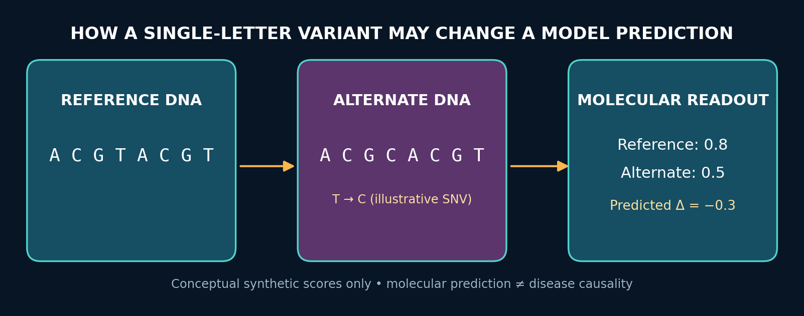
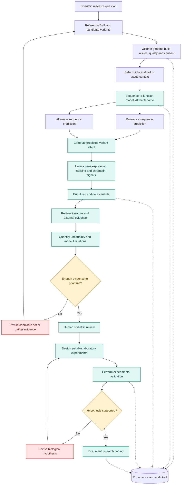
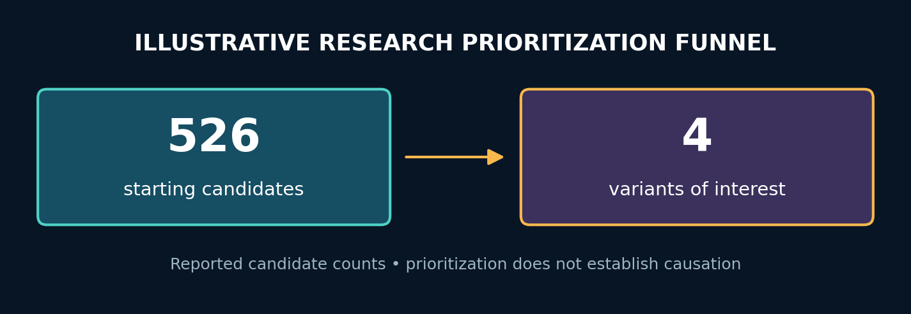
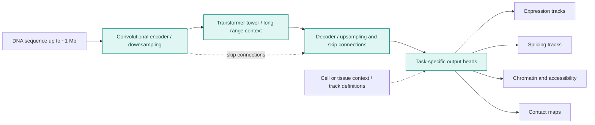
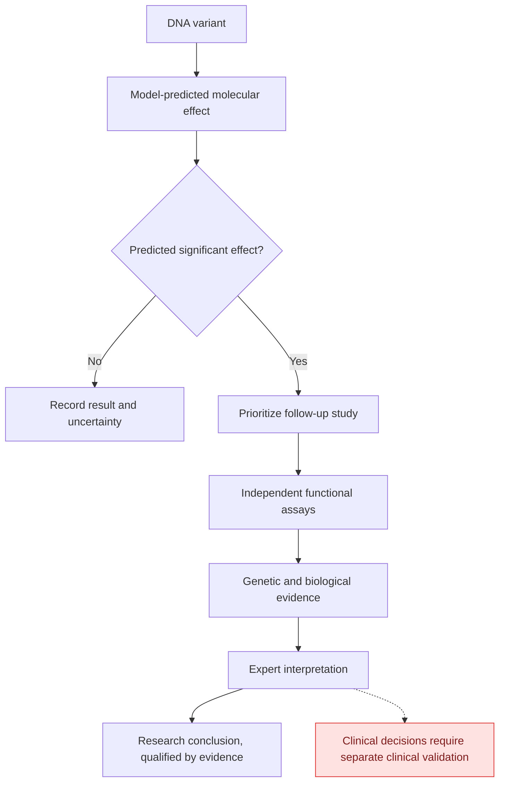

# Research Problem 19 — AlphaGenome and Genome Interpretation

**Can AI Understand How DNA Changes Affect Life?**

**PROMPT & PULSE AI · RESEARCH TO REALITY · GOOGLE DEEPMIND RESEARCH DIRECTION · SERIES 19/20**

> **Research-only educational material.** Predictions of molecular effects do not establish disease causation or justify clinical decisions. This is not a diagnostic tool.



## Contents

| Section | Topic |
|---|---|
| 01 | Problem statement |
| 02 | Why is this problem difficult? |
| 03 | Technical concepts behind the problem |
| 04 | End-to-end Mermaid architecture diagram |
| 05 | Real research example: AlphaGenome and AlphaGenome Atlas |
| 06 | Research goal |
| 07 | What remains difficult? |
| 08 | Interview perspective |
| 09 | Subscriber learning challenge |
| 10 | Primary research references |

---


## 1. Problem statement

Can artificial intelligence predict how changes in DNA sequences influence gene activity, RNA processing, and other molecular processes, helping scientists understand which genetic variants may be biologically important?

Imagine researchers investigating a rare genetic disorder.

They sequence a patient's DNA and discover thousands of genetic differences compared with a reference genome.

Some variants may have little measurable effect. Others may influence how genes are regulated, how RNA is processed, or how proteins are produced.

The challenge is determining which variations are worth investigating.

Now imagine an AI model that can examine a DNA sequence, introduce a hypothetical single-letter change, and predict how that change could affect molecular processes.

This is the idea behind Google DeepMind's AlphaGenome.

The key research question is:

Can AI help scientists move from identifying genetic differences to understanding their possible biological consequences?

And there is an essential distinction:

Predicting that a DNA variant changes molecular activity is not the same as proving that the variant causes a disease.


## 2. Why is this problem difficult?

The human genome contains approximately three billion DNA base pairs.

Only about 2% directly encodes proteins. Much of the remaining genome includes noncoding sequences that can regulate when, where, and how genes are expressed.

A change in a protein-coding region might alter a protein's amino-acid sequence.

But a change in a noncoding region could influence the amount of RNA produced, how that RNA is spliced, or whether a gene is activated in a particular cell type.

That makes genomic interpretation much more complicated than simply translating DNA into proteins.


### A simple analogy: DNA as instructions and controls

Think of a gene as a recipe.

The protein-coding sequence helps specify the ingredients and instructions needed to produce a protein.

Regulatory DNA contributes to controlling when, where, and how strongly that recipe is used.

Changing one instruction may affect the protein itself.

Changing a regulatory element may affect how much of the protein is made, even if the protein-coding sequence remains unchanged.

### How a DNA change can influence biological function

Conceptual illustration. Many DNA variants have no important measurable impact, and the effect of a variant may depend on cell type and biological context.

### Three challenges researchers face

Scale: There are billions of possible single-nucleotide substitutions in the human genome, making exhaustive laboratory testing impractical.

Context dependence: A variant may affect gene regulation differently in liver cells, neurons, or immune cells.

Causality: Even if a model predicts altered gene expression, that does not automatically establish a causal connection to a disease.

These challenges motivate predictive models that can help scientists prioritize experiments.


## 3. Technical concepts behind the problem

| Technical concept | What students should understand |
|---|---|
| Genome | An organism's complete genetic information. |
| DNA sequence | A sequence of nucleotide bases A, C, G, and T. |
| Single-nucleotide variant (SNV) | A change involving one nucleotide position. |
| Coding DNA | DNA sequences that specify protein-coding information. |
| Noncoding DNA | DNA that does not directly encode proteins, including regions with regulatory functions. |
| Gene expression | The process through which information from a gene is used to produce RNA and, for protein-coding genes, proteins. |
| Gene regulation | Mechanisms determining when, where, and how strongly genes are expressed. |
| Promoter / enhancer | Regulatory DNA elements involved in controlling gene activity. |
| RNA splicing | Processing RNA by joining selected segments and removing introns. |
| Chromatin accessibility | How accessible DNA regions are to regulatory machinery. |
| Sequence-to-function model | A model predicting molecular properties from DNA sequence. |
| Variant-effect prediction | Estimating how a genetic change alters a molecular property. |
| Cell-type specificity | Differences in molecular activity across cell types and tissues. |
| In-silico mutagenesis | Computationally introducing sequence changes to estimate their effects. |
| Uncertainty and calibration | Understanding how reliable predictions are and when further validation is needed. |
| Experimental validation | Laboratory investigation of predicted biological effects. |


### How does a sequence model predict a variant's effect?

Suppose the original DNA sequence is \(x_{\text{ref}}\) and the altered sequence is \(x_{\text{alt}}\).

A model predicts a biological measurement using:
\[
\hat y=f_\theta(x,c)
\]

Where \(c\) represents relevant biological context, such as cell type.

The estimated effect of the variant is:
\[
\Delta\hat y =
f_\theta(x_{\text{alt}},c)
-
f_\theta(x_{\text{ref}},c)
\]

For example, suppose the model predicts a normalized gene-expression-related score of 0.8 for the reference sequence and 0.5 for the altered sequence.

Then:
\[
\Delta\hat y=0.5-0.8=-0.3
\]

The model predicts a reduction in that particular score.

But this example does not mean that real gene expression necessarily decreases by 30%, nor does it establish disease causality. The units, calibration, and interpretation depend on the precise model output.


## 4. End-to-end Mermaid architecture diagram

The following diagram shows how an AI-assisted genomic variant interpretation platform could combine sequence models, variant-effect predictions, evidence retrieval, expert review, and laboratory validation.




**Editable source:** [`diagrams/interpretation_pipeline.mmd`](diagrams/interpretation_pipeline.mmd)


### How the diagram works

Researchers begin with a genomic question and identify variants they want to investigate.

The AI model predicts molecular properties for the reference and altered sequences.

Differences between those predictions help estimate possible variant effects.

The system combines predictions across molecular processes, such as splicing and gene regulation, and identifies variants that may deserve further investigation.

Scientific literature, uncertainty analysis, and human review help determine which candidates should be tested experimentally.

Laboratory evidence is then compared with the predictions.

The essential principle: AlphaGenome can help prioritize biological hypotheses, but the predictions must not be treated as independently established biological or clinical conclusions.


## 5. Real research example: Google DeepMind's AlphaGenome and AlphaGenome Atlas

**GOOGLE DEEPMIND | JUNE 2025 – SEPTEMBER 2026**


Google DeepMind introduced AlphaGenome on June 25, 2025. Its research was subsequently published in Nature in January 2026.

AlphaGenome combines long DNA sequence context with predictions of multiple molecular properties, including gene expression, chromatin accessibility, and RNA splicing.

The published architecture uses a convolutional encoder, a transformer-based central component, and a decoder with task-specific prediction heads.

It accepts DNA inputs of approximately one million base pairs, enabling it to analyze relationships spanning large genomic regions.

### Architectural view (conceptual)



**Editable source:** [`diagrams/model_architecture.mmd`](diagrams/model_architecture.mmd)


### Example A — Predicting many molecular properties from DNA

An important distinction is that AlphaGenome does not directly translate DNA into a complete explanation of a disease.

It predicts molecular readouts associated with genomic function.

Those predictions can help investigate questions such as:
- Could a variant affect how a gene is expressed?
- Could it alter RNA splicing?
- Might it disrupt regulatory activity in a particular tissue?
- Which variants should researchers investigate first?
The original Nature paper reported state-of-the-art performance on 22 of 24 genome-track prediction benchmarks and 25 of 26 variant-effect prediction benchmarks included in its evaluation. These are benchmark results for defined tasks, not universal guarantees of biological correctness.


### Example B — AlphaGenome Atlas: Scaling predictions across the genome

On September 8, 2026, Google DeepMind introduced AlphaGenome Atlas, which precomputes predictions for approximately nine billion possible single-nucleotide substitutions across the human reference genome.

| Atlas summary (as stated in original article) | Value |
|---|---:|
| Possible single-nucleotide substitutions | ~9 billion |
| Approximate dataset size | ~1 PB |
| Recurrent DNA motifs | 2,500+ |

The Atlas also includes an AlphaGenome Variant Impact (AVI) score intended to help researchers rank variants based on predicted molecular effects.

It provides feature-level interpretations, helping researchers investigate which predicted regulatory processes may explain an elevated score.


### Why does this matter?

Suppose researchers have one million candidate variants.

Experimentally investigating every variant would require substantial resources.

A predictive atlas can help narrow the search by identifying variants likely to have important molecular consequences.

But a high impact score does not necessarily mean the variant is harmful or disease-causing.

It indicates a predicted effect that requires biological interpretation.

### Example C — Narrowing a large candidate list

Google DeepMind describes genomic research in which AlphaGenome Atlas helped narrow a region containing 526 raw candidate variants to four variants of particular interest.

This is an example of AI-assisted scientific prioritization: reducing a large search space to a smaller set of candidates for deeper investigation.


### Illustrative research funnel based on the reported candidate counts


The narrowed list helps concentrate scientific attention. It does not by itself establish which variant is causal.


### How does AlphaGenome differ from AlphaFold?

| AlphaFold | AlphaGenome |
|---|---|
| Focuses on predicting molecular structures, especially protein structures and complexes in later versions | Focuses on predicting molecular consequences of DNA sequences and sequence variants |
| Addresses questions about three-dimensional molecular arrangement | Addresses questions about sequence-to-function relationships and regulation |
| Can support structural biology and molecular research | Can support genomic variant interpretation and regulatory biology |

Both demonstrate how AI can help scientists work with complex biological systems, but they tackle different prediction problems.


## 6. Research goal

The overarching research goal is to improve our understanding of how genomic sequence influences molecular function.

Researchers want to use predictive models to identify meaningful variants, investigate noncoding regulatory mechanisms, prioritize experiments, and develop testable hypotheses about biological processes.

A longer-term ambition is to make genomic interpretation more systematic by combining sequence modeling, high-resolution molecular predictions, and experimental evidence.

AlphaGenome Atlas also makes large-scale predictions more accessible to researchers who may not have the computational resources to run every variant through a large model individually.

The objective is not to replace molecular biology with predictions, but to use predictions to guide better biological investigation.


## 7. What remains difficult?

Prediction versus causation: A predicted molecular effect does not prove that a variant causes a trait or disease.

Cell-type context: The effect of a regulatory variant can depend on the tissue or cell type.

Complex variants: Changes involving large rearrangements, insertions, deletions, or interactions among many variants may require different or additional modeling approaches.

Uncertainty: A model can be inaccurate or overly confident, particularly on unfamiliar biological contexts.

Biological interactions: Many traits depend on combinations of genes, environmental influences, and regulatory processes.

Experimental validation: Predicted effects should be checked using suitable biological experiments.

Clinical limitations: A research model is not automatically a clinically validated diagnostic system.

Data governance: Genomic data can be highly sensitive and requires strong privacy, access control, and consent practices.

Google DeepMind states explicitly that AlphaGenome has not been validated or approved for clinical use.


## 8. Interview perspective


### Interview question:

How would you design an AI-powered genomic variant interpretation platform that predicts molecular effects, ranks important variants, incorporates scientific evidence, and maintains reproducibility and appropriate safeguards?

### Strong answer direction

Begin with the scientific question. For example, the objective might be to identify candidate regulatory variants associated with altered gene expression.

Design a data pipeline that validates reference genome coordinates, sequence context, variant format, and relevant tissue information.

Use AlphaGenome or another suitable sequence-to-function model to predict molecular properties for reference and alternate sequences.

Calculate variant-effect estimates and rank candidates according to appropriate scientific criteria.

Include uncertainty analysis, supporting literature, independent biological evidence, and careful interpretation of variant impact scores.

Maintain provenance for input sequences, genome builds, model versions, parameters, and resulting predictions.

Finally, describe how scientists would select candidates for experimental validation, and clearly separate research predictions from clinical conclusions.


**What the interviewer is testing:** Genomics fundamentals, deep learning, transformers, data pipelines, model evaluation, uncertainty, reproducibility, and scientific system design.


### Follow-up interview question

If AlphaGenome predicts that a DNA variant substantially changes gene expression, can you conclude that the variant causes a disease?

No. The result identifies a plausible molecular effect. Demonstrating disease causality requires additional biological, genetic, and possibly clinical evidence.

### Prediction is not proof



**Editable source:** [`diagrams/prediction_vs_evidence.mmd`](diagrams/prediction_vs_evidence.mmd)


## 9. Subscriber learning challenge

Scenario: AlphaGenome predicts that a single-letter DNA variant strongly affects RNA splicing in a particular cell type.

Which conclusion is scientifically justified?

The variant definitely causes a genetic disease.

The prediction suggests a potentially important molecular effect worth investigating experimentally.

The variant must have the same effect in every cell type.

The predicted effect proves that clinical treatment is necessary.


### Hands-on exercise: Build a simple variant-prioritization system

Use synthetic data to investigate how ranking criteria change which variants are selected for further study.
```python
"""Synthetic educational variant prioritization; NOT AlphaGenome/AVI scoring."""
import pandas as pd

variants = pd.DataFrame({
    "variant": ["V1", "V2", "V3", "V4"],
    "predicted_impact": [0.91, 0.78, 0.65, 0.88],
    "tissue_relevance": [0.40, 0.95, 0.85, 0.60],
    "uncertainty": [0.35, 0.10, 0.20, 0.45],
})

# Fictional ranking weights; not a published AlphaGenome formula.
variants["priority_score"] = (
    0.50 * variants["predicted_impact"]
    + 0.35 * variants["tissue_relevance"]
    - 0.15 * variants["uncertainty"]
)
print(variants.sort_values("priority_score", ascending=False).to_string(index=False))
```

Run locally with `python -m pip install -r requirements.txt` then `python examples/variant_prioritization.py`.

Try adjusting the weights.

Observe whether the top-ranked variant changes when tissue relevance or uncertainty receives more importance.

This exercise demonstrates prioritization under multiple criteria. It is not biological validation and does not reproduce AlphaGenome's internal scoring system.


## 10. Primary research references

- Google DeepMind — AlphaGenome: AI for Better Understanding the Genome (June 2025)
- Nature — Advancing Regulatory Variant Effect Prediction with AlphaGenome (January 2026)
- Google DeepMind — AlphaGenome Atlas (September 2026)
- AlphaGenome — Model, Atlas and Research Resources
- Google Cloud — AlphaGenome Documentation and Quickstart Resources

### Key takeaway

AlphaGenome addresses one of biology's most difficult questions: how changes in DNA affect molecular function.

Its contribution is not simply identifying DNA variants. It helps predict which molecular processes those variants may influence, enabling researchers to prioritize potentially informative experiments.

The distinction between prediction and proof remains essential.


### This connects with the previous research problems:

Problem 03 — Distributed Scientific Agents: AI can help coordinate literature review, genomic analysis, and hypothesis generation.

Problem 12 — Mathematical Discovery: A discovered pattern requires rigorous evaluation before being treated as established knowledge.

Problem 15 — Drug-Development Assistance: Better understanding genetic regulation may help scientists investigate biological targets and disease mechanisms.

Problem 17 — AlphaEvolve: Automated evaluation and optimization can improve scientific computational workflows.

Problem 18 — World Models: Both areas investigate how AI can model complex systems and predict consequences, although genomic regulation and physical dynamics are very different domains.


### The question to leave with subscribers is:

If AI could predict the molecular effect of billions of DNA changes, how should scientists decide which predictions deserve laboratory investigation first?

Prompt & Pulse AI — Learn AI. Build AI. Stay Ahead.

Next and final in the series: Research Problem 20 — NVIDIA Physical AI with Cosmos and GR00T: How can AI systems combine world models, simulation, vision, language, and robot control to perform reliable actions in the physical world?

---

## Verified official research links

- [Google DeepMind — AlphaGenome](https://deepmind.google/discover/blog/alphagenome-ai-for-better-understanding-the-genome/)
- [Avsec et al., *Nature* (2026), DOI: 10.1038/s41586-025-10014-0](https://www.nature.com/articles/s41586-025-10014-0)
- [Google DeepMind — AlphaGenome Atlas (Sept 8, 2026)](https://deepmind.google/blog/alphagenome-atlas-a-predictive-map-of-every-possible-dna-letter-change-in-the-human-genome/)
- [Official AlphaGenome API / research resources](https://github.com/google-deepmind/alphagenome)
- [Official AlphaGenome documentation](https://github.com/google-deepmind/alphagenome/blob/main/docs/source/index.md)

## Repository guide

```text
Research_Problem_19_AlphaGenome_GitHub/
├── README.md                         # Full educational article
├── assets/                           # Local PNG illustrations
│   ├── variant_effect_illustration.png
│   ├── candidate_funnel.png
│   └── synthetic_priority_ranking.png
├── diagrams/                         # Editable Mermaid source
│   ├── interpretation_pipeline.mmd
│   ├── model_architecture.mmd
│   └── prediction_vs_evidence.mmd
├── examples/
│   └── variant_prioritization.py
├── source/
│   └── original_article.txt          # Original upload, unchanged
├── requirements.txt
└── .gitignore
```

**Viewing diagrams:** GitHub renders fenced `mermaid` blocks in Markdown. Edit the corresponding `.mmd` files using any text editor or [Mermaid Live Editor](https://mermaid.live/). PNG assets are stored locally, so they remain visible when this repo is uploaded to GitHub.

**Content integrity:** The original source text is archived without edits. The original pasted exporter included a long CSS/rendered-diagram blob rather than editable diagram code; the repository supplies a reconstructed, editable Mermaid version representing the workflow described in the article. Charts and diagrams are original educational illustrations, not reproduced Google DeepMind figures.

**Scientific limitation:** Official AlphaGenome outputs and Atlas resources are subject to their terms of use, including restrictions on clinical use; the runnable Python lab uses only synthetic scores.
