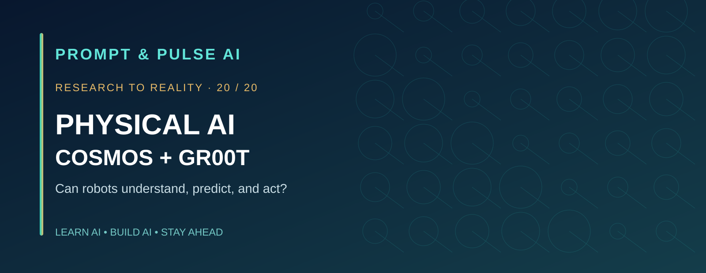
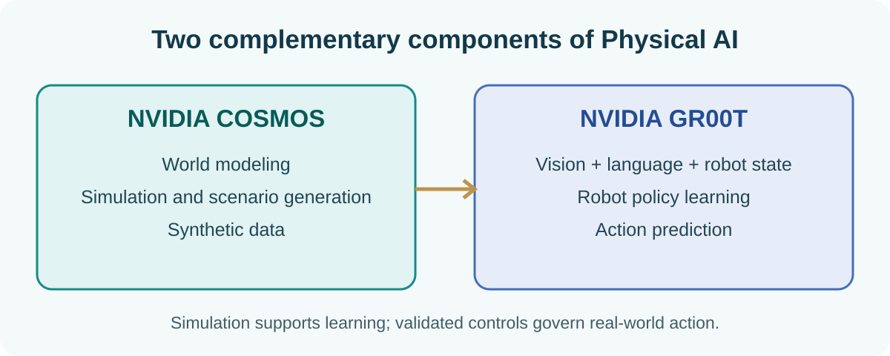
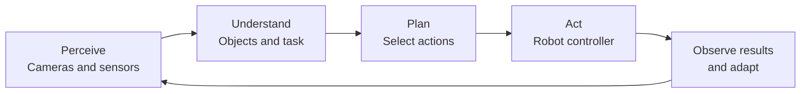
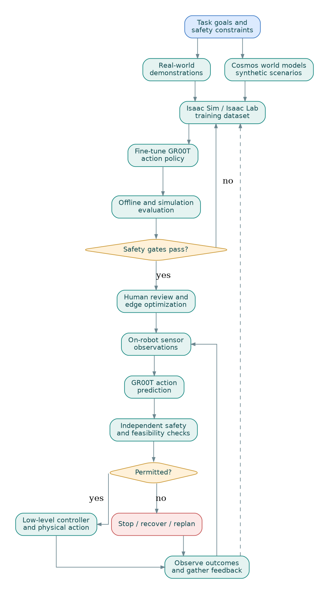
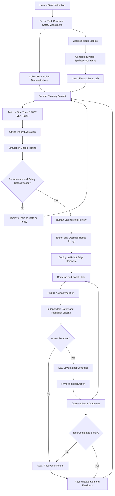
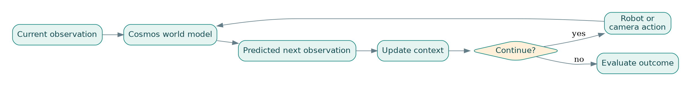
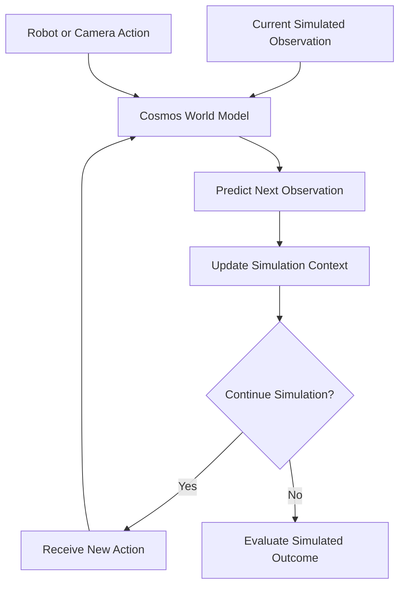
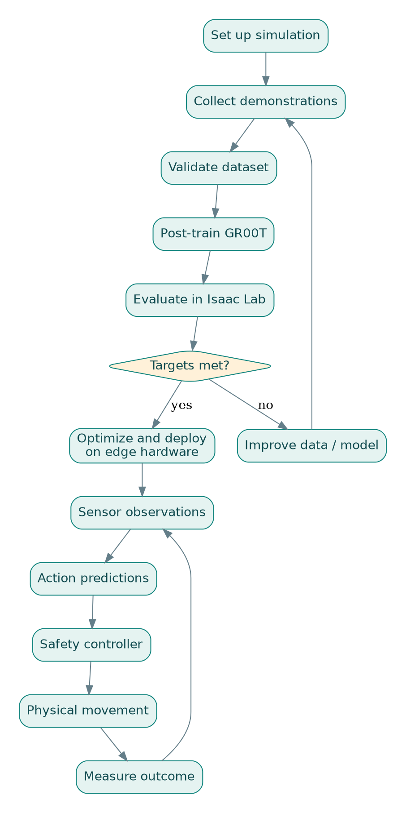
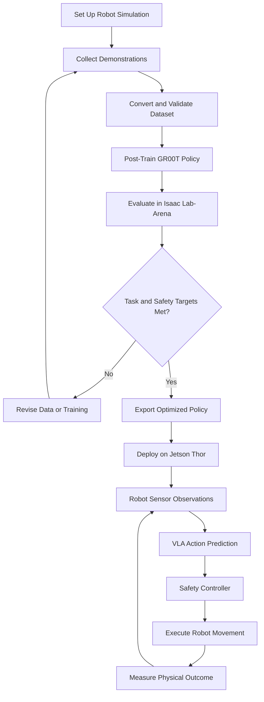

<div align="center">



**PROMPT & PULSE AI · RESEARCH TO REALITY · SERIES 20/20**

# Research Problem 20: NVIDIA Physical AI
### Can Robots Understand, Predict, and Act in the Real World?

[](https://www.nvidia.com/en-us/ai/cosmos/) [](https://www.nvidia.com/en-us/industries/robotics/isaac-groot/) [](#the-complete-20-problem-series)

**Learn AI · Build AI · Stay Ahead**

</div>

> **Research problem:** Can artificial intelligence combine visual perception, language understanding, world modeling, planning, and real-time control to enable robots to perform useful physical tasks reliably in dynamic, unfamiliar environments?
>
> **Editorial note:** This is an educational synthesis. Research and product claims are distinct from proposed architectures, fictional examples, and toy exercises. Simulation success is not a safety certification.

## Contents

1. [Problem statement](#1-problem-statement)
2. [Why is this problem difficult?](#2-why-is-this-problem-difficult)
3. [Technical concepts](#3-technical-concepts-behind-the-problem)
4. [End-to-end Mermaid architecture](#4-end-to-end-mermaid-architecture-diagram)
5. [NVIDIA research examples](#5-real-research-examples-nvidia-cosmos-3-and-isaac-gr00t-17)
6. [Research goal](#6-research-goal)
7. [Open challenges](#7-what-remains-difficult)
8. [Interview preparation](#8-interview-perspective)
9. [Subscriber challenge and Python lab](#9-subscriber-learning-challenge)
10. [Research and developer links](#10-primary-research-and-developer-resources)

---

## 1. Problem statement

Imagine a warehouse with hundreds of products. A worker asks a humanoid robot:

> **“Pick up the fragile glass container from the packing table, place it in the correct box, and avoid damaging anything.”**

For a human, this sounds simple. For a robot, it introduces multiple engineering problems: it must locate the container, infer relevant physical properties, estimate a safe grasp, avoid collisions, and react if the container slips or a person enters its workspace.

What if the container differs slightly from examples seen during training? A robot that memorized fixed movements may fail. A more general physical-AI system needs to perceive the current situation, make task-relevant predictions, choose feasible actions, and adapt using feedback.

**The fundamental question is not whether AI can describe a physical task, but whether it can execute the task safely and reliably under real-world uncertainty.** This is the broad challenge motivating NVIDIA Cosmos and NVIDIA Isaac GR00T.

## 2. Why is this problem difficult?

Language models can generate explanations, code, and plans. Robots must turn plans into actual motion under constraints involving gravity, geometry, contact, friction, torque, uncertainty, and timing.

A robot cannot merely generate *“grasp the cup carefully.”* It must determine what **carefully** means for the gripper, the object, and the surrounding environment.

### From understanding language to performing actions



### The physical intelligence loop



**Four fundamental challenges:**

- **Perception:** Cameras and sensors provide incomplete and noisy information; objects may be hidden or poorly illuminated.
- **Physical reasoning:** A robot must account for gravity, object geometry, contact, friction, and other physical properties.
- **Action generation:** High-level instructions must become feasible trajectories and motor commands.
- **Real-time reliability:** The system must respond quickly to new observations while preserving safety constraints.

These capabilities must work together. Accurate vision alone does not guarantee a good grasp, and a capable action model cannot compensate for stale sensor information.

## 3. Technical concepts behind the problem

| Technical concept | What students should understand |
|---|---|
| Physical AI | AI systems that perceive, reason about, and interact with physical environments. |
| Embodied intelligence | Intelligence grounded in interaction between an agent, its body, and an environment. |
| World foundation model | A model trained to represent or generate aspects of environmental dynamics and interactions. |
| Vision-language model (VLM) | A model that processes visual information and natural language. |
| Vision-language-action model (VLA) | A model connecting observations and instructions to predicted actions. |
| Robot policy | A learned or programmed rule selecting actions from observations and context. |
| Action chunking | Predicting a sequence of actions together. |
| Synthetic data | Generated training or evaluation data, commonly from simulated scenarios. |
| Imitation learning | Learning behaviors from demonstrations. |
| Reinforcement learning | Learning behavior through reward-guided interaction. |
| Sim-to-real transfer | Moving learned behavior from simulation to physical robots. |
| Kinematics | Relationship between robot joints and geometry. |
| Dynamics | Relationship among force, torque, motion, and contact. |
| Motion planning | Finding feasible paths or trajectories under constraints. |
| Feedback control | Adjusting movements using measurements of current behavior. |
| SLAM | Simultaneous localization and mapping. |
| Domain randomization | Varying simulation parameters to improve robustness. |
| Safety envelope | Explicit limits on permitted motion or actions. |
| Edge inference | Running models on or close to the robot. |

### Understanding vision-language-action models

A simplified robot policy can be represented as:

$$
a_t=\pi_\theta(o_t,l,s_t)
$$

where **oₜ** is visual/sensor observation, **l** the natural-language instruction, **sₜ** the current robot state, **πθ** the learned policy, and **aₜ** the predicted action. A policy may predict a chunk of multiple actions. A controller then tracks or translates them into actuator commands.

**A learned policy is not automatically a safe controller.** Motion constraints, independent safety checks, and hardware protections remain necessary.

### How is Cosmos different from GR00T?

| NVIDIA Cosmos | NVIDIA Isaac GR00T |
|---|---|
| World modeling, physical reasoning, simulation, synthetic data | Robot foundation models, policy learning, action generation |
| Generates and evaluates diverse simulated scenarios | Connects observations and instructions to actions |
| Helps build training and evaluation environments | Can be adapted to particular robot bodies and tasks |
| Primarily supports environment understanding and simulation | Primarily supports robot behavior and control |

The broader Isaac platform connects simulation, learning, runtime, and deployment infrastructure.

## 4. End-to-end Mermaid architecture diagram

**Conceptual production-oriented physical-AI architecture:**



<details>
<summary><strong>Copy the editable Mermaid source</strong></summary>



</details>

**How it works:** Engineers define task goals and limits, collect demonstrations, and generate additional simulated scenarios. These support training or fine-tuning a robot policy. Simulation testing and human review precede deployment. During operation, the robot repeatedly observes, predicts, checks safety, acts, and evaluates outcomes.

> **Key principle:** Training a capable robot policy and operating a safe robot are different engineering responsibilities that must be integrated.

## 5. Real research examples: NVIDIA Cosmos 3 and Isaac GR00T 1.7

**NVIDIA research and engineering — reported through October 2026.** The descriptions below summarize research claims in the source material; verify product availability and versions against the official links before republishing.

### Example A — Cosmos 3: Modeling and simulating the physical world

NVIDIA's Cosmos 3, described in May 2026, supports physical reasoning, world generation, and action-related modeling across modalities including text, images, video, sound, and actions. The cited research describes a Mixture-of-Transformers architecture.

An important direction is **interactive world simulation**. Instead of creating a complete video at once, a system can condition the next simulation segment on a new camera or robot action.





**Research goal:** Build scalable environments where physical agents can learn from varied experiences and be evaluated before physical deployment. Simulated dynamics still need validation before use in safety-critical robotics.

### Example B — Isaac GR00T 1.7: From instructions to robot actions

GR00T 1.7 is described in NVIDIA's July 2026 developer material as an open VLA model for humanoid skills. The base checkpoint is reported as **3 billion parameters**, with approximately **32,000 hours of real demonstration and human-video data**, and **8,000 hours of simulated demonstrations and rollouts**. These are source-reported development figures, not guarantees of downstream performance.

| Reported quantity | Value |
|---|---:|
| Base checkpoint | 3B parameters |
| Real demonstrations and human video | ~32K hours |
| Simulated demonstrations and rollouts | ~8K hours |

A robot learning to open a drawer needs examples of how observation, instruction, and motor action relate. Demonstrations teach these relationships; adapting to a new robot or environment may still require additional data and post-training.

### Sim-to-real workflow





The important engineering separation is this: training produces a candidate policy, simulation evaluates it, and real-world deployment tests actual behavior under physical conditions.

## 6. Research goal

NVIDIA's physical-AI research aims to make robots more scalable to develop, transferable across tasks, and reliable in new environments.

Three connected needs are **better environmental understanding** through world models, **better robot learning** through foundation policies and synthetic data, and **better deployment infrastructure** through efficient inference runtimes and edge accelerators.

The long-term goal is robots that adapt to more tasks without requiring entirely new code for every behavior. **Generalization remains a research challenge, not a guarantee.**

## 7. What remains difficult?

- **Sim-to-real transfer:** Friction, lighting, mass, and sensor properties differ from simulation.
- **Unseen environments:** Real objects and layouts may lie outside training coverage.
- **Grasp uncertainty:** Weight, fragility, slipperiness, and deformation may be unknown.
- **Latency:** Robot inference and feedback must satisfy control deadlines.
- **Action safety:** Plausible action predictions can still be mechanically unsafe.
- **Error accumulation:** Small errors can grow over a series of actions.
- **Hardware diversity:** Different robots have different actuators, sensors, and degrees of freedom.
- **Evaluation quality:** Simulation/benchmark success is not a guarantee of real-world reliability.
- **Human interaction:** People introduce unpredictable motion and safety considerations.

World-generation systems can exhibit temporal inconsistencies or implausible physical dynamics. Independent safety analysis remains important.

## 8. Interview perspective

### Main question

**How would you design an end-to-end physical AI platform using NVIDIA Cosmos, Isaac Sim, Isaac Lab, GR00T, and Jetson hardware to train, evaluate, and deploy a warehouse humanoid robot?**

**Strong answer direction:** Define task requirements, object types, manipulation goals, measurable success criteria, permitted movements, response-time requirements, and safety boundaries. Use Isaac Sim/Lab to create test environments. Use Cosmos for synthetic scenarios where appropriate, validating realism. Collect demonstrations, adapt a GR00T policy, and test on unseen tasks, object properties, and disturbances. Measure completion, collisions, grasp stability, action latency, recovery, and simulated-to-real performance. Optimize the policy for edge deployment, but maintain an independent safety-controller layer, telemetry, human intervention paths, and staged rollouts.

**What the interviewer is testing:** Robotics architecture, VLA models, RL, simulation, GPU inference, edge deployment, real-time control, and safety engineering.

### Follow-up

**Why might a robot with an excellent language model still fail to pick up an unfamiliar object?** Understanding the instruction does not guarantee accurate object geometry, force control, friction modeling, kinematic feasibility, or timely sensor integration.

## 9. Subscriber learning challenge

**Scenario:** A humanoid robot learned to pick up warehouse boxes in simulation. In a real-world test, it grasps an unfamiliar slippery box, and the grasp begins to fail.

**What should it do?**

A. Continue the original movement regardless of feedback.

B. Increase gripping force without checking fragility or hardware limits.

C. **Detect instability, respect safety limits, and adjust or stop using feedback.**

D. Assume simulation success guarantees physical success.

<details>
<summary><strong>Answer and explanation</strong></summary>

**C is correct.** Physical AI must adapt to observed conditions. An unstable grasp should trigger correction or a safe stop rather than blindly continuing the planned movement.

</details>

### Hands-on experiment: Simulate the reality gap

This CPU-only exercise illustrates the difference between predicted motion and actual motion. It is not a complete robotics policy or a Cosmos/GR00T reproduction.

```python
import random

random.seed(42)

target = 5.0
position = 0.0
estimated_gain = 1.0

for step in range(12):
    error = target - position

    # Simple bounded controller.
    action = max(-1.0, min(1.0, error))

    # Predicted dynamics.
    predicted = position + estimated_gain * action

    # Simulated reality differs from the model.
    true_gain = random.uniform(0.65, 1.05)
    observed = position + true_gain * action

    print(
        f"Step {step}: "
        f"predicted={predicted:.2f}, "
        f"observed={observed:.2f}, "
        f"prediction_error={abs(predicted-observed):.2f}"
    )

    position = observed

    if abs(target - position) < 0.05:
        print("Goal reached within tolerance.")
        break
```

**Try next:** Change the motion uncertainty, estimate the true gain from observed data, and adapt the controller over time.

## 10. Primary research and developer resources

- [NVIDIA Cosmos — Physical AI and World Models](https://www.nvidia.com/en-us/ai/cosmos/)
- [NVIDIA Cosmos — Source Code, Models, and Recipes](https://github.com/NVIDIA/cosmos)
- [NVIDIA Isaac GR00T — Humanoid Robotics Platform](https://www.nvidia.com/en-us/industries/robotics/isaac-groot/)
- [NVIDIA — End-to-End GR00T Policy Development](https://developer.nvidia.com/blog/develop-humanoid-robot-policies-end-to-end-with-nvidia-isaac-gr00t/)
- [NVIDIA — Interactive World Simulation Research](https://research.nvidia.com/labs/cosmos-lab/cosmos-simulation/)
- [NVIDIA Isaac Sim](https://developer.nvidia.com/isaac/sim)
- [NVIDIA Isaac Lab](https://github.com/isaac-sim/IsaacLab)

## Key takeaway

> **Physical AI requires more than a language model that understands instructions.** It requires perception, predictions, feasible actions, independent safety controls, and correction based on feedback.

Cosmos and GR00T address complementary needs: modeling or simulating environments on one side, learning robot behavior and action generation on the other.

### The complete 20-problem series

| Problems | Core question |
|---|---|
| 01–04 | Can AI assist in mathematical discovery, scientific reasoning, and trustworthy software? |
| 05–07 | Can agents pursue the right objectives, be monitored, and maintain useful memory? |
| 08–12 | Can we understand models, represent human preferences, coordinate agents, and verify results? |
| 13–17 | Can AI improve computation and algorithms without sacrificing correctness? |
| 18–20 | Can predictive models connect digital intelligence to biology and the physical world? |

**Final subscriber question:** As AI becomes capable of making decisions and taking actions in the real world, what evidence should we require before trusting those actions?

---

<div align="center">

**Prompt & Pulse AI — Learn AI. Build AI. Stay Ahead.**

[Join the WhatsApp Learning Community](https://chat.whatsapp.com/EkoT6XtYLyCK5vfNQf8s2B) · [LinkedIn](https://www.linkedin.com/company/prompt-pulse-ai/) · [Website](https://prompt-pulse-chi.vercel.app/) · [GitHub](https://github.com/Abhinav-kanduri)

**Research to Reality — 20 of 20 completed.**

</div>
