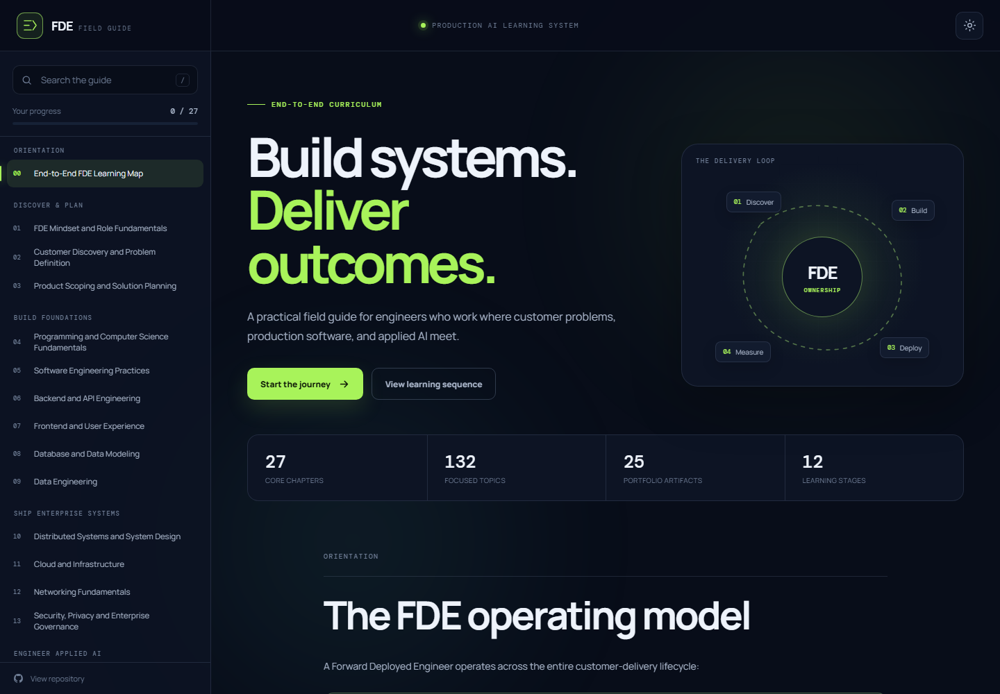

# FDE Field Guide website

This directory contains the static GitHub Pages website. Its learning content is
maintained in [the Forward Deployed Engineer learning map](../content/guides/end-to-end-fde-learning-map/README.md).

## Local preview

Run from the repository root:

```powershell
python -m http.server 8000
```

Open <http://localhost:8000/docs/>. Serve the repository root so the browser can
load `../content/guides/end-to-end-fde-learning-map/README.md` as the local content fallback.

## Deployment

[The Pages workflow](../.github/workflows/deploy-fde-field-guide.yml) copies the
guide's `README.md` into `docs/content/fde-learning-map.md` and deploys `docs/`. That
generated directory is ignored by Git. Changes to the learning map, website, or
workflow trigger deployment on pushes to `main`.

The `#end-to-end-fde-learning-map` anchor remains unchanged. New blogs and
technical articles are organized in the [writing library](../content/README.md).

- `index.html`: page shell
- `assets/app.js`: content loading, navigation, progress, and theme behavior
- `assets/styles.css`: visual styling
- `.nojekyll`: disables Jekyll processing


